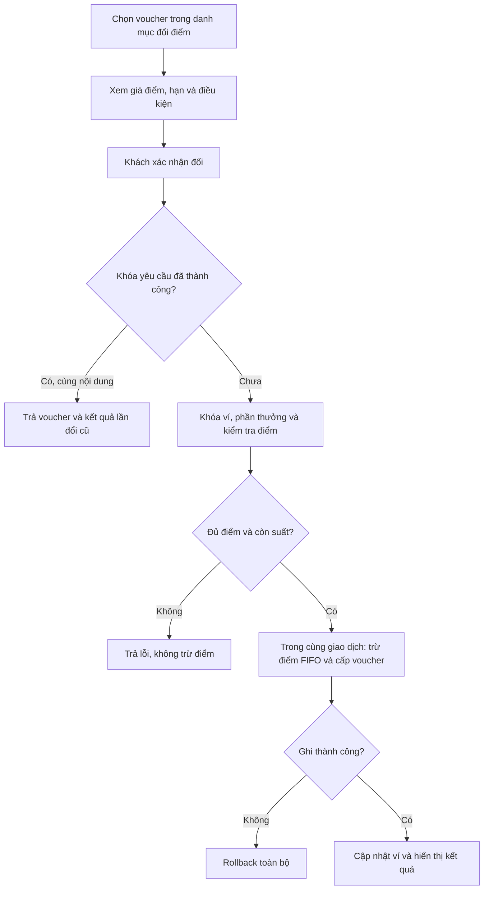
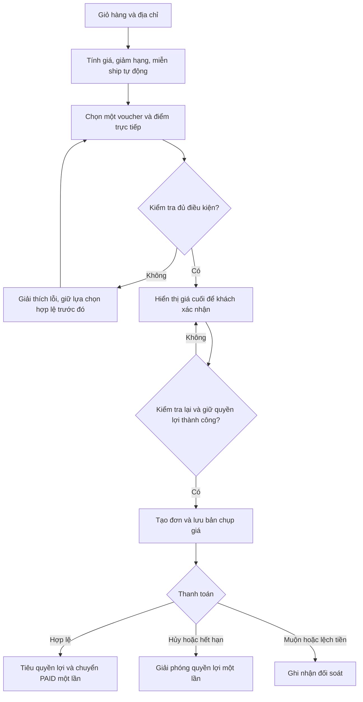
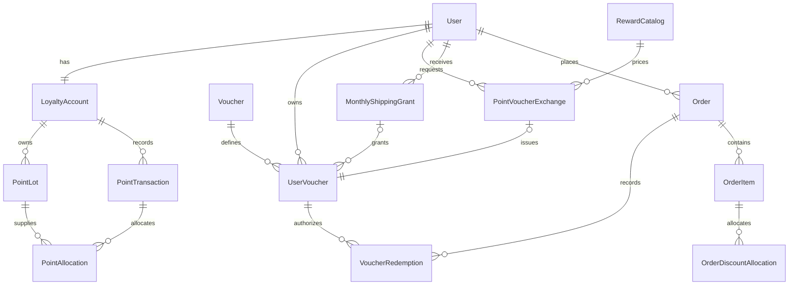

# Thiết kế phần 1 Khuyến mãi và voucher cho Quanlypho

## Kết quả và phạm vi

Phần 1 bổ sung ví voucher, áp ưu đãi khi đặt món, dùng điểm trừ tiền, đổi điểm lấy voucher, freeship theo hạng và phát mã freeship hằng tháng. Giá cuối được xác định trên máy chủ và lưu vào đơn để giao diện, VietQR, thu ngân và webhook cùng dùng một số tiền.

Đây là bản thiết kế kết quả phần 1, chưa phải tính năng đã lập trình hoặc triển khai. Kết quả phần 2, phần 3 và phần bổ sung được lưu trong tài liệu riêng theo `00_KE_HOACH.md`; các liên kết tích hợp bên dưới đã được đồng bộ. Chặng trợ lý AI/gợi ý sản phẩm, Dashboard và yêu cầu thông tin sinh viên tiếp tục ngoài phạm vi.

## Căn cứ và người sử dụng

| Căn cứ | Yêu cầu được sử dụng |
|---|---|
| Chú thích mới của người dùng | Điểm đổi được voucher; Bạc 2 mã freeship/tháng; Vàng freeship dưới 5 km và 3 mã trên 5 km/tháng; Kim Cương freeship dưới 5 km và 10 mã trên 5 km/tháng; điều chỉnh phạm vi đã nêu |
| Đề Word, Hướng 1 | Điều kiện, thời hạn, hạn mức, cộng gộp, tình huống không hợp lệ; luồng, bảng quy tắc, wireframe và điểm tích hợp |
| File yêu cầu Markdown | Hạng giảm 0/2/5/7/10%; một voucher/đơn; 1 điểm = 100đ; điểm trực tiếp tối đa 50% phần còn lại; điểm có hạn 12 tháng, FIFO; gói voucher khi lên hạng |
| Mã nguồn đã đọc | Django/PostGIS; giỏ trong trang thực đơn; đơn và thanh toán có trạng thái riêng; tiền QR/webhook đang là tiền hàng cộng ship; xuất nguyên liệu khi chuyển PAID |
| Đề xuất của bản thiết kế | Mốc đúng 5 km; cấp bù giữa tháng; thời hạn giữ; danh mục đổi điểm mẫu; cách cộng gộp freeship tự động; các chính sách chi tiết chưa được nguồn quy định |

Khách hàng đã đăng nhập là người xem ví, đổi điểm, chọn voucher và xác nhận thanh toán. Khách vãng lai tiếp tục đặt món, nhưng đề xuất cần đăng nhập để sử dụng quyền lợi có hạn mức theo tài khoản. Thu ngân xem số cần thu và nguồn giảm. Quản lý được cấu hình mẫu voucher/phần thưởng bằng công cụ có phân quyền; quyền cấu hình không mặc định cho khách hoặc thu ngân. Màn hình vận hành voucher riêng có thể bổ sung sau, không cần dashboard/KPI cho MVP này.

Vấn đề hiện tại là chưa có voucher/loyalty trong các model đã kiểm tra; số phải trả đang được cộng trực tiếp ở nhiều nơi. Cách bổ sung dùng một dịch vụ tính giá chung và lưu bản chụp ưu đãi, giúp giải thích được khoản giảm và tránh lệch tiền khi nhận thanh toán.

## Quyền lợi freeship theo hạng

| Hạng | Giảm tiền hàng theo nguồn | Dưới 5 km | Đúng 5 km | Trên 5 km, còn trong phạm vi giao | Mã freeship mỗi tháng |
|---|---|---|---|---|---|
| Thành viên | 0% | Không tự miễn | Không tự miễn | Không tự miễn | Chưa có quyền lợi mặc định |
| Đồng | 2% | Không tự miễn | Không tự miễn | Không tự miễn | Chưa có quyền lợi mặc định |
| Bạc | 5% | Có thể chọn mã | Có thể chọn mã | Có thể chọn mã | **2 mã** |
| Vàng | 7% | **Miễn tự động** | Đề xuất miễn tự động | Có thể chọn mã giao xa | **3 mã giao xa** |
| Kim Cương | 10% | **Miễn tự động** | Đề xuất miễn tự động | Có thể chọn mã giao xa | **10 mã giao xa** |

Số 2/3/10 và hai nhóm khoảng cách dưới/trên 5 km là yêu cầu của người dùng. Các lựa chọn chi tiết sau là **đề xuất cần người dùng xem lại**:

- Đúng 5 km thuộc nhóm gần: Vàng/Kim Cương tự miễn khi `d <= 5`; mã giao xa dùng khi `d > 5`.
- Mã Bạc áp dụng toàn phạm vi giao hàng hợp lệ. Không tự thêm giới hạn khoảng cách mà người dùng chưa nêu.
- Freeship là miễn toàn bộ phí giao chuẩn do dịch vụ hiện có tính, không chỉ miễn phần 5 km đầu; không tự thêm trần tiền cho mã tháng.
- Quyền tự động của Vàng/Kim Cương không giới hạn số đơn trong nhóm gần vì người dùng chưa đặt hạn mức. Nó là đặc quyền ngoài ví, không chiếm vị trí voucher.
- Mỗi đơn vẫn dùng tối đa một mã trong ví: mã giảm món, mã đổi từ điểm hoặc mã freeship tháng. Có thể dùng một mã giảm món cùng freeship tự động. Nếu đã tự miễn toàn bộ phí thì không giữ/tiêu thêm mã freeship.
- Tại bàn, hàng đợi chưa đủ điều kiện checkout, thiếu dữ liệu khoảng cách hoặc ngoài bán kính giao không tạo quyền freeship giả. Đơn ngoài phạm vi vẫn bị từ chối theo cấu hình giao hàng hiện có.

Khoảng cách dùng dữ liệu máy chủ tính bằng Haversine hiện có, trước làm tròn hiển thị. Đây là khoảng cách địa lý ước tính, không phải cam kết quãng đường chạy xe. `compute_delivery_fee` hiện trả khoảng cách đã làm tròn hai chữ số; cần thêm dữ liệu khoảng cách trước làm tròn khi triển khai. Ví dụ **5,004 km** thuộc nhóm giao xa dù giao diện làm tròn thành 5,00 km; khu vực gần ngưỡng cần hiển thị thêm độ chính xác và lý do đủ/không đủ điều kiện.

Tọa độ phải có giá trị hợp lệ và gắn với bản chụp địa chỉ của lần báo giá; không nhận cờ “được freeship” hoặc số km do trình duyệt tự kết luận. Việc xác minh tọa độ khớp địa chỉ thực tế chưa có trong mã đã đọc, là điểm tích hợp phải hoàn thiện khi triển khai giao hàng; tính lại trên máy chủ chưa tự giải quyết được việc khách nhập sai tọa độ. Nếu chưa xác định được khoảng cách, giao diện nêu rõ chưa xác nhận freeship, hiển thị phí tạm tính hiện có và yêu cầu xem lại giá trước đặt đơn.

## Cấp mã freeship hằng tháng

Kỳ tháng đề xuất là `YYYY-MM` theo `Asia/Ho_Chi_Minh`. Mã có hiệu lực từ lúc cấp đến **00:00 ngày đầu tháng kế tiếp**, không cộng dồn số chưa dùng. Mỗi mã có một lượt sử dụng và nằm trong ví cá nhân. Mã freeship tháng tách khỏi các gói voucher tặng một lần khi lên hạng.

1. Đầu tháng, tác vụ hoặc lần truy cập tài khoản/ví đầu tiên gọi `ensure_monthly_shipping_grant(user, period)`.
2. Máy chủ đọc hạng thật và ánh xạ mục tiêu Bạc 2, Vàng 3, Kim Cương 10; không có quyền thì mục tiêu 0.
3. Khóa bản ghi cấp quyền `(user, period, program_version)`; mục tiêu đã ghi trong kỳ chỉ tăng, không đặt lại khi hạng dao động.
4. Tính `additional = max(0, target_max - issued_count)`. Số đã cấp bao gồm cả mã đã dùng, hết hạn hoặc đang giữ; không cấp bù vì khách đã tiêu mã.
5. Tạo đúng `additional` quyền trong ví với số thứ tự suất duy nhất, phạm vi theo hạng lúc cấp, ngày hết hạn và nguồn `MONTHLY_SHIPPING`.
6. Cập nhật số đã cấp trong cùng giao dịch; chạy lại trả cùng kết quả. Tháng sau tạo kỳ mới thay vì sửa/xóa lịch sử kỳ trước.

**Đề xuất nâng hạng giữa tháng:** chỉ cấp chênh lệch đến mục tiêu mới. Bạc đã nhận 2 mã lên Vàng nhận thêm 1 mã giao xa, sau đó lên Kim Cương nhận thêm 7; tổng tháng là 10, không phải 2 + 3 + 10. Mã đã cấp giữ điều kiện lúc cấp; mã Bạc còn hạn vẫn dùng được cho giao xa. Mã đã tiêu không được cấp lại. Người đạt hạng ở bất kỳ ngày nào trong tháng được đủ mục tiêu tháng đó, không chia theo số ngày; đây cũng là lựa chọn đề xuất.

Quyền freeship tự động lấy hạng hiện tại khi xác nhận đơn. Nếu sau này có hạ hạng, đề xuất giữ mã tháng đã cấp đến hết hạn và không đặt lại số đã cấp. Đơn đã tạo có giữ hợp lệ được bảo đảm theo bản chụp trong thời gian giữ. Các thay đổi chính sách giữa kỳ cần giữ cùng kỳ cấp để không vô tình phát thêm cả gói do đổi `program_version`.

## Voucher và đổi điểm lấy voucher

Có bốn kiểu voucher: giảm phần trăm có trần; giảm tiền cố định; miễn/giảm ship; tặng một suất món gốc giá dưới 100.000đ. Nguồn cấp gồm chiến dịch, quà lên hạng, quyền freeship tháng và đổi điểm. Điều kiện sử dụng ghi trên quyền trong ví và bản chụp chính sách.

Danh mục đổi điểm dưới đây là **dữ liệu đề xuất**, người dùng chưa chốt giá điểm, hạn hay ngưỡng đơn:

| Mã phần thưởng | Giá điểm | Quyền nhận | Hạn dùng đề xuất | Điều kiện mẫu |
|---|---|---|---|---|
| `REWARD_10K` | 100 | Một voucher giảm 10.000đ | 30 ngày từ lúc đổi | Không có đơn tối thiểu; giảm không vượt tiền hàng đủ điều kiện |
| `REWARD_20K` | 200 | Một voucher giảm 20.000đ | 30 ngày từ lúc đổi | Như trên |
| `REWARD_50K` | 500 | Một voucher giảm 50.000đ | 30 ngày từ lúc đổi | Như trên |

Danh mục lưu riêng giá điểm, số suất phát toàn cục, giới hạn mỗi tài khoản, hạng được đổi và phiên bản. Ví dụ dùng tỷ lệ 1 điểm = 100đ để dễ giải thích, không khẳng định mọi phần thưởng sau này bắt buộc cùng tỷ lệ. Mã cá nhân đã đổi có một lượt riêng; tách số suất phát phần thưởng khỏi hạn mức áp mã công khai để tránh thu điểm rồi để mã không có lượt sử dụng khả dụng.

Luồng đổi điểm:

1. Khách mở mục Đổi điểm lấy voucher, xem điểm khả dụng và điều kiện từng phần thưởng.
2. Chọn phần thưởng; màn hình xác nhận nêu điểm bị trừ, voucher nhận được, hạn, điều kiện và số dư dự kiến.
3. Khách xác nhận; trình duyệt gửi ID phần thưởng, phiên bản đã xem và khóa yêu cầu, không gửi giá điểm làm căn cứ trừ.
4. Máy chủ kiểm tra phiên đăng nhập, khóa ví và phần thưởng, kiểm tra giá/phiên bản, số suất còn lại, hạn mức và điểm hợp lệ chưa bị giữ.
5. Trừ điểm FIFO theo ngày tích lũy, ghi phân bổ lô điểm và một lần đổi; đồng thời cấp đúng một voucher vào ví trong cùng giao dịch.
6. Nếu có lỗi ghi dữ liệu, rollback cả trừ điểm/cấp mã/số suất. Cùng khóa và cùng payload trả lại kết quả cũ; cùng khóa nhưng payload khác trả xung đột.
7. Thành công hiển thị mã mới, số dư mới và nút về ví. Khách chọn dùng ở đơn phù hợp; việc đổi chưa tự áp mã vào một đơn hoặc giữ lượt thanh toán.



Điểm đã trừ để đổi voucher không còn dùng trực tiếp được. Sử dụng mã đã đổi không trừ điểm lần nữa và không làm giảm `total_qualifying_spend`. Cho dùng mã này cùng số điểm trực tiếp còn dư là **đề xuất cộng gộp**; mỗi đơn vẫn tối đa một voucher. Trần 50% trong nguồn giới hạn dùng điểm trực tiếp ở checkout, không giới hạn giao dịch đổi điểm lấy voucher. Nếu muốn một trần chung cho cả voucher đổi điểm và điểm trực tiếp thì cần thêm chính sách riêng, không ngầm thay yêu cầu hiện tại.

Đề xuất không hoàn điểm chỉ vì mã đổi xong không dùng hoặc hết hạn. Nếu đơn chưa thanh toán bị hủy, giải phóng mã về ví khi mã còn hạn; không vừa trả điểm đã mua mã vừa trả mã. Lỗi cấp mã rollback ngay; bồi hoàn ngoại lệ sau khi cấp cần một giao dịch đảo được phân quyền và tham chiếu lần đổi. Hạn voucher 30 ngày tính lại sau đổi có thể kéo dài thời gian hưởng lợi của điểm sắp hết hạn; cần xem đây là lựa chọn chính sách rõ ràng, không là lỗi âm thầm tái tạo điểm. Chi tiết hoàn sau thanh toán thuộc phần 2.

## Luồng áp dụng ưu đãi khi đặt món

1. Khách chọn món, topping, số lượng, hình thức nhận món và địa chỉ; máy chủ tính tiền hàng/phí giao.
2. Đọc hạng hiện tại, tính chiết khấu hàng hóa và quyền miễn ship tự động; ví hiển thị mã đã cấp và lý do đủ/không đủ điều kiện.
3. Khách nhập mã hoặc chọn một mã trong ví, kể cả mã vừa đổi bằng điểm; máy chủ kiểm tra và trả báo giá, chưa giữ lượt.
4. Khách chọn thêm điểm trực tiếp nếu muốn; chỉ dùng điểm chưa hết hạn/chưa bị giữ. Giao diện hiển thị riêng từng khoản và tổng phải trả.
5. Khi khách xác nhận, kiểm tra lại giá/điều kiện, giữ quyền lợi và tạo đơn trong giao dịch. Thay đổi bất lợi so với báo giá đã xác nhận phải trả giá mới để khách xác nhận lại.
6. Lưu bản chụp tiền hàng, hạng, mã, khoảng cách, giảm ship, điểm và phân bổ theo dòng. Hiển thị VietQR hoặc số tiền thu ngân cần thu từ `payable_amount` đã lưu.
7. Xác nhận thanh toán hợp lệ chuyển `PAID`, tiêu quyền lợi giữ đúng một lần và chạy xuất nguyên liệu theo cơ chế hiện có; không coi PAID là COMPLETED.
8. Hủy/thất bại/hết thời gian trước thanh toán giải phóng quyền lợi một lần. Tiền đến muộn, lệch tiền hoặc không thể xác nhận kho được ghi nhận đối soát, chuyển hợp đồng xử lý sang phần 2.



## Quy tắc và ngoại lệ

| Mã | Quyết định thiết kế | Căn cứ |
|---|---|---|
| R01 | Máy chủ chuẩn hóa mã bằng trim và chữ hoa; mã riêng chỉ thuộc chủ ví; chỉ user đăng nhập nhận quyền lợi tài khoản | Đề xuất |
| R02 | Hiệu lực theo `starts_at <= now < expires_at`; mã tháng hết hạn đầu tháng sau; mã đổi có hạn riêng được chụp lúc cấp | Word; biên và lịch hết hạn là đề xuất |
| R03 | Hạn mức chiến dịch gồm lượt đã tiêu và đang giữ; phần thưởng đổi điểm có hạn mức cấp riêng; giữ dưới khóa để không vượt lượt | Word; cơ chế là đề xuất |
| R04 | Chỉ một voucher từ ví/đơn, bất kể nguồn cấp. Freeship tự động theo hạng không chiếm vị trí này | Markdown; cách cộng đặc quyền là đề xuất |
| R05 | Chiết khấu hạng áp trước voucher, điểm trực tiếp áp sau cùng; không cộng các tỷ lệ phần trăm rồi nhân chung | Markdown; thứ tự chi tiết là đề xuất |
| R06 | Đơn tối thiểu tính trên tiền hàng đủ điều kiện sau giảm hạng, trước voucher/điểm, không tính ship | Đề xuất |
| R07 | Giảm cố định/phần trăm không vượt cơ sở đủ điều kiện; mã tặng món chỉ giảm một suất gốc dưới 100.000đ, đề xuất không giảm topping/đồ uống | Markdown; phạm vi chi tiết là đề xuất |
| R08 | Mã tháng 2/3/10 theo hạng; Vàng/Kim Cương miễn ship dưới 5 km. Đúng 5 km đề xuất xếp nhóm gần | Người dùng; điểm biên là đề xuất |
| R09 | Không tiêu mã freeship khi ship đã miễn tự động; không miễn vượt phí chuẩn hoặc vượt phạm vi phục vụ | Đề xuất bám yêu cầu freeship |
| R10 | Đổi điểm trừ FIFO và cấp mã nguyên tử; dùng mã không trừ lại điểm; không lấy điểm đã giữ hoặc hết hạn | Người dùng và Markdown; cơ chế là đề xuất |
| R11 | Điểm trực tiếp tối đa 50% phần phải trả trước điểm; số điểm nguyên, không âm, đủ số dư. Không lấy điểm sẽ tích từ chính đơn chưa hoàn tất | Markdown |
| R12 | Báo giá không giữ lượt. Đề xuất giữ 15 phút cho VietQR; tiền mặt đề xuất thời hạn cấu hình riêng, phải thông báo cho thu ngân | Đề xuất |
| R13 | Khi tạo giữ phải còn hiệu lực; giữ hợp lệ được bảo đảm đến hạn giữ dù mã/lô điểm hết hạn trong lúc chờ. Giải phóng sau hạn gốc đưa quyền về hết hạn, không làm sống lại | Đề xuất |
| R14 | Cùng khóa tạo đơn/đổi thưởng và cùng nội dung chỉ có một kết quả; khóa cũ với nội dung khác trả 409. Webhook trùng không tiêu hoặc xuất kho thêm | Đề xuất |
| R15 | Đơn lưu giá đã chụp, không tính lại theo chiến dịch/hạng hiện tại sau khi chờ thanh toán; thay địa chỉ/giỏ sau tạo đơn phải hủy hoặc tạo báo giá/đơn mới đúng quy trình | Đề xuất |
| R16 | Hủy đơn chưa trả giải phóng; hoàn sau trả dùng giao dịch đảo tham chiếu, không tự tăng điểm/lượt. Chính sách hoàn chi tiết thuộc phần 2 | Ranh giới được xác định trong kế hoạch |

Lỗi mã sai/hết hạn/không sở hữu trả thông điệp phù hợp và không làm lộ danh tính người khác. Không đủ giá trị đơn phải nêu cơ sở còn thiếu; sai khoảng cách phải nêu loại mã; không đủ điểm trả số khả dụng; hết suất không trừ điểm. Yêu cầu thất bại không xóa giỏ hoặc ghi đè voucher hợp lệ đang được chọn.

## Cách tính tiền và ví dụ

Các cơ sở chưa được nguồn chốt dùng đề xuất sau: tiền hàng `S` gồm món, topping và đồ uống, chưa gồm ship; đơn tối thiểu áp trên phần hàng phù hợp sau chiết khấu; điểm trực tiếp được trừ cả phí ship còn phải trả. Tiền VNĐ dùng Decimal/số nguyên, phần giảm phần trăm làm tròn xuống từng khoản. Khi phân bổ theo dòng, phần lẻ được phân phối ổn định theo số dư lớn nhất rồi ID dòng, bảo đảm tổng phân bổ khớp khoản giảm.

```text
Dt = floor(S × tier_rate)
A  = S - Dt
E  = phần tiền hàng đủ điều kiện voucher sau phân bổ Dt

Dv = min(floor(E × percent), cap, E)     nếu mã phần trăm
Dv = min(fixed_amount, E)                nếu mã tiền cố định
Dv = tiền một suất gốc sau phân bổ hạng  nếu mã tặng món
Dv = 0                                  nếu mã ship hoặc không chọn mã hàng

F  = phí giao chuẩn từ máy chủ
Da = F nếu Vàng/Kim Cương giao hợp lệ thuộc nhóm gần; ngược lại 0
Ds = F - Da nếu chọn mã tháng hợp lệ và Da < F; ngược lại 0
     Với mã giảm ship có trần riêng, Ds = min(F - Da, cap)

R  = A - Dv + F - Da - Ds
points_max = min(điểm hợp lệ chưa giữ, floor(R / 200))
Dp = points_requested × 100, với 0 <= points_requested <= points_max
payable_amount = R - Dp
```

Không âm hóa `R` bằng cách che lỗi tính toán; phải kiểm tra `Dv <= E <= A`, `Da + Ds <= F`, mọi khoản không âm. `shipping_discount_amount = Da + Ds` là tổng hiển thị/đối soát, không trừ tổng này thêm lần nữa sau khi đã trừ `Da`, `Ds`.

**Bổ sung hợp đồng cho phần 2:** lưu phân bổ theo từng suất/thành phần có thể hoàn và phần ship, gồm tiền sau giảm hạng/voucher, số điểm nguyên đã dùng và phần trả bằng tiền. Mỗi điểm phân bổ tương ứng 100đ và không làm phần trả bằng tiền của một thành phần âm. Trần điểm còn bị giới hạn bởi `sum(floor(component_net_amount / 100))` nếu nhiều thành phần có giá trị dưới 100đ khiến không phân bổ hết điểm nguyên. Đây là ràng buộc kỹ thuật đề xuất bổ sung vào báo giá trước khi khách xác nhận, không tự sửa đơn đã thanh toán; các ví dụ hiện tại không thay đổi. Thuật toán và ví dụ hoàn theo phân bổ nằm trong `02_THIET_KE_HUY_DOI_TRA_HOAN_TIEN.md`.

Phí giao trong bảng sau là **số giả định để minh họa**, không phải kết quả cấu hình giao hàng thực tế.

| Tình huống | Tiền hàng | Giảm hạng | Giảm hàng bằng mã | Phí ship | Miễn ship tự động | Giảm ship bằng mã | Điểm trực tiếp | Phải trả |
|---|---:|---:|---:|---:|---:|---:|---:|---:|
| Bạc, mã 20% trần 50.000đ, 100 điểm | 300.000 | 15.000 | 50.000 | 25.000 | 0 | 0 | 10.000 | **250.000** |
| Bạc, chọn mã freeship tháng, không dùng điểm | 300.000 | 15.000 | 0 | 25.000 | 0 | 25.000 | 0 | **285.000** |
| Vàng, 3 km, mã đổi từ 200 điểm giảm 20.000đ, dùng thêm 100 điểm | 300.000 | 21.000 | 20.000 | 25.000 | 25.000 | 0 | 10.000 | **249.000** |
| Vàng, 6 km, chọn mã freeship tháng, không dùng điểm | 300.000 | 21.000 | 0 | 40.000 | 0 | 40.000 | 0 | **279.000** |
| Kim Cương, 6 km, chọn mã freeship tháng, không dùng điểm | 300.000 | 30.000 | 0 | 40.000 | 0 | 40.000 | 0 | **270.000** |

Ở hàng đầu, trần dùng điểm là 1.300 điểm; 1.301 điểm bị từ chối dù đủ số dư. Ở hàng Vàng 3 km, nếu ban đầu có 1.000 điểm thì sau đổi còn 800; khi tạo đơn giữ 100, còn 700 khả dụng và 100 đang giữ; khi trả tiền tiêu 100, còn 700. Voucher được mua bằng 200 điểm trước đó không trừ thêm 200 điểm lúc áp dụng.

Nếu `payable_amount = 0`, dùng tất toán nội bộ có nguồn `BENEFIT_ZERO`, ghi rõ tiền ngoài hệ thống nhận là 0 và các nguồn giảm. Đề xuất thêm trường nguồn tất toán hoặc bản ghi settlement mới; không coi `BENEFIT_ZERO` là enum đã có. Chỉ sau giao dịch kiểm tra đầy đủ mới chuyển PAID, tiêu quyền lợi và chạy signal kho đúng một lần; không sinh VietQR 0đ hoặc giả webhook ngân hàng.

## Dữ liệu và ràng buộc

Mở rộng các model hiện có, không tạo một bảng User/Order thứ hai. Các thực thể mới sau là thiết kế dự kiến, chưa có migration.

| Thực thể | Trường quan trọng và vai trò |
|---|---|
| `Voucher` | `code`, `type`, `percent`, `fixed_amount`, `max_discount`, `minimum_eligible_amount`, hiệu lực, trạng thái, phạm vi món/loại đơn/thanh toán/khoảng cách, giới hạn chiến dịch, phiên bản |
| `UserVoucher` | `user_id`, `voucher_id`, `issued_at`, `expires_at`, `source`, `source_id`, `source_period`, `slot_index`, bản chụp chính sách, đã tiêu/thu hồi; một quyền dùng riêng |
| `VoucherRedemption` | `order_id`, `user_voucher_id`, `status`, `reserved_at`, `reservation_expires_at`, `consumed_at`, số giảm, khóa sự kiện và bản ghi gốc nếu đảo |
| `RewardCatalog` | `reward_key`, voucher mẫu, `points_cost`, `voucher_validity_days`, điều kiện, trạng thái, cửa sổ đổi, số suất phát/đã phát, giới hạn mỗi user, `version` |
| `PointVoucherExchange` | User, reward, giá điểm/phiên bản đã chụp, voucher được cấp, giao dịch điểm, khóa yêu cầu, dấu vết kết quả; một lần đổi thành công |
| `MonthlyShippingGrant` | User, `period`, phiên bản chương trình trong kỳ, mục tiêu tối đa đã đạt, số mã đã cấp; liên kết các suất trong ví |
| `LoyaltyAccount` tối thiểu | Một ví/user; `available_points`, `reserved_points`, `total_qualifying_spend`; số dư phải khớp lô điểm/sổ giao dịch, không đổi chi tiêu xét hạng khi tiêu điểm |
| `PointLot` | Nguồn cộng, ngày tích, hạn 12 tháng, số đã cấp/khả dụng/đang giữ/đã tiêu/hết hạn; FIFO theo ngày tích rồi ID |
| `PointTransaction`, `PointAllocation` | Giao dịch giữ/tiêu/giải phóng/đổi voucher/hết hạn/đảo; điểm phân bổ từ từng lô; tham chiếu đơn hoặc lần đổi và sự kiện gốc |
| `Order` mở rộng | Giữ `total_amount` là tiền hàng gốc; thêm giảm hạng, giảm voucher hàng, giảm ship tự động, giảm ship qua mã, tổng giảm ship, điểm dùng/giảm điểm, `payable_amount`, hạn giữ, khoảng cách trước làm tròn, phiên bản và bản chụp giá |
| `OrderDiscountAllocation` | OrderItem, thành phần món/topping, giá gốc theo suất, giảm hạng/voucher/điểm được phân bổ và tiền thực trả; làm cơ sở hoàn một phần |
| `RequestKey` | User/phiên, loại thao tác, khóa yêu cầu, hash payload, kết quả đơn hoặc lần đổi; phục vụ gửi lại an toàn |



Ràng buộc chính:

- Duy nhất mã chuẩn hóa; duy nhất ví điểm/user; chi phí điểm và số suất phải dương, các số dư không âm. Giới hạn cấp có thể để trống nghĩa là không giới hạn, không dùng số âm làm ký hiệu.
- Duy nhất `(user, operation, idempotency_key)`; payload đổi trả 409. Kết quả cùng lần đổi liên kết đúng một voucher và một giao dịch điểm, không cấp thêm khi thử lại sau lỗi mạng.
- Duy nhất kỳ cấp của user; duy nhất `(monthly_grant, slot_index)` đối với mã tháng. Cấp và tăng số đã cấp cùng transaction; phiên bản chính sách thay đổi không cho tái tạo một kỳ mới để phát cả gói.
- Một quyền trong ví chỉ có một lần giữ đang hoạt động hoặc lần tiêu chưa đảo; một đơn chỉ có một voucher hợp lệ dù lưu được lịch sử nhiều lần thử. Dùng constraint có điều kiện cho trạng thái và dịch vụ kiểm tra thời gian dưới khóa, không dựa vào CHECK dùng đồng hồ động.
- Chủ ví trùng chủ đơn. Lịch sử voucher và điểm đã gắn đơn không bị xóa khi sửa mẫu; thu hồi cần lưu lý do, người thực hiện và tham chiếu.
- `PointLot` bảo toàn tổng điểm cấp = khả dụng + đang giữ + đã tiêu + hết hạn + đã thu hồi sau các giao dịch điều chỉnh có tham chiếu. Khi đọc/tiêu, loại điểm quá hạn theo đồng hồ máy chủ; tiến trình hết hạn và mọi cập nhật dùng cùng thứ tự khóa, số dư tổng chỉ là giá trị tổng hợp cần đối chiếu.
- Chỉ mục cho `(user, expires_at)`, mã chuẩn hóa, `(status, reservation_expires_at)`, kỳ tháng và tham chiếu đơn/lần đổi. Hạn mức qua nhiều dòng cần khóa hoặc bộ đếm nguyên tử, không chỉ form validation.

## API và ví dụ dữ liệu

API mới dùng session Django, POST có CSRF; không cần thêm framework chỉ để trả JSON. User lấy từ phiên, không tin `user_id`, hạng, giá điểm, giá món, số km hay số tiền do client tự khai.

| Giao diện đề xuất | Đầu vào chính | Kết quả |
|---|---|---|
| `GET /api/me/vouchers/` | Phiên user; có thể kèm ngữ cảnh giỏ | Ví, nguồn/hạn/điều kiện, số mã tháng đã cấp/đã tiêu/đang giữ/còn khả dụng |
| `GET /api/rewards/` | Phiên user | Danh mục, giá điểm, điều kiện, số suất còn lại, phiên bản; không khẳng định số dư mẫu là thật |
| `POST /api/me/reward-exchanges/` | `reward_id`, `reward_version`, `idempotency_key` | Lần đổi, voucher mới, số dư hiện tại và ảnh chụp số dư sau đổi |
| `POST /api/checkout/quote/` | ID món/số lượng/topping, cách nhận, địa chỉ/tọa độ, một voucher, điểm muốn dùng | Các khoản tính tiền, khoảng cách, lý do quyền lợi, phiên bản/hash báo giá |
| `POST /thuc-don/dat-mon/` hiện có | Giỏ hiện có + voucher/điểm + tham chiếu báo giá đã xác nhận + khóa yêu cầu | Đơn với bản chụp và hạn giữ; lệch báo giá trả lỗi để xác nhận lại |

Ví dụ đổi điểm, các ID dưới đây là mẫu:

```json
{
  "reward_id": "REWARD_20K",
  "reward_version": 1,
  "idempotency_key": "exchange-example-001"
}
```

```json
{
  "ok": true,
  "exchange_id": 101,
  "user_voucher_id": 501,
  "points_spent": 200,
  "points_balance_after_exchange": 800,
  "available_points_now": 800,
  "duplicate": false
}
```

`points_balance_after_exchange` không đổi khi trả lại lần đổi cũ; `available_points_now` được đọc lại để không ghi đè số dư giao diện bằng một số dư lịch sử. Response thật cần thêm hạn và điều kiện voucher đã nhận.

Ví dụ báo giá hàng Vàng 3 km ở bảng tính tiền:

```json
{
  "ok": true,
  "policy_version": "benefits-v1",
  "quote_token": "opaque-server-bound-token",
  "tier": "GOLD",
  "subtotal": 300000,
  "tier_discount_amount": 21000,
  "user_voucher_id": 501,
  "voucher_discount_amount": 20000,
  "delivery_distance_km": "3.000",
  "distance_method": "HAVERSINE_ESTIMATE",
  "delivery_fee": 25000,
  "auto_shipping_discount_amount": 25000,
  "voucher_shipping_discount_amount": 0,
  "shipping_discount_amount": 25000,
  "shipping_benefit_reason": "GOLD_NEAR_DISTANCE",
  "available_points": 800,
  "points_max": 800,
  "points_used": 100,
  "points_discount_amount": 10000,
  "payable_amount": 249000,
  "benefits_reserved": false
}
```

`quote_token` là tham chiếu máy chủ hoặc token có chữ ký, gắn với user/phiên, giỏ, địa chỉ, các lựa chọn và hạn; không chỉ là chuỗi hash do client tự khai. Trần theo tiền của ví dụ là 1.295 điểm nhưng số dư chỉ 800, nên `points_max = 800`. Phí giao vẫn là dữ liệu minh họa.

Mã lỗi ổn định đề xuất: 401 `AUTH_REQUIRED`; 404 `VOUCHER_NOT_AVAILABLE` cho quyền không tồn tại/không được phép biết; 422 `MINIMUM_NOT_MET`, `DISTANCE_NOT_ELIGIBLE`, `INSUFFICIENT_POINTS`; 409 `OUT_OF_STOCK_REWARD`, `VOUCHER_RESERVED`, `QUOTE_CHANGED`, `IDEMPOTENCY_CONFLICT`; 503 khi không thể tính giá đáng tin cậy. Mã lỗi đi kèm thông điệp tiếng Việt và trường liên quan; không làm lộ ví của user khác.

## Giao dịch và xử lý đồng thời

**Đồng bộ phần bổ sung:** `04_THIET_KE_TAI_KHOAN_DIA_CHI_LOYALTY.md` mô tả nguồn điểm/xét hạng và ngữ cảnh tài khoản. Request từ trình duyệt khóa vault/slot trước RequestKey nếu cần và User trước ví; tác vụ nhiều ví khóa theo user ID tăng dần. Chi tiêu/điểm mua hàng đề xuất tính trên phần tiền thật trả cho hàng hóa, không tính ship; đây không thay công thức thanh toán và vẫn là chính sách chờ góp ý.

Các dịch vụ dự kiến là `calculate_order_checkout` tương đương `calculateOrderCheckout`, `exchange_points_for_voucher`, `ensure_monthly_shipping_grant`, `reserve_benefits`, `consume_benefits`, `release_benefits`. Hàm tính giá không tự tiêu điểm hoặc giữ voucher; các hàm ghi dùng `transaction.atomic`.

Thứ tự khóa đề xuất đã đối chiếu qua phần 2 và phần 3: khóa yêu cầu → ví điểm của user → bàn nếu có → đơn → giao dịch nhận tiền → yêu cầu/hoàn tiền → danh mục/chiến dịch theo ID ổn định → kỳ cấp tháng → quyền trong ví → lô điểm → giữ kho/giao nhận → phiên bản BOM → nguyên liệu. Bỏ nhóm không liên quan nhưng không đảo thứ tự. Bàn được đặt trước đơn để thống nhất với `apply_order_action(cancel_cash)` hiện có; đọc ID bàn trước, sau khi khóa phải kiểm tra lại quan hệ. Mọi tác vụ hết hạn/cấp tháng cũng theo cùng nguyên tắc. Việc khóa ví cho thao tác quyền lợi của một user chấp nhận tuần tự ở quy mô MVP.

**Hợp đồng phần 3:** đơn mới giữ nguyên liệu, voucher và điểm trong cùng giao dịch tạo đơn, dùng chung `hold_expires_at`. Báo giá chưa giữ tài nguyên. Khi thanh toán được xác nhận trong hạn, signal PAID gọi đầu mối chuyển giữ nguyên liệu thành xuất đúng một lần theo BOM đã chụp; không trừ lại ở bếp/giao hàng. Hết hạn/hủy giải phóng các nguồn một lần; tiền tới muộn ghi receipt đối soát phần 2, không tự lấy lại hàng/ưu đãi đã giải phóng. Khoảng cách/phí giao được chụp cùng báo giá, fallback chưa xác minh phạm vi không là giá cam kết để nhận đơn giao.

`place_order` hiện khóa bàn và webhook hiện khóa đơn; khi triển khai phải tổ chức lại vị trí gọi dịch vụ quyền lợi để không tạo đường khóa ngược. Signal kho đã khóa đơn/nguyên liệu phải được kiểm tra cùng luồng này. Không thực hiện API bên ngoài trong lúc giữ khóa DB. Giới hạn chiến dịch dùng khóa ngắn và cập nhật điều kiện; chiến dịch đông có thể là điểm nghẽn, chỉ tách cơ chế bộ đếm khi đo được tải cần thiết.

Một voucher hết hạn trong lúc đang giữ theo R13 vẫn dùng được đến hạn giữ; callback và tiến trình giải phóng cùng khóa đơn/quyền nên chỉ một nhánh thắng. Voucher/lô điểm được giải phóng sau hạn gốc chuyển hết hạn, không tăng điểm khả dụng. Lỗi mạng sau đổi thưởng thành công được thử lại cùng khóa; lỗi DB trước commit không để voucher hoặc điểm tồn tại một nửa.

Thanh toán bên ngoài đã thành công nhưng transaction PAID không thể xác nhận kho là trường hợp đối soát cần ghi nhận, không coi như khách chưa chuyển tiền. Cơ chế hoàn/đổi trạng thái hậu thanh toán sẽ được thiết kế ở phần 2; không tự gọi dịch vụ hoàn ngân hàng trong phần 1.

## Wireframe và trạng thái giao diện

Giữ dialog giỏ hàng hiện có; ví và danh mục đổi điểm dùng nội dung chuyển màn trong cùng dialog hoặc trang riêng có điều hướng trở lại, tránh chồng nhiều modal. Ví dụ giá trị hiển thị dưới đây là dữ liệu thiết kế.

```text
ƯU ĐÃI CỦA BẠN
Hạng Vàng · Giảm tiền hàng 7%
Giao 3 km · Freeship theo hạng, không dùng mã tháng
Mã giao xa tháng này: 3 còn lại

Mã voucher [Nhập mã                 ] [Áp dụng]
[Chọn trong ví]  [Đổi điểm lấy voucher]
Đã chọn: Voucher đổi điểm giảm 20.000đ       [Bỏ]

Điểm khả dụng: 800
Dùng điểm trực tiếp [100]    Tối đa 800 điểm cho đơn này

Tiền hàng                                  300.000đ
Giảm theo hạng                              -21.000đ
Voucher giảm tiền hàng                      -20.000đ
Phí giao gốc                                 25.000đ
Freeship theo hạng                          -25.000đ
Giảm ship bằng mã                                 0đ
Dùng 100 điểm                               -10.000đ
TỔNG THANH TOÁN                             249.000đ
[Xác nhận đặt món · 249.000đ]
```

```text
ĐỔI ĐIỂM LẤY VOUCHER
Điểm khả dụng: 1.000

Giảm 10.000đ | 100 điểm | Hạn 30 ngày    [Xem điều kiện]
Giảm 20.000đ | 200 điểm | Hạn 30 ngày    [Xem điều kiện]
Giảm 50.000đ | 500 điểm | Hạn 30 ngày    [Xem điều kiện]

XÁC NHẬN ĐỔI VOUCHER GIẢM 20.000đ
Điểm bị trừ: 200 | Dự kiến còn: 800
Hạn: 30 ngày | Một lần dùng | Không đổi lại điểm khi hết hạn
Giảm tối đa tiền hàng đủ điều kiện, không trả tiền thừa
[Quay lại] [Xác nhận đổi 200 điểm]

Thành công: Voucher đã vào ví | Điểm khả dụng hiện tại: 800
[Xem trong ví]
```

Giao diện có trạng thái đang tải/đang đổi, ví rỗng, hết quà, thiếu điểm, thay giá điểm, mã hết hạn, sai khoảng cách và lỗi mạng. Mỗi lỗi hiện gần trường hoặc phần thưởng; gửi form thất bại có tổng hợp lỗi và chuyển focus phù hợp. Response cũ không ghi đè giỏ mới hoặc số dư mới; lúc gửi cần phản hồi và chống bấm lặp. Nhãn trường rõ, thao tác bàn phím, vùng bấm tối thiểu 44px, thông báo động đọc được bằng screen reader, không chỉ dùng màu báo lỗi. Màn hình điện thoại không tràn ngang và tổng tiền không nhảy khi hiện thông báo.

## Tích hợp với mã hiện có

| Tệp hoặc khu vực | Thay đổi dự kiến khi triển khai |
|---|---|
| `C:\Users\HP\Quanlypho\pho_app\models.py` và migrations mới | Model quyền lợi/điểm tối thiểu, trường tiền trên đơn, constraint và chỉ mục; không sửa migration cũ |
| `C:\Users\HP\Quanlypho\pho_app\services.py` | Tính phí/kho hiện có; bổ sung khoảng cách trước làm tròn; gọi dịch vụ quyền lợi chung, có thể tách module mới mà giữ import tương thích |
| `C:\Users\HP\Quanlypho\pho_app\views.py` | API ví/đổi điểm/báo giá; place_order giữ ưu đãi; QR, webhook, chi tiết đơn và thu tiền dùng payable_amount đã chụp |
| `C:\Users\HP\Quanlypho\pho_app\urls.py` | Đăng ký các endpoint mới, giữ endpoint đặt món hiện có |
| `C:\Users\HP\Quanlypho\pho_app\signals.py` | Bảo toàn cơ chế PAID xuất kho một lần; phối hợp với tất toán 0đ và thứ tự khóa, không thêm lần trừ kho khác |
| `C:\Users\HP\Quanlypho\pho_app\templates\pho_app\customer\menu.html` và `C:\Users\HP\Quanlypho\pho_app\static\pho_app\js\menu.js` | Ưu đãi trong giỏ, chọn ví/đổi điểm, hiển thị tiền máy chủ và trạng thái request; không tự tính quyền lợi làm căn cứ thanh toán |
| `C:\Users\HP\Quanlypho\pho_app\templates\pho_app\customer\order_detail.html` và các nơi hiển thị tiền đang có | Tách tiền gốc/khoản giảm/thực trả; tìm toàn bộ phép cộng total_amount + delivery_fee để cập nhật nhất quán, không bổ sung dashboard |
| Management commands mới dự kiến | Cấp mã tháng, giải phóng giữ quá hạn, đối chiếu số dư; chạy lại an toàn, chưa tạo lịch tự động trong lượt thiết kế |

Đơn cũ backfill `payable_amount = total_amount + delivery_fee`; các giảm/điểm bằng 0. Khi triển khai nên thêm trường cho phép chuyển tiếp, backfill, xác minh rồi áp ràng buộc bắt buộc; không dùng điều kiện `payable_amount or old_total` vì 0đ là giá trị hợp lệ. Điểm và hạng dùng dữ liệu thật; môi trường chưa có module xét hạng/nguồn điểm thì chỉ trình diễn bằng dữ liệu mẫu có nhãn, không giả quyền lợi production.

## Kịch bản nghiệm thu

| Mã | Dữ liệu hoặc thao tác | Kết quả mong đợi |
|---|---|---|
| T01 | Ví dụ Bạc ở bảng tính tiền | 250.000đ ở báo giá, đơn, QR, webhook và số thu; điểm tối đa 1.300 nếu đủ số dư |
| T02 | Nhập 1.301 điểm ở T01 | Từ chối vì vượt 50%; không âm thầm sửa số khách đã chọn |
| T03 | Đổi REWARD_20K từ 1.000 điểm, giá mẫu 200 | Một voucher 20.000đ, số dư 800; chi tiêu xét hạng không đổi |
| T04 | Bấm đổi hai lần cùng khóa; gửi lại sau mất mạng | Cùng mã và lần đổi; không trừ thêm điểm hoặc suất |
| T05 | Cùng khóa nhưng đổi phần thưởng khác | 409; không có tác dụng phụ |
| T06 | Hai yêu cầu đổi/checkout tranh 200 điểm còn lại | Chỉ một thao tác có quyền giữ/tiêu 200 điểm; không có số dư âm |
| T07 | Điểm hết hạn hoặc đang giữ; lỗi tạo UserVoucher | Điểm không hợp lệ không được dùng; lỗi tạo mã rollback toàn bộ lần đổi |
| T08 | Đổi 200 rồi dùng mã với thêm 100 điểm | Chỉ trừ tổng 300 điểm qua hai mục đích; không trừ thêm 200 khi dùng mã |
| T09 | Bạc/Vàng/Kim Cương đầu tháng, tác vụ chạy lặp hoặc đồng thời | Đúng 2/3/10 mã, không sinh thêm do chạy lặp |
| T10 | Bạc đã nhận 2 lên Vàng rồi Kim Cương cùng tháng | Theo đề xuất: thêm 1 rồi 7; tổng 10, số đã tiêu vẫn tính đã cấp |
| T11 | Vàng/Kim Cương 4,999 km và đúng 5 km | Miễn ship tự động, mốc 5 km theo đề xuất; không giữ/tiêu mã tháng |
| T12 | 5,004 km hiển thị làm tròn 5,00 | Thuộc giao xa; chỉ miễn bằng mã hợp lệ nếu chọn, giao diện giải thích ngưỡng |
| T13 | Bạc giao gần nhưng chưa chọn mã; Vàng giao xa hết mã | Không tự miễn ship; báo giá nêu quyền lợi còn thiếu |
| T14 | Vàng giao gần, mã hàng + tự miễn ship | Được; một voucher hàng, Da = F, Ds = 0 |
| T15 | Mã hàng + mã freeship trên cùng đơn | Từ chối hai mã; cho khách chọn, không lặng lẽ bỏ mã đang dùng |
| T16 | Địa chỉ thiếu khoảng cách hoặc ngoài bán kính | Chưa cam kết freeship hoặc từ chối giao theo tình huống; không nhận số km do client tự kết luận |
| T17 | Đầu tháng theo giờ Việt Nam | Mã chưa giữ của kỳ cũ hết hạn, kỳ mới cấp đúng một gói; giữ hợp lệ kỳ cũ xử lý theo R13 |
| T18 | Giữ trước hạn mã/lô điểm; timeout sau hạn gốc | Cho tiêu trong hạn giữ; giải phóng sau hạn gốc chuyển hết hạn, không hồi sinh số dư |
| T19 | Quota chiến dịch còn 1, hai đơn đồng thời | Một giữ thành công; đơn kia xem lỗi/giá mới, không vượt lượt |
| T20 | Webhook thành công gửi lặp hoặc tranh tiến trình timeout | Chỉ một trạng thái cuối thắng dưới khóa; không tiêu quyền lợi/xuất kho hai lần; tiền muộn có đối soát |
| T21 | Mã một món, dòng có 2 suất và topping; món đúng 100.000đ | Giảm một suất gốc hợp lệ; không giảm cả hai/topping; món đúng 100.000đ không đạt điều kiện dưới 100.000đ |
| T22 | Mã cố định lớn hơn cơ sở hàng; tổng phải trả bằng 0 | Không giảm vượt cơ sở; tất toán nội bộ có nhật ký, không sinh QR 0đ |
| T23 | User khác gửi ID voucher hoặc giá điểm/số tiền giả | Không tiết lộ/dùng ví người khác; tính/kiểm tra lại bằng dữ liệu máy chủ |
| T24 | Giỏ/địa chỉ/giá đổi lúc response cũ đang chờ | Response cũ bị bỏ; giá mới cần khách xác nhận, không tạo đơn theo báo giá client tự sửa |
| T25 | Đơn cũ, khách vãng lai, tiền mặt, tại bàn, giao hàng, xếp hàng | Giữ đường đi hợp lệ và tổng tiền đúng; quyền lợi chỉ áp khi đủ điều kiện |

Đây là thiết kế ca nghiệm thu, chưa chạy kiểm thử ứng dụng cho các tính năng chưa được lập trình. Ví dụ số học được kiểm tra riêng khi soạn tài liệu.

## Trình tự triển khai riêng phần 1

1. Chốt các đề xuất chính sách bên dưới và kiểm tra lại model/đường tiền hiện có.
2. Thêm schema quyền lợi, điểm tối thiểu và trường giá đơn; chuẩn bị migration/backfill an toàn cho đơn cũ.
3. Làm dịch vụ sổ điểm FIFO và đổi điểm/cấp mã nguyên tử; xác minh cạnh tranh số dư và thử lại request.
4. Làm cấp mã tháng và cấp bù theo hạng, phân biệt tự miễn ship và mã trong ví; xác minh lịch kỳ và khoảng cách.
5. Làm hàm báo giá chung và phân bổ theo dòng, chụp chính sách, trần điểm, tổng 0đ.
6. Tích hợp tạo đơn/giữ/tiêu/giải phóng với VietQR, tiền mặt và kho; xác minh thứ tự khóa và callback lặp.
7. Bổ sung giao diện ví/đổi điểm/checkout, thông báo lỗi và hiển thị giá cuối.
8. Chạy các ca nghiệp vụ có ý nghĩa trên môi trường thử, gồm giao dịch đồng thời bằng PostgreSQL và hồi quy luồng cũ; báo rõ kiểm thử nào thực chạy trước khi coi là đã triển khai.

Các bước trên là kế hoạch thực hiện mã nguồn sau thiết kế. Phần 1 không tự triển khai phần 2, phần 3, tài khoản đa phiên, nguồn thưởng điểm hay thuật toán xét hạng đầy đủ.

## Phiếu hoàn thành phần thiết kế

| Mục trong đề Word | Nội dung hoàn thành |
|---|---|
| Tên đồ án | Hệ thống Quản lý Quán Phở Quanlypho |
| Hướng chọn | Hướng 1 Hệ thống thương mại điện tử |
| Thành phần bổ sung | Khuyến mãi/voucher, đổi điểm lấy voucher, freeship theo hạng và mã tháng |
| Người dùng và bối cảnh | Khách đặt món, dùng quyền lợi; thu ngân đối chiếu tiền; quản lý cấu hình có phân quyền |
| Vấn đề và giá trị | Minh bạch điều kiện và tiền cuối; bảo vệ số dư/lượt; tái sử dụng quyền lợi theo hạng |
| Hiện vật | Hai sơ đồ luồng, ERD, bảng quy tắc, API/JSON, hai wireframe, dữ liệu mẫu và ca nghiệm thu |
| Quyết định quan trọng | Một voucher/đơn; tự miễn ship ngoài vị trí mã; đổi điểm/cấp voucher cùng giao dịch; cấp tháng chống lặp; lưu giá đơn; khóa và xử lý lại an toàn |
| Tích hợp | User, thực đơn, giỏ, đơn, VietQR/tiền mặt, phí giao và xuất kho PAID; hợp đồng xét hạng/nguồn điểm bổ sung sau |
| Việc tiếp theo | Người dùng góp ý các chính sách đề xuất; chỉ chuyển phần 2 sau khi phần 1 được chốt |

## Những đề xuất cần xem lại

Các yêu cầu số mã 2/3/10 và freeship dưới 5 km đã được giữ nguyên. Những điểm sau chưa được người dùng quyết định nên không được coi là chính sách đã duyệt:

- Đúng 5 km có được tự miễn như nhóm gần không; cách công bố khoảng cách Haversine ước tính.
- Giá mẫu 100/200/500 điểm đổi 10.000/20.000/50.000đ, hạn 30 ngày, không có ngưỡng đơn; việc không hoàn điểm khi mã hết hạn.
- Cấp bù khi lên hạng trong tháng, hết hạn đầu tháng sau, không cộng dồn và không chia hạn mức theo số ngày.
- Tự miễn ship cho phép cộng một voucher hàng; mã trong ví vẫn chỉ một; điểm trực tiếp còn dư có được dùng cùng mã đổi từ điểm không.
- Cơ sở giảm hạng có gồm đồ uống không, đơn tối thiểu sau hạng, điểm trực tiếp được trả phần ship còn lại và giữ VietQR 15 phút.

**Bạn muốn bổ sung hoặc điều chỉnh gì ở phần Khuyến mãi/voucher? Có yêu cầu nào còn thiếu không? Khi bạn chốt phần này, mình mới chuyển sang phần 2.**
