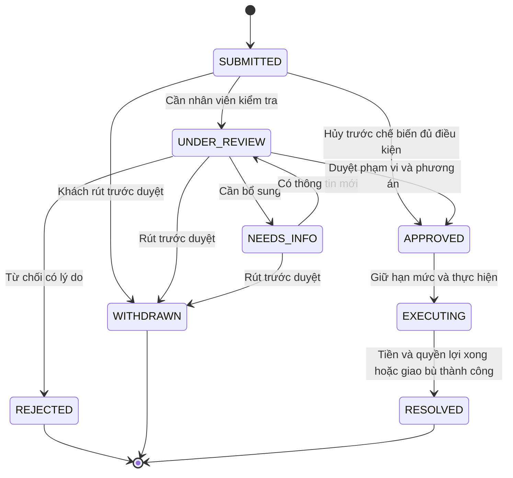
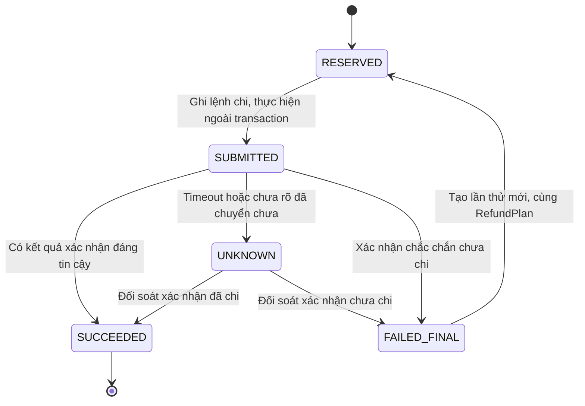
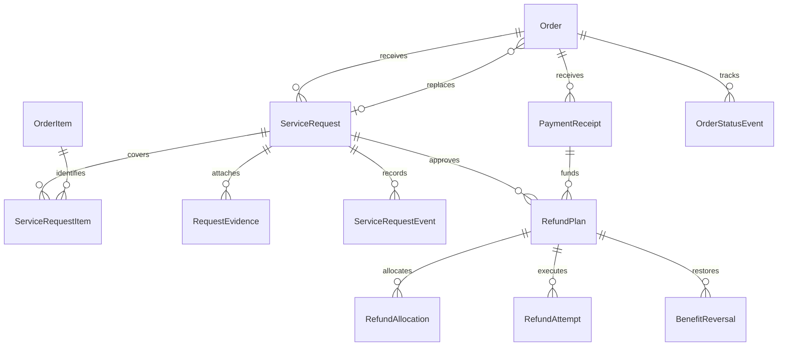

# Thiết kế phần 2 Hủy đơn đổi trả và hoàn tiền cho Quanlypho

## Kết quả và phạm vi

Phần 2 bổ sung yêu cầu hủy đơn, báo món lỗi/giao thiếu, làm lại hoặc giao bù, hoàn tiền toàn phần/một phần và tra cứu tiến độ. Tiền hoàn lấy từ số thực trả và nguồn thanh toán đã lưu; điểm, voucher, freeship và tồn kho được xử lý bằng giao dịch riêng có tham chiếu.

Đây là bản thiết kế phần 2, chưa triển khai mã nguồn hay thực hiện hoàn tiền thật. Các chính sách đề xuất tiếp tục giữ nhãn đề xuất. Kết quả phần 3 và phần bổ sung được lưu riêng theo `00_KE_HOACH.md`; các hợp đồng liên quan đã được đồng bộ. Không khôi phục chặng trợ lý AI, Dashboard hoặc yêu cầu thông tin sinh viên đã bỏ.

## Căn cứ và hiện trạng

| Căn cứ | Điều dùng trong thiết kế |
|---|---|
| Yêu cầu trực tiếp | Tiếp tục phần 2 theo thứ tự, dừng sau mỗi phần |
| Đề Word, Hướng 1 | Trạng thái đơn, ai được yêu cầu, điều kiện theo trạng thái, các bước xử lý, thông báo và màn hình tra cứu |
| Thiết kế phần 1 | Giá cuối được chụp, một voucher/đơn, điểm đổi voucher, hoàn ưu đãi có tham chiếu; Bạc/Vàng/Kim Cương có 2/3/10 mã tháng; freeship tự động theo khoảng cách |
| Mã hiện có | Chỉ hủy CASH + PENDING + CART qua nhân viên; chưa có model yêu cầu/hoàn tiền/giao dịch nhận tiền riêng trong model đã đọc |
| Đề xuất mới | Quyền hủy trước COOKING, thời hạn yêu cầu sau hoàn tất, điều kiện hoàn phí ship, khôi phục ưu đãi và các thời hạn xử lý bên dưới |

`OrderStatus` hiện gồm CART, PENDING_KITCHEN, COOKING, READY, DELIVERING, COMPLETED, CANCELLED. `PaymentStatus` hiện chỉ có PENDING, PAID, FAILED. `apply_order_action` khóa bàn trước đơn khi hủy tiền mặt và chuyển đơn sang CANCELLED/FAILED. Bếp có thể đánh dấu xong trực tiếp từ PENDING_KITCHEN, nên không được giả định mọi món luôn đi qua COOKING.

`order_detail` hiện cho chủ tài khoản, khách vãng lai có đơn trong `session.guest_orders`, nhân viên/quản lý và bếp trong một số trạng thái xem đơn. Quyền xem không tự động là quyền duyệt hoặc thực hiện hoàn. Webhook hiện kiểm tra chữ ký và tiền nhưng chưa đọc mã giao dịch ngân hàng riêng; QR chỉ là hướng dẫn chuyển tiền, chưa có API hoàn tiền ngân hàng đã xác minh trong mã đọc được.

## Người dùng và quyền

| Vai trò | Được làm | Giới hạn |
|---|---|---|
| Khách hàng | Xem điều kiện, yêu cầu hủy/báo sự cố cho đơn của mình; chọn mong muốn hoàn hoặc làm lại; theo dõi; bổ sung bằng chứng; rút yêu cầu chưa được duyệt | Không nhập số tiền làm căn cứ hoàn, tự duyệt hoặc xem yêu cầu người khác |
| Khách vãng lai | Các thao tác của chủ đơn trong phiên gốc đã được cấp quyền | Mã đơn đoán được không đủ để truy cập; mất phiên thì qua hỗ trợ xác minh, không mở tra cứu công khai bằng mã đơn |
| Thu ngân STAFF | Tiếp nhận, kiểm tra chứng từ, tạo yêu cầu thay khách có ghi người thao tác; thực hiện hoàn tiền mặt đã được duyệt và ghi xác nhận | Không tự duyệt khiếu nại sau chế biến, tăng hạn mức hoặc tự đánh dấu chuyển khoản đã hoàn chỉ từ ảnh khách gửi |
| Quản lý ADMIN | Duyệt/từ chối, ghi phạm vi/lý do, cho ngoại lệ, xác nhận đối soát chuyển khoản có chứng từ phù hợp | Không xóa lịch sử thu/hoàn; việc sửa sau duyệt phải có phiên bản và kiểm tra phần chưa xử lý |
| Bếp KITCHEN | Xác nhận chưa/đã chế biến, món giao bù và tình trạng hao phí | Không xem tài khoản nhận hoàn đầy đủ, duyệt hoặc trả tiền |
| Hệ thống | Tự duyệt hủy đủ điều kiện trước chế biến, giữ hạn mức hoàn, xử lý sự kiện và thông báo nội bộ | Mọi điều kiện được kiểm tra lại dưới khóa; không tự chuyển tiền khi chưa có tích hợp và quyền thực hiện |

API kiểm tra quyền ở cấp đối tượng cho từng đơn/yêu cầu/tệp, không chỉ ẩn nút. Quyền của khách vãng lai dùng phiên hoặc token giới hạn theo đơn được máy chủ cấp; xác thực đích nhận hoàn dựa trên chứng từ giao dịch, không coi mọi tài khoản ngân hàng khách nhập là đích được phép chuyển.

## Ma trận theo trạng thái đơn và thanh toán

Toàn bộ chính sách cho phép/từ chối cụ thể trong bảng là **đề xuất nghiệp vụ**, không được mô tả như quy định pháp luật hoặc chính sách đã được người dùng chốt.

| Trạng thái lúc khóa kiểm tra | Khách muốn đổi ý/hủy | Lỗi phía quán/giao hàng | Xử lý mặc định đề xuất |
|---|---|---|---|
| CART, chưa có tiền được xác nhận | Chủ đơn yêu cầu hủy ngay; STAFF/ADMIN hủy giúp | Quán hết món hoặc không thể phục vụ có thể hủy | CANCELLED; giải phóng ưu đãi; không tạo hoàn tiền nếu thực tế chưa nhận tiền |
| PENDING_KITCHEN, đã trả và bếp chưa bắt đầu | Cho hủy tự duyệt | Cho hủy | Chuyển CANCELLED dưới khóa, chặn chế biến; hoàn toàn bộ số thực trả và quyền lợi đủ điều kiện |
| COOKING hoặc READY, đã trả | Cho gửi yêu cầu, không tự duyệt; mặc định từ chối đổi ý đơn thuần | ADMIN quyết định làm lại/giao bù hoặc hoàn phạm vi bị ảnh hưởng | Không tự cộng nguyên liệu về kho; không vừa bù món vừa hoàn cùng suất |
| DELIVERING | Không có hủy ngay; chuyển yêu cầu hỗ trợ | Sai/thiếu/hỏng hoặc giao thất bại được xem xét | Giữ trạng thái giao thực tế; xử lý sự cố theo từng suất hoặc toàn đơn có lý do |
| COMPLETED | Không có hủy ngược đơn để xóa lịch sử | Cho báo sự cố theo thời hạn đề xuất | Giữ COMPLETED; yêu cầu và hoàn tiền có trạng thái riêng |
| CANCELLED | Không tạo hủy thứ hai | Tiền đến muộn, tiền trùng hoặc còn hoàn chưa xong được đối soát | Trả trạng thái hủy hiện có; không mở lại đơn để xử lý tiền |
| Trạng thái không nhất quán, ví dụ CART + PAID | Không tự suy luận là được hủy/hoàn | Tạo việc đối soát | Xác minh tiền và trạng thái bếp trước; không dựa vào enum đơn lẻ để trả tiền |

**Đồng bộ phần 3:** đề xuất thêm OrderStatus `DELIVERY_EXCEPTION` cho giao thất bại/chờ xử lý, ánh xạ từ lịch sử giao nhận. Đây là enum mới dự kiến, không có trong mã nguồn đã đọc; áp dụng nhánh hỗ trợ sự cố như DELIVERING, không tự hoàn tất/hủy hoặc tạo hoàn tiền khi chỉ nhận sự kiện giao lỗi.

Đề xuất thời hạn báo món lỗi/giao thiếu là **2 giờ từ thời điểm giao thành công hoặc hoàn tất phục vụ**. `updated_at` không thay được mốc này vì còn bị cập nhật bởi thao tác khác; cần lưu sự kiện hoặc trường `completed_at`/`delivered_at`. Đơn cũ thiếu mốc đáng tin cậy chuyển duyệt thủ công, không từ chối chỉ vì thiếu dữ liệu. Ngoài 2 giờ vẫn có đường gửi hỗ trợ để ADMIN xem ngoại lệ. Tiền chuyển muộn/trùng không bị áp thời hạn khiếu nại món ăn.

Ảnh là bằng chứng hỗ trợ, không mặc định bắt buộc cho trường hợp giao thiếu hoặc không thể chụp. Lý do gồm đổi ý, hết món, sai món, giao thiếu, chất lượng món, giao thất bại, trả trùng, tiền sau hủy và khác. Chỉ lựa chọn lý do không tự tạo quyền hoàn, số tiền hoặc quyền quản trị.

## Đổi trả phù hợp món ăn

MVP dùng **làm lại/giao bù** cho sai món, món lỗi hoặc thiếu suất; không mặc định thu hồi món chín để nhập lại kho hoặc bán lại. Việc có cần quán nhận lại món để xác minh là quyết định hỗ trợ riêng, không là điều kiện chung để gửi yêu cầu.

Một yêu cầu chọn phương án dự kiến là REFUND hoặc REPLACE. ADMIN duyệt phạm vi theo từng suất/thành phần. Mỗi suất bị ảnh hưởng chỉ được giữ một phương án đang xử lý; không tạo hai yêu cầu song song để vừa nhận món thay vừa nhận lại tiền cho cùng phần, trừ bồi thường thiện chí riêng được ghi rõ và có ngân sách riêng ngoài MVP.

Giao bù tạo đơn con `replacement_for_request_id` liên kết đơn gốc, giữ dấu vết suất thay thế và nguồn tất toán `SERVICE_REPLACEMENT` mới. Đơn con có phải trả 0đ, không sinh VietQR, không tiêu voucher/điểm/mã tháng, không cộng doanh số xét hạng hoặc điểm mua hàng lần nữa. Cần lưu giá trị danh nghĩa/chi phí phục vụ thay vì ghi có tiền khách trả. Kho của đơn con xuất riêng một lần theo luồng xử lý, trong khi hao phí của món gốc không bị xóa. Nếu giao bù cũng lỗi, mở lại cùng vụ việc hoặc yêu cầu con có liên kết, khóa phạm vi và đổi phương án có lịch sử; không sinh một ngân sách hoàn mới từ giá danh nghĩa của đơn bù.

## Tách trạng thái và sổ tiền

| Lớp | Trạng thái/dữ liệu | Ý nghĩa |
|---|---|---|
| Đơn | Enum OrderStatus hiện có và lịch sử chuyển trạng thái | Tình trạng phục vụ/giao; đơn hoàn tất rồi vẫn giữ lịch sử hoàn tất |
| Tiền nhận | PaymentReceipt: CONFIRMED, CONFIRMED_UNALLOCATED, RECONCILIATION_PENDING | Bằng chứng tiền thật vào; tiền trùng/muộn được ghi riêng, không xóa hoặc tính bằng giá món |
| Yêu cầu | SUBMITTED, UNDER_REVIEW, NEEDS_INFO, APPROVED, REJECTED, WITHDRAWN, EXECUTING, RESOLVED | Tiến trình xử lý mong muốn của khách |
| Lần hoàn tiền | RESERVED, SUBMITTED, UNKNOWN, SUCCEEDED, FAILED_FINAL | Hạn mức đã giữ và kết quả chi tiền; UNKNOWN vẫn giữ hạn mức để không hoàn lần nữa |
| Khôi phục quyền lợi | PENDING, APPLIED, FAILED_RETRYABLE hoặc NOT_REQUIRED | Điểm/voucher cập nhật độc lập với bằng chứng tiền hoàn |
| Tổng hợp hiển thị | Không cần hoàn / Chờ hoàn / Hoàn một phần / Đã hoàn / Cần đối soát | Tính từ giao dịch, không nhét toàn bộ vào OrderStatus |

Không đổi PAID thành FAILED để biểu thị đã hoàn. Tiền đã nhận và tiền đã hoàn đều giữ lịch sử. Với đơn đã hủy mà tiền tới muộn, ghi receipt chưa phân bổ và trạng thái đối soát; **không chuyển đơn sang PAID chỉ để ghi nhận tiền**, vì signal hiện có sẽ xuất kho. Giao diện phải thể hiện “Đã nhận tiền, chờ hoàn/đối soát”, không chỉ đọc cờ FAILED cũ.





FAILED_FINAL kết thúc lần thử đó; chỉ được tạo lần thử mới cho cùng RefundPlan khi có bằng chứng chắc chắn chưa trả tiền, không sửa/xóa lần thử cũ hoặc dùng lỗi mạng làm căn cứ. Khi tiền đã hoàn thành công nhưng khôi phục điểm bị lỗi, giữ SUCCEEDED và xử lý lại phần điểm; không gửi lệnh hoàn tiền lần nữa.

## Luồng từ yêu cầu đến kết quả

1. Chủ đơn mở chi tiết đơn; máy chủ trả thao tác được phép theo quyền, trạng thái, tiền đã nhận và phần đã được xử lý trước đó.
2. Khách chọn hủy hoặc báo sự cố, suất bị ảnh hưởng, lý do và mong muốn hoàn/làm lại; có thể thêm mô tả/ảnh. Bản xem trước phân biệt tiền, điểm và voucher dự kiến, không coi mong muốn khách là quyết định duyệt.
3. Khi gửi, máy chủ kiểm tra lại dưới khóa, tạo yêu cầu bằng khóa xử lý lặp. Hủy trước chế biến đủ điều kiện được tự duyệt và chặn phục vụ; các trường hợp khác vào hàng đợi xem xét, việc gửi đơn thuần không tự dừng món đang nấu.
4. STAFF xác minh với bếp/giao nhận, xin thêm thông tin nếu cần; ADMIN duyệt/từ chối có lý do và phạm vi. Lúc duyệt phải kiểm tra lại trạng thái mới nhất, phần đã hoàn/giao bù và nguồn tiền; không dùng bản xem trước đã cũ.
5. Duyệt hoàn thì giữ ngân sách trên receipt và từng suất; duyệt giao bù thì khóa phương án và tạo đơn con một lần. Đơn bị hủy toàn bộ trước phục vụ chuyển CANCELLED ngay khi chấp nhận hủy, không chờ tiền về.
6. Thu ngân hoàn tiền mặt theo quyết định đã duyệt và có xác nhận bàn giao; chuyển khoản qua thao tác đối soát có phân quyền trong MVP. Chỉ khi có tích hợp được xác minh mới đề xuất gọi API nhà cung cấp, không giả định VietQR đã hỗ trợ hoàn tự động.
7. Khi xác nhận tiền hoàn, ghi kết quả bền vững và phát sự kiện khôi phục điểm/voucher, điều chỉnh nguồn tích lũy. Nếu không cần tiền thì xử lý quyền lợi trực tiếp; giao bù theo dõi đến kết quả giao thực tế.
8. Khách xem dòng thời gian và các khoản đã xong/đang xử lý. Yêu cầu chỉ RESOLVED khi mọi nghĩa vụ đã được xác nhận; thất bại/UNKNOWN hiển thị đối soát, không thông báo “đã hoàn” sớm.

Thông báo trong ứng dụng gồm tiếp nhận, cần bổ sung, duyệt/từ chối, đang hoàn/giao bù, đã hoàn tiền nhưng đang cập nhật điểm và hoàn tất. Lưu sự kiện/outbox cùng thay đổi DB rồi gửi thông báo sau commit; retry không phát trùng cùng sự kiện. Thiết kế này không tạo lịch, gửi email/SMS hoặc nhắn ra ngoài thật.

## Tính hoàn tiền và điểm từ đơn gốc

Mỗi suất/thành phần có thể hoàn và phần phí giao là một đơn vị `u` đã được chụp lúc đặt đơn:

```text
B_u = tiền đơn vị sau giảm hạng và voucher, trước điểm trực tiếp
p_u = số điểm nguyên phân bổ cho đơn vị
C_u = B_u - 100 × p_u

sum(B_u) = R của phần 1
sum(p_u) = điểm trực tiếp đã tiêu P
sum(C_u) = payable_amount = tiền chuẩn cần nhận cho đơn

Với tập đơn vị U được duyệt:
cash_target   = sum(C_u với u thuộc U)
points_target = sum(p_u với u thuộc U)
```

Phần ship dùng `B_ship = F - Da - Ds`, không dùng phí ship gốc để hoàn. Không quy đổi chiết khấu hạng, voucher hàng hoặc freeship thành tiền cho khách. Không tính lại ngưỡng đơn/voucher theo giỏ còn lại để thu hồi ưu đãi cũ sau khi hoàn một phần; đây là đề xuất giữ giá lịch sử cho MVP.

**Phân bổ điểm nguyên khi đặt đơn:** phân bổ tỷ lệ theo B_u, lấy phần nguyên rồi chia số điểm còn lại theo phần lẻ lớn nhất và khóa thứ tự ID ổn định; mỗi đơn vị có sức chứa `floor(B_u / 100)`. Bỏ đơn vị hết sức chứa và lặp qua các đơn vị còn sức chứa đến khi phân bổ đủ, không tạo C_u âm. Trần điểm thực tế là nhỏ nhất giữa số dư, trần 50% phần 1 và tổng sức chứa. Ràng buộc sức chứa đã được bổ sung vào tài liệu phần 1 như một đề xuất kỹ thuật, phải tính trước xác nhận; không sửa phân bổ đơn đã trả để tăng tiền hoàn. Đơn cũ thiếu dữ liệu phân bổ cần lập bản chụp phục hồi được kiểm duyệt từ dữ liệu có thật; chưa đủ căn cứ thì xem xét thủ công, không tự tái tính bằng giá thực đơn hiện tại.

### Ví dụ hoàn một phần

Đơn mẫu phần 1 có S = 300.000đ, hạng Bạc giảm 15.000đ, voucher giảm 50.000đ, ship thực trả trước điểm 25.000đ, dùng 100 điểm và trả 250.000đ. Phân bổ sau đây được lưu từ lúc đặt:

| Đơn vị | Giá gốc | Giảm hạng | Giảm voucher | B_u | p_u | C_u tiền đã trả |
|---|---:|---:|---:|---:|---:|---:|
| Suất A | 200.000 | 10.000 | 33.333 | 156.667 | 60 | 150.667 |
| Suất B | 100.000 | 5.000 | 16.667 | 78.333 | 30 | 75.333 |
| Phí giao | 25.000 | 0 | 0 | 25.000 | 10 | 24.000 |
| Tổng | 325.000 | 15.000 | 50.000 | **260.000** | **100** | **250.000** |

Nếu chỉ suất B được hoàn vì giao sai, đề xuất **hoàn 75.333đ và 30 điểm**, không hoàn 100.000đ giá gốc, không hoàn phí giao và chưa trả lại voucher đã dùng. Nếu sau đó hoàn toàn bộ các đơn vị còn lại, hoàn thêm 174.667đ và 70 điểm; tổng cả hai lần đúng 250.000đ và 100 điểm. Khôi phục voucher nếu đáp ứng chính sách hoàn toàn bộ bên dưới chỉ một lần, không làm lại mỗi khi nhận callback.

Đơn có phần ship đã được miễn toàn bộ thì `B_ship = 0`: không có tiền ship để hoàn. Đơn bằng 0đ không tạo lệnh hoàn tiền ngân hàng; vẫn có thể cần hoàn điểm, phục hồi quyền voucher hoặc làm lại món theo quyết định.

## Ngân sách hoàn và tiền tới muộn hoặc trả trùng

Giá trị được hoàn phải qua cả hai giới hạn: phạm vi suất/điểm đã được duyệt và số tiền thật trên receipt. Mọi khoản RESERVED, SUBMITTED hoặc UNKNOWN vẫn chiếm ngân sách:

```text
cash_remaining_for_receipt = confirmed_received_amount
                            - succeeded_refund_amount
                            - active_reserved_refund_amount

refundable_quantity = original_quantity
                      - resolved_quantity
                      - active_claimed_quantity
```

Trong lúc giữ hạn mức, khóa receipt và phạm vi suất; không chỉ kiểm tra tổng rồi ghi ở hai request độc lập. Hoàn phải có số tiền dương, không vượt cash_remaining hoặc quyền theo bản chụp; số điểm trả cộng dồn không vượt điểm gốc phân bổ. Hoàn một phần nhiều lần căn cứ phần chưa được xử lý, không lấy lại toàn bộ giá gốc mỗi lần.

Ngân sách được giữ trên **nghĩa vụ RefundPlan**, không giữ mới cả số tiền cho từng RefundAttempt thử lại. Một lần thử FAILED_FINAL không tự giải phóng nghĩa vụ đã duyệt; chỉ khi hủy nghĩa vụ hợp lệ và đã chắc chắn chưa chi mới được trả ngân sách. Mỗi lần chi xác nhận chỉ giải ngân phần còn chưa chi của nghĩa vụ; mã chi ngoài được kiểm tra duy nhất để không dùng cùng chứng từ hoàn cho hai kế hoạch.

`PaymentReceipt` lưu `provider`, `external_transaction_id` duy nhất theo provider, `order_id`, số tiền, thời điểm, nguồn xác minh và trạng thái phân bổ. Callback gửi lặp cùng mã giao dịch không là lần thu mới. Hai lần chuyển tiền thật có hai mã khác nhau dù cùng mã đơn và số tiền; không khử trùng bằng `(order_code, amount)`.

Ví dụ khách chuyển 250.000đ hai lần thật: receipt đầu phân bổ vào đơn, receipt thứ hai là tiền dư. Hoàn receipt dư 250.000đ **không** hủy đơn, hoàn điểm, trả voucher hoặc nhập lại kho. Nếu sau đó đơn cũng được hủy và hoàn toàn bộ, receipt đầu có ngân sách hoàn riêng 250.000đ. Tổng tiền hoàn theo đơn có thể vượt payable_amount do khách đã chuyển dư, nhưng không được vượt tổng tiền nhận và không hoàn lặp từng receipt.

Webhook hiện chưa có mã giao dịch ngoài, nên triển khai phải bổ sung hợp đồng nguồn tiền đáng tin hoặc đối soát thủ công trước khi xác nhận các receipt. Không tự bịa ID ngân hàng từ thời gian gọi webhook. Tiền vào sau khi đơn đã hủy hoặc thanh toán bị từ chối do kho phải được ghi receipt chưa phân bổ và lập hoàn/đối soát; không chạy lại chế biến/xuất kho và không hoàn các quyền lợi vốn chưa tiêu.

## Chính sách phí giao và khôi phục quyền lợi

Các chính sách chi tiết sau là **đề xuất để người dùng góp ý**; không có giá trị tiền mới ngoài quyền đã giữ/tiêu thực tế.

| Tình huống | Tiền | Điểm trực tiếp | Voucher và freeship |
|---|---|---|---|
| Hủy chưa trả | Không tạo hoàn nếu chưa nhận tiền | Giải phóng giữ; quá hạn gốc thì hết hạn | Giải phóng mã còn hạn, không cấp mã mới hoặc giảm issued_count tháng |
| Hủy toàn bộ đã trả, trước chế biến | Hoàn toàn bộ tiền chuẩn đã nhận, gồm phần ship thực trả nếu chưa giao | Trả đủ điểm đã tiêu theo phân bổ | Khôi phục một quyền voucher đã tiêu đủ điều kiện; tự miễn ship không có mã để hoàn |
| Hoàn một phần món | Hoàn C_u được duyệt; mặc định giữ phí giao nếu dịch vụ giao vẫn thực hiện | Trả p_u của phần đó | Giữ voucher tiêu thụ; không trả một mã nguyên vẹn sau mỗi phần hoàn |
| Quán không thể phục vụ/giao thất bại do quán, hoàn toàn đơn | Hoàn toàn bộ thực trả, gồm ship thực trả | Trả đủ điểm | Khôi phục quyền voucher; nếu hết hạn do quá trình xử lý có thể bù thời hạn như quy tắc bên dưới |
| Giao thất bại do khách | ADMIN xem xét phần dịch vụ/món đã thực hiện; không tự phạt thêm tiền | Chỉ trả phần tương ứng đã duyệt | Không tự khôi phục cả gói hoặc mã khi chưa có quyết định hợp lệ |
| Làm lại/giao bù | Không hoàn tiền cho cùng phần đã chọn bù | Không hoàn/trừ điểm cho việc giao bù | Không tiêu thêm mã; không phát điểm mua hàng mới cho đơn bù |
| Chuyển dư hoặc chuyển sau hủy, tiền chưa phân bổ | Chỉ hoàn tiền từ receipt dư/muộn | Không có điểm đã tiêu từ receipt này để hoàn | Không tác động lượt voucher/mã tháng hoặc tự miễn ship |

**Điểm trực tiếp:** khoản trả có tham chiếu từng PointAllocation gốc và từng lô. Nếu lô còn hạn thì phục hồi với hạn gốc; đề xuất khi đã hết hạn tại lúc hoàn, cấp lô bồi hoàn **7 ngày**, giữ tham chiếu nguồn và số lượng, không tự thêm 12 tháng. Điều này chỉ áp cho điểm đã tiêu của đơn được duyệt hoàn, khác với giải phóng điểm giữ của đơn chưa trả ở phần 1. Hai callback hoặc hai yêu cầu không được phục hồi vượt số gốc.

**Voucher đổi từ điểm:** hoàn toàn bộ đủ điều kiện thì phục hồi đúng quyền voucher đã dùng, không trả thêm số điểm đã mua voucher. Hoàn một phần không hoàn một tỷ lệ điểm đã mua mã. Chỉ khi chính giao dịch đổi voucher thất bại/bị đảo hợp lệ mới xét hoàn điểm mua mã, với mã được thu hồi/không còn sử dụng; không thực hiện hai cách bồi hoàn cho cùng quyền.

**Mã freeship tháng:** phục hồi một mã đã tiêu hợp lệ không đặt lại quota hoặc giảm `issued_count`, nên không kích hoạt cấp lại 2/3/10 mã. Khi mã còn hạn, khôi phục chính quyền đó bằng giao dịch đảo. Khi quá hạn chỉ đề xuất bù nếu lỗi quán hoặc xử lý kéo dài phía quán: một voucher bồi hoàn 7 ngày liên kết quyền gốc, nguồn `AFTERSALES_RESTORE`; nó không là gói tháng mới. Mã tháng sau vẫn có quota riêng. Không cấp cả gói để bù một mã.

**Voucher khác hết hạn:** đề xuất chính sách tương tự, chỉ bù một quyền 7 ngày khi lỗi quán/chậm xử lý; hủy do khách không tự gia hạn mã hết hạn. Giảm hạng tự động và tự miễn ship không tạo tiền/mã bồi hoàn. Mỗi VoucherRedemption chỉ có một khôi phục; hoàn đủ qua nhiều lần cộng dồn phải kiểm tra lại điều kiện toàn bộ và khóa quyền gốc.

**Điểm mới đã tích từ đơn COMPLETED:** phát sự kiện điều chỉnh trên đóng góp chi tiêu gốc được chụp, không tự lấy giá gốc món hoặc tự quyết định lại phạm vi ship đang chờ chốt ở phần bổ sung. Nếu nguồn thưởng tính theo tiền ròng còn hợp lệ, mục tiêu điểm còn lại là `floor(remaining_qualifying_spend / 10.000)`; số thu hồi cộng dồn là điểm mua hàng đã cấp trừ mục tiêu, không làm tròn riêng từng lần hoàn. Phần điểm thưởng gốc còn khả dụng bị thu hồi; phần đã tiêu có thể ghi `point_debt` riêng và bù từ điểm vào sau theo chính sách đề xuất, không làm available_points âm hoặc tự thu tiền mặt. Giao diện phải hiện điểm hoàn, điểm bị thu hồi/nợ và số dư khả dụng tách biệt. Xét lại hạng và quà đã phát do module bổ sung sở hữu; không phát lại gói quà vì dao động hạng.

Quyết định trừ điểm thưởng/chi tiêu chỉ được áp khi nghĩa vụ hoàn tương ứng đã được xác nhận, không ngay khi khách vừa gửi yêu cầu. Các sự kiện có mã duy nhất để chạy lại không điều chỉnh hai lần.

## Hợp đồng với tồn kho và giao hàng của phần 3

Bản chi tiết nằm trong `03_THIET_KE_TON_KHO_GIAO_HANG.md`: giữ kho và ưu đãi có hạn chung; stock xuất tại PAID theo BOM đã chụp; giao nhận có sự kiện độc lập, không hoàn kho/tiền chỉ từ một cờ giao thất bại.

- Hủy đơn chưa PAID hiện chưa xuất nguyên liệu: chỉ giải phóng giữ nếu phần 3 bổ sung cơ chế giữ; không tạo bút toán nhập kho giả.
- Đơn PAID đã bị signal xuất: nếu bếp xác nhận chưa sử dụng nguyên liệu, phần 3 có thể hoàn lại qua một bút toán đảo tham chiếu lần xuất gốc, có người xác nhận và chạy một lần.
- Món đã chế biến/hỏng/giao bù không tự hoàn nguyên liệu về current_stock; ghi hao phí và xuất riêng cho món bù. Thực phẩm nhận lại không mặc định nhập bán lại.
- Hủy tranh thao tác bắt đầu hoặc hoàn tất nấu phải khóa cùng đơn; nhánh đã thắng quyết định ma trận, kể cả đường bếp hoàn tất trực tiếp từ PENDING_KITCHEN.
- Không giải phóng bàn chỉ vì có yêu cầu hoàn; chỉ hủy trước phục vụ và không còn đơn chiếm bàn mới xử lý theo điều phối hiện có. Sau phục vụ vẫn theo bước dọn bàn.
- Hoàn tiền không đồng nghĩa giao thất bại hoặc đơn chưa được phục vụ; giữ lịch sử thực tế để phần 3 đồng bộ đúng.

## Mô hình dữ liệu

| Thực thể dự kiến | Trường và trách nhiệm |
|---|---|
| `ServiceRequest` | Đơn, người/phiên yêu cầu, người tạo thay, loại CANCEL/ISSUE, lý do, mong muốn REFUND/REPLACE, trạng thái, bản chụp chính sách, mốc gửi/duyệt, người duyệt, lý do quyết định |
| `ServiceRequestItem` | OrderItem, suất/thành phần, số lượng ảnh hưởng, phương án duyệt, phạm vi đã giữ/giải quyết; ngăn chồng yêu cầu |
| `RequestEvidence` | Tệp riêng tư, chủ yêu cầu, loại/kích thước đã xác minh, thời điểm; không lộ URL công khai hoặc thông tin ngân hàng cho bếp |
| `PaymentReceipt` | Nguồn thu, mã giao dịch ngoài, đơn, số tiền xác nhận, thời điểm/nguồn xác minh, trạng thái phân bổ; receipt tiền dư/muộn riêng |
| `RefundPlan`, `RefundAllocation` | Nghĩa vụ đã duyệt, receipt, các suất/ship, tiền/điểm theo bản chụp, số đã giữ/đã hoàn, phiên bản, phần quyền lợi cần đảo |
| `RefundAttempt` | Kế hoạch hoàn, số tiền, phương thức, khóa thực hiện, trạng thái RESERVED/SUBMITTED/UNKNOWN/SUCCEEDED/FAILED_FINAL, mã đối soát, thời điểm, người thực hiện; giữ riêng từng lần thử |
| `BenefitReversal` | PointAllocation/VoucherRedemption gốc, phạm vi trả, quyền/lô bồi hoàn nếu có, trạng thái và khóa sự kiện; bảo đảm một voucher khôi phục một lần |
| `OrderStatusEvent`, `ServiceRequestEvent` | Trạng thái trước/sau, tác nhân, lý do, thời điểm; xác định mốc nấu/giao/hoàn tất đáng tin |
| `PaymentEventInbox`, `EventOutbox` | Nhận sự kiện ngoài chống lặp; phát thông báo/điều chỉnh quyền lợi sau commit; không đặt lệnh chi lần hai vì job điểm thất bại |
| `Order` và dữ liệu phần 1 | Thêm liên kết đơn bù/nguồn tất toán, mốc hoàn tất nếu cần; tái sử dụng phân bổ theo suất và RequestKey, không tạo bộ giá mới |



Ràng buộc: duy nhất `(provider, external_transaction_id)` với giao dịch xác minh; mã ngân hàng không để chuỗi rỗng dùng chung cho mọi receipt. Duy nhất khóa thao tác theo user/phiên và loại thao tác; payload khác bị từ chối. Hoàn có số tiền dương; không tạo RefundAttempt cho 0đ. Khóa receipt để bảo đảm tổng đã chi + đang giữ không vượt tiền nhận, khóa phân bổ để tổng số lượng/điểm đã xử lý không vượt gốc. Một giao dịch đảo coupon có khóa duy nhất trên quyền tiêu gốc, không chỉ theo request. Đơn bù duy nhất theo phương án/phạm vi đã duyệt và mọi lần tạo lại giữ dấu vết.

Lịch sử thu/hoàn không bị xóa khi đổi tên món/xóa sản phẩm; ràng buộc và bản chụp phải bảo toàn chứng từ. Dữ liệu nhận tiền và mã đối soát được hạn chế truy cập; ảnh tài khoản ngân hàng không xuất sang thông báo hoặc log công khai.

## API và ví dụ

Các endpoint dưới đây là **đề xuất mới**, dùng session Django và CSRF cho POST từ giao diện. Chưa cần thêm framework API. Đường STAFF/ADMIN phải có kiểm tra hành động cụ thể, không tái dùng quyền xem đơn làm quyền hoàn.

| API | Quyền và chức năng |
|---|---|
| `GET /api/orders/{id}/service-options/` | Chủ đơn/phiên hoặc nhân viên được phép; thao tác, phạm vi còn lại và lý do không đủ điều kiện |
| `POST /api/orders/{id}/service-requests/` | Chủ đơn/phiên; tạo yêu cầu từ item/suất, lý do, mong muốn và khóa yêu cầu; tiền tính trên máy chủ |
| `GET /api/service-requests/{id}/` | Chủ yêu cầu hoặc nhân viên theo quyền; trạng thái, timeline, tiền/điểm/voucher và phần đang xử lý |
| `POST /api/service-requests/{id}/evidence/` | Chủ yêu cầu/nhân viên được phép; bổ sung bằng chứng riêng tư |
| `POST /api/service-requests/{id}/withdraw/` | Chủ yêu cầu, chỉ trước duyệt/chi; kiểm tra dưới khóa |
| `POST /api/staff/service-requests/{id}/decision/` | ADMIN; duyệt/từ chối, phạm vi, phương án, lý do và expected_version |
| `POST /api/staff/refunds/{id}/cash-confirmation/` | STAFF/ADMIN có khoản hoàn tiền mặt đã duyệt; chứng từ và xác nhận đã bàn giao |
| `POST /api/staff/refunds/{id}/bank-reconciliation/` | ADMIN hoặc quyền đối soát chuyên biệt; đối chiếu giao dịch, không nhận ảnh chụp làm kết quả tự động |

Ví dụ yêu cầu hoàn suất B, ID là dữ liệu mẫu:

```json
{
  "request_type": "ISSUE",
  "reason": "WRONG_ITEM",
  "preferred_remedy": "REFUND",
  "items": [{"order_item_id": 202, "unit_indexes": [1]}],
  "description": "Suất B được giao khác món đã chọn",
  "idempotency_key": "service-request-example-001"
}
```

```json
{
  "request_id": 701,
  "status": "SUBMITTED",
  "policy_version": "aftersales-v1",
  "preview": {
    "cash_amount": 75333,
    "points_amount": 30,
    "shipping_refund_amount": 0,
    "restore_voucher": false,
    "is_approved": false
  },
  "message": "Đã nhận yêu cầu. Khoản hoàn dự kiến đang chờ duyệt."
}
```

Trường `shipping_refund_amount` chỉ là phần tiền mặt ship trong cash_amount, không cộng thêm lần nữa. Response chi tiết sau duyệt tách `cash_status`, `benefit_status`, số tiền đã xác nhận hoàn và điểm đã áp dụng để không nói đã xong khi mới duyệt. Đích hoàn được xác minh và hiển thị dạng che bớt thông tin.

Lỗi: 404 cho đối tượng không có/không được phép biết; 403 cho hành động nhân viên vượt quyền; 409 cho trạng thái thay đổi, phạm vi trùng, khóa khác payload hoặc ngân sách đã giữ; 422 cho dữ liệu không hợp lệ; 503 cho nguồn đối soát chưa sẵn sàng. Dùng lý do cụ thể bằng tiếng Việt, giữ dữ liệu form khi lỗi. RequestEvidence đề xuất JPG/PNG/WEBP, tối đa 5 MB/tệp; kiểm tra nội dung thật/kích thước và quyền đọc, không chỉ phần mở rộng, không chạy tệp tải lên.

## Giao dịch và kiểm soát hoàn lặp

**Đồng bộ phần bổ sung:** `04_THIET_KE_TAI_KHOAN_DIA_CHI_LOYALTY.md` định nghĩa ngữ cảnh phiên, đóng góp chi tiêu ròng từng đơn, thu hồi điểm đang giữ/đã tiêu và referral hai ví. Với request trình duyệt thêm khóa vault/slot trước RequestKey khi cần, User trước ví; nhiều ví khóa theo user ID tăng dần. Sự kiện hoàn xử lý theo mục tiêu ròng/version hiện tại, không cộng/trừ lại từ sự kiện cũ; khoản điểm đang giữ cần theo dõi thu hồi chờ, không vừa tạo nợ vừa thu hồi cùng điểm.

Thứ tự khóa thống nhất cùng phần 1 và phần 3: RequestKey → ví điểm nếu có → bàn → đơn → receipt → yêu cầu/kế hoạch hoàn → danh mục/chiến dịch → kỳ cấp → quyền voucher → lô điểm → giữ kho/giao nhận → phiên bản BOM → nguyên liệu. Nhiều dòng cùng nhóm khóa theo ID ổn định. Đọc ID quan hệ trước rồi kiểm tra lại sau khi khóa. Bàn đứng trước đơn phù hợp nhánh hủy hiện tại; webhook đang khóa đơn trước ví phải được tái cấu trúc khi triển khai để không có đường khóa ngược. Tất cả thao tác bếp, hủy, timeout và xác nhận tiền phải dùng cùng kiểm tra chuyển trạng thái.

1. Transaction lập/duyệt hoàn khóa các nguồn, tính từ bản chụp và giữ cash budget/phạm vi suất, ghi RefundPlan/Attempt cùng sự kiện cần thực hiện rồi commit.
2. Worker hoặc người được phân quyền thực hiện chi ngoài transaction DB; không giữ khóa trong lúc gọi ngân hàng. Định danh nghĩa vụ hoàn/khóa provider được giữ ổn định qua retry theo hợp đồng của nhà cung cấp; chưa có hợp đồng thì dùng đối soát thủ công.
3. Callback hoặc chứng từ đối soát được xác minh và ghi inbox có định danh riêng; xác nhận chi được lưu bền vững, chuyển ngân sách đã giữ thành đã chi và tạo outbox khôi phục quyền lợi.
4. Job quyền lợi dùng tham chiếu gốc chống lặp để trả điểm/mã và điều chỉnh nguồn tích lũy. Lỗi bước này chỉ thử lại bước này; khách thấy tiền đã xong, điểm đang xử lý.
5. Chỉ đóng yêu cầu khi mọi nghĩa vụ được xác nhận. UNKNOWN không tự trả ngân sách để thử một lệnh chi mới; FAILED_FINAL cũng phải kiểm tra quyền và nghĩa vụ còn lại trước khi thử lại.

Webhook ngoài có xác thực/chữ ký và định danh giao dịch; không bỏ CSRF cho các POST phiên của khách/nhân viên. Ghi log tác nhân, quyết định và mã đối soát đã che dữ liệu nhạy cảm; không log bí mật hoặc tài khoản ngân hàng đầy đủ. Giao diện escape mô tả/bằng chứng người dùng, tránh biến lý do hoàn thành HTML thực thi.

## Wireframe tra cứu và gửi yêu cầu

```text
ĐƠN PHO-...                         Đã hoàn tất phục vụ
Thanh toán đã nhận: 250.000đ
[Báo món sai / giao thiếu]          [Lịch sử yêu cầu]

TẠO YÊU CẦU
Suất bị ảnh hưởng: [Suất B, 1 suất]
Lý do: [Giao sai món]
Mong muốn: (•) Hoàn phần bị ảnh hưởng   ( ) Làm lại/giao bù
Mô tả [........................................]
Bằng chứng [Thêm ảnh nếu có]

DỰ KIẾN, CHƯA ĐƯỢC DUYỆT
Tiền: 75.333đ | Điểm: 30 | Phí giao: không hoàn
Voucher: tiếp tục tính đã dùng vì hoàn một phần
[Quay lại] [Gửi yêu cầu]
```

```text
YÊU CẦU #701                        Đang xử lý
Đơn hàng: Đã hoàn tất phục vụ
Phương án đã duyệt: Hoàn suất B

Tiền hoàn: 75.333đ                   Đã xác nhận trả
Điểm hoàn: 30                        Đang cập nhật
Voucher: Không khôi phục cho hoàn một phần
Tài khoản nhận: ****1234

DÒNG THỜI GIAN
10:00 Đã tiếp nhận
10:10 Quản lý duyệt và nêu lý do
10:20 Tiền đã được xác nhận hoàn
      Điểm đang cập nhật, yêu cầu chưa đóng
[Bổ sung thông tin nếu được yêu cầu] [Xem chi tiết đơn]
```

Đây là màn hình xử lý yêu cầu theo đơn, không phải dashboard. Màn hình nhân viên thêm phạm vi đã giải quyết/đang giữ, bằng chứng bếp và receipt, số tối đa còn được hoàn và nút quyết định theo quyền. Không cho sửa trực tiếp số thực nhận trên receipt để hợp thức hóa khoản hoàn.

Nút có nhãn rõ, điều khiển bàn phím, focus và trạng thái đang gửi; nút rút chỉ hiện khi được phép. Thông báo lỗi cạnh trường và tổng hợp khi submit thất bại; không chỉ dùng màu. Chờ xử lý/UNKNOWN không hiển thị nút “Hoàn lại lần nữa”. Giao diện nhỏ không tràn ngang; thông tin thời gian theo giờ Việt Nam, không cam kết thời điểm tiền tới tài khoản nếu chưa có dữ liệu xác minh. Thời hạn gửi, mục tiêu duyệt hay thời gian đối soát đều là cấu hình đề xuất, không gắn bảo đảm ngân hàng vào màn hình.

## Tích hợp và dữ liệu cũ

| Khu vực | Thay đổi dự kiến khi triển khai |
|---|---|
| `C:\Users\HP\Quanlypho\pho_app\models.py` và migrations mới | Thực thể yêu cầu, receipt, hoàn, đảo quyền lợi và sự kiện; mốc nấu/giao/hoàn tất, đơn giao bù; giữ lịch sử đơn cũ |
| `C:\Users\HP\Quanlypho\pho_app\services.py` | Tái sử dụng available_order_actions/apply_order_action; bổ sung quyền và quy trình hủy đã trả, phân bổ, giữ ngân sách, hoàn/giao bù |
| `C:\Users\HP\Quanlypho\pho_app\views.py` | Bảo vệ yêu cầu theo chủ đơn/phiên; API duyệt/đối soát; webhook lưu tiền tới muộn/trùng có bằng chứng, không tự mở lại đơn |
| `C:\Users\HP\Quanlypho\pho_app\permissions.py` và `C:\Users\HP\Quanlypho\pho_app\urls.py` | Quyền cụ thể cho duyệt/chi/đối soát, endpoint mới; giữ tương thích luồng hủy tiền mặt cũ |
| `C:\Users\HP\Quanlypho\pho_app\signals.py` | Không dùng thay đổi PAID để biểu thị hoàn; phối hợp kho/đơn bù mà không xuất lại đơn gốc |
| `C:\Users\HP\Quanlypho\pho_app\templates\pho_app\customer\order_detail.html` | Quyền thao tác, form sự cố, timeline, trạng thái tiền/điểm riêng |
| Giao diện nhân viên xử lý đơn hiện có | Chi tiết yêu cầu, quyết định và chứng từ theo quyền; không thêm KPI/dashboard |
| Dịch vụ phần 1 và bổ sung | Giải phóng/đảo quyền lợi theo gốc, phân bổ điểm nguyên, sự kiện điều chỉnh chi tiêu/điểm mua hàng; không phát lại gói hạng |

Đơn PAID cũ không tự động có receipt ngân hàng “đã xác minh” chỉ từ cờ PAID. Có thể tạo bản ghi nhập lịch sử `RECONCILIATION_PENDING`, đợi chứng từ đối chiếu trước chi tiền. Đơn chưa có phân bổ/mốc thời gian phải được xác minh dữ liệu cũ; không tính lại bằng giá hiện tại hoặc bịa thời điểm giao. Không sửa migration cũ và không chạy migration trong giai đoạn thiết kế.

## Quy tắc trọng tâm và tiêu chí nghiệm thu

| Mã | Ca kiểm chứng | Kết quả mong đợi |
|---|---|---|
| T2-01 | Chủ đơn hủy CART chưa trả; gửi lại cùng khóa | Một hủy và một giải phóng ưu đãi; không tạo khoản hoàn |
| T2-02 | Hủy tranh bếp bắt đầu hoặc hoàn tất thẳng từ PENDING_KITCHEN | Chỉ một chuyển trạng thái thắng; yêu cầu còn lại theo trạng thái thực tế, không tự hoàn khi món đã chuyển làm |
| T2-03 | Hủy PAID trước chế biến | CANCELLED chặn bếp ngay; tiền là chờ hoàn cho đến xác nhận chi, không đổi PAID thành FAILED |
| T2-04 | Khách đổi ý khi COOKING/READY | Không hủy ngay; yêu cầu xem xét và quyết định có lý do theo đề xuất |
| T2-05 | Hoàn suất B của ví dụ | Đúng 75.333đ và 30 điểm; không hoàn giá gốc/ship/voucher nguyên vẹn |
| T2-06 | Sau T2-05 hoàn toàn bộ phần còn lại | Thêm 174.667đ/70 điểm; tổng 250.000đ/100 điểm; khôi phục voucher nếu đủ điều kiện đúng một lần |
| T2-07 | Hai yêu cầu khác khóa cùng hoàn một suất hoặc cùng receipt sắp hết ngân sách | Không vượt số lượng, điểm gốc hoặc tổng tiền xác nhận; phạm vi đang giữ cũng được tính |
| T2-08 | Timeout khi gửi lệnh hoàn | UNKNOWN giữ ngân sách; không tự gửi một lệnh mới hoặc báo đã hoàn |
| T2-09 | Callback xác nhận chi gửi lặp; job trả điểm lỗi rồi chạy lại | Tiền chi một lần; điểm/voucher cập nhật một lần; không gửi lại tiền vì lỗi điểm |
| T2-10 | Chuyển 250.000đ hai lần thật, hai mã ngân hàng khác nhau | Hai receipt; hoàn tiền dư không hủy đơn hoặc trả ưu đãi của receipt chuẩn |
| T2-11 | Callback lặp cùng mã giao dịch; tiền tới sau CANCELLED | Không thu hai lần từ callback lặp; tiền muộn có receipt/đối soát, không xuất kho hoặc mở lại đơn |
| T2-12 | Hoàn voucher mua bằng 200 điểm | Phục hồi quyền voucher đủ điều kiện, không trả thêm 200 điểm mua mã |
| T2-13 | Hoàn mã freeship tháng đã tiêu | Chỉ phục hồi một quyền đủ điều kiện, issued_count giữ nguyên, không cấp lại gói 2/3/10 |
| T2-14 | Tự miễn ship hoặc voucher tặng món làm phần tiền bằng 0 | Không hoàn tiền cho giá trị giảm; xử lý điểm/quyền hoặc giao bù theo phạm vi |
| T2-15 | Điểm gốc/voucher hết hạn khi hoàn | Hạn gốc hoặc chính sách bù 7 ngày theo đề xuất; không gia hạn 12 tháng hay vừa trả mã vừa trả điểm mua mã |
| T2-16 | Mã/điểm chỉ đang giữ, hết hạn trước khi giải phóng đơn chưa trả | Chuyển hết hạn, không dùng chính sách hoàn sau trả để tái tạo số dư |
| T2-17 | Giao bù và hoàn tiền đồng thời cùng suất | Chỉ một phương án giữ phạm vi; đơn bù một lần, không tích điểm/tiêu mã hoặc tạo ngân sách tiền mới |
| T2-18 | PAID đã xuất kho, món đã nấu, yêu cầu hoàn | Không tự nhập nguyên liệu; chỉ bút toán đủ điều kiện theo hợp đồng phần 3 |
| T2-19 | User khác, guest mất phiên, KITCHEN gọi API quyết định/chi | Từ chối đúng quyền; không lộ ảnh/tài khoản; mã đơn không đủ để xem yêu cầu |
| T2-20 | POST thiếu CSRF, ảnh giả đuôi, mô tả chứa HTML | Bị chặn/xử lý an toàn; nội dung không thực thi; file riêng tư kiểm tra quyền |
| T2-21 | Nhiều lần hoàn sau COMPLETED, điểm mua hàng đã tiêu | Thu hồi theo mục tiêu cộng dồn, không làm tròn mỗi lần; nợ điểm riêng, không âm số dư hoặc phát lại quà hạng |
| T2-22 | Đơn cũ thiếu receipt/phân bổ/mốc giao | Chuyển xác minh thủ công; không tự xác nhận tiền ngân hàng hoặc từ chối do thiếu mốc |
| T2-23 | Thu ngân và quản lý bấm trả cùng lúc; định sửa sau khi chi | Một nghĩa vụ/chi; không tăng tiền đã được duyệt, lịch sử giữ nguyên |
| T2-24 | Rút yêu cầu trước và sau duyệt; hoàn tiền xong nhưng điểm còn chờ | Chỉ rút lúc cho phép; không RESOLVED sớm hoặc hủy ngược lệnh chi đang xử lý |
| T2-25 | Ba thành phần B_u = 99đ, trần 50% tính ra 1 điểm nhưng tổng sức chứa là 0 | Báo giá trước xác nhận có điểm tối đa 0; không ép phân bổ điểm để tạo phần tiền âm |

Các ca trên là thiết kế nghiệm thu, chưa phải kết quả chạy kiểm thử ứng dụng. Phần soạn tài liệu chỉ kiểm tra tính nhất quán, JSON và ví dụ số học.

## Kế hoạch triển khai riêng phần 2

1. Chốt ma trận hủy, thời hạn báo sự cố, phí ship và khôi phục quyền lợi; xác minh nguồn receipt/khả năng đối soát thực tế.
2. Bổ sung schema/migration dự kiến, bản chụp phân bổ theo suất và kế hoạch nhập dữ liệu cũ cần xác minh.
3. Làm kiểm tra quyền, yêu cầu/timeline và chuyển trạng thái dưới khóa; giữ tương thích hủy tiền mặt chưa trả.
4. Làm RefundPlan và ngân sách receipt/suất, kiểm thử cạnh tranh với bếp, các yêu cầu khác và callback.
5. Làm hoàn tiền mặt/đối soát chuyển khoản trong phạm vi được xác nhận; inbox/outbox, UNKNOWN và retry riêng cho tiền/quyền lợi.
6. Làm đảo điểm/voucher, sự kiện điều chỉnh chi tiêu/điểm và giao bù liên kết; tích hợp hợp đồng kho của phần 3 khi có thiết kế được duyệt.
7. Làm giao diện khách/nhân viên và thông báo trong ứng dụng; kiểm tra điện thoại, bàn phím, quyền file và trạng thái lỗi.
8. Chạy ca nghiệp vụ, đồng thời bằng PostgreSQL, kiểm tra bảo toàn tiền/điểm/lượt và hồi quy các luồng đặt món/thanh toán cũ; chỉ công bố ca đã chạy thật khi có triển khai.

## Phiếu hoàn thành và điểm cần góp ý

| Mục | Kết quả thiết kế |
|---|---|
| Tên đồ án và hướng | Quanlypho, Hướng 1 Hệ thống thương mại điện tử |
| Thành phần bổ sung | Hủy, khiếu nại món, làm lại/giao bù, hoàn tiền và khôi phục quyền lợi |
| Nhu cầu và giá trị | Khách biết điều kiện và tiến độ; nhân viên xử lý đúng quyền, không hoàn trùng/vượt tiền, giữ lịch sử phục vụ |
| Hiện vật | Ma trận trạng thái/quyền, hai state diagram, ERD, luồng 8 bước, bảng quy tắc/phân bổ, API/JSON, wireframe và ca nghiệm thu |
| Quyết định quan trọng | Tách hủy/chi tiền; dựa receipt và phân bổ; một phương án mỗi suất; không hoàn ưu đãi thành tiền; UNKNOWN giữ hạn mức; điểm/voucher đảo có tham chiếu |
| Tích hợp | Đơn/thu ngân/bếp, thanh toán, quyền lợi phần 1, hợp đồng kho/giao phần 3 và nguồn tích lũy phần bổ sung |
| Việc tiếp theo | Người dùng góp ý phần 2; chỉ chuyển phần 3 sau phản hồi tiếp tục |

Những đề xuất chưa được người dùng quyết định: hủy tự duyệt trước chế biến; mặc định không hủy do đổi ý khi đã nấu; cửa sổ báo sự cố 2 giờ có ngoại lệ; hoàn phí giao theo lỗi/phần dịch vụ; khôi phục một mã khi hoàn toàn bộ; bù 7 ngày cho điểm/mã đủ điều kiện; xử lý nợ điểm đã tích rồi tiêu; quy trình xác nhận hoàn tiền mặt/chuyển khoản của MVP. Không coi các lựa chọn này là điều khoản đã công bố cho khách.

**Bạn muốn bổ sung hoặc điều chỉnh gì ở phần Hủy đơn/đổi trả/hoàn tiền? Có yêu cầu nào còn thiếu không? Mình sẽ dừng ở đây trước khi chuyển sang phần 3.**
