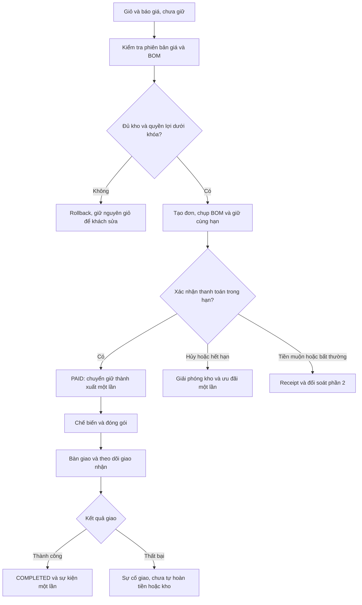
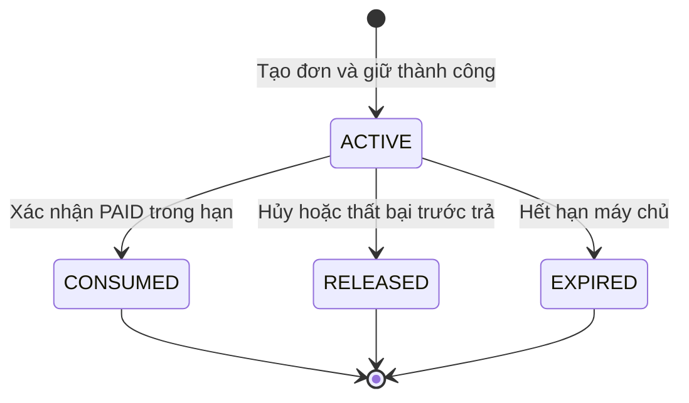
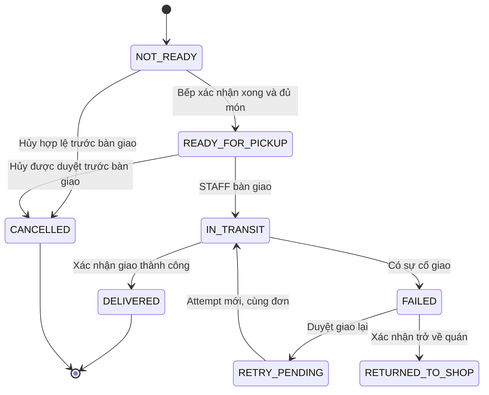
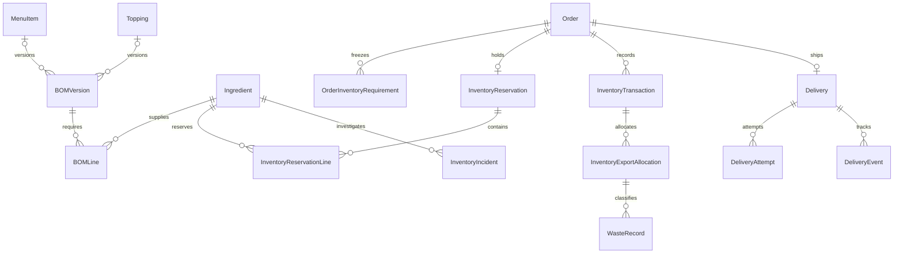

# Thiết kế phần 3 Tồn kho và giao hàng cho Quanlypho

## Kết quả và phạm vi

Phần 3 bổ sung giữ nguyên liệu khi tạo đơn, chuyển phần giữ thành xuất kho khi xác nhận PAID, giải phóng khi hủy/hết hạn và theo dõi giao nhận đến kết quả thật. Dữ liệu định lượng, địa chỉ, khoảng cách, phí và quyền freeship được chụp theo đơn; sửa công thức hoặc hồ sơ sau đó không tự đổi cam kết của đơn đã tạo.

Đây là bản thiết kế phần 3, chưa lập trình, chạy migration hoặc thay đổi tồn kho/giao hàng thật. Những chính sách mang nhãn đề xuất chưa tự động được xác nhận. Phần bổ sung tài khoản/sổ địa chỉ/loyalty đã có tài liệu riêng theo `00_KE_HOACH.md`, các hợp đồng nguồn điểm/ngữ cảnh tài khoản đã được đồng bộ. Không khôi phục chặng trợ lý AI, Dashboard hoặc thông tin sinh viên đã bỏ.

## Căn cứ và hiện trạng đã đọc

| Căn cứ | Nội dung sử dụng |
|---|---|
| Đề Word, Hướng 1 | Giữ hàng khi đặt, hết hàng, cập nhật và đồng bộ giao nhận; luồng đặt–giữ–giao và dữ liệu/thành phần liên quan |
| Thiết kế phần 1 | Giá/ưu đãi theo bản chụp, giữ voucher/điểm, hạn thanh toán, mã freeship tháng 2/3/10 và quyền tự miễn theo khoảng cách |
| Thiết kế phần 2 | Hủy tranh bếp, tiền muộn/trùng, receipt độc lập, hoàn theo suất, giao bù và đảo nguyên liệu có bằng chứng |
| Mã nguồn | Django/PostGIS; Ingredient/Recipe/InventoryTransaction; kiểm tra kho khi tạo đơn, xuất qua signal khi PAID; phí Haversine; bàn giao và giao xong là hai thao tác riêng |
| Đề xuất mới | Mô hình giữ/BOM version, TTL, chính sách thiếu cấu hình, trạng thái DELIVERY_EXCEPTION, xác nhận giao và các ràng buộc chi tiết |

Trong `pho_app/services.py`, `inventory_deductions` đã cộng định lượng món và topping; số lượng topping lưu trên OrderItemTopping đã là tổng, không nhân lại số tô. `ensure_inventory_available` có thể khóa nguyên liệu theo ID nhưng chỉ so với current_stock; chưa có dữ liệu giữ kho của đơn khác. `catalog_stock_limits` là ảnh chụp để hiển thị, không bảo đảm còn hàng lúc đặt.

Phở không có Recipe hiện bị từ chối; topping hoặc đồ uống không có Recipe hiện có thể đi qua mà không trừ kho. Phần thiết kế này đề xuất khai báo rõ BOM hoặc không theo dõi, thay vì hiểu thiếu công thức là còn vô hạn. `order_inventory_deductions` hiện đọc công thức đang có, nên cần chuyển sang bản chụp để công thức sửa sau đặt không làm đổi lượng xuất.

`signals.py` chỉ trừ khi chuyển PAID và ghi EXPORT, đã khóa nguyên liệu. `InventoryTransaction` hiện chưa có tham chiếu đơn/lần xuất gốc. `current_stock` và quantity_required dùng Decimal hai số lẻ; đơn vị đang là chuỗi tự nhập. Form sửa kho cho chỉnh current_stock và ghi ADJUST, nên phải tích hợp kiểm tra phần đang giữ.

Luồng giao hiện có READY → DELIVERING qua handover_delivery, rồi DELIVERING → COMPLETED qua complete_delivery. shipping_code được tạo nội bộ, không là bằng chứng đã kết nối hãng vận chuyển. Tem giao hàng có sẵn cho bếp/nhân viên; giao hàng hiện dùng VietQR. Chưa có vai trò SHIPPER hoặc API hãng giao nhận đã xác minh trong mã đọc được.

## Vai trò và nhu cầu

| Vai trò | Nhu cầu và quyền |
|---|---|
| Khách/chủ phiên guest | Biết món còn đủ, thời hạn giữ, phí giao và tiến độ đơn của mình; không xem tồn nguyên liệu chi tiết hoặc đơn người khác |
| Thu ngân STAFF | Xác nhận thanh toán trong hạn; kiểm tra đủ điều kiện bàn giao, ghi tài xế và kết quả giao có chứng từ; không tự sửa kho hoặc hoàn tiền vượt quyền phần 2 |
| Bếp KITCHEN | Thấy đơn đã trả có vật tư được xuất, ghi bắt đầu/xong, kiểm tra đóng gói; xác nhận phần chưa sử dụng/hao phí khi có sự cố |
| Quản lý ADMIN | Cấu hình định lượng/theo dõi kho, nhập/kiểm kê, duyệt đảo xuất và xử lý thiếu thực tế; xem lịch sử cần thiết |
| Hệ thống | Giữ/xuất/giải phóng và phát sự kiện chống lặp; đồng bộ trạng thái; không tự kết luận giao thành công theo thời gian trôi qua |

MVP dùng nhân viên hiện có ghi giao nhận. Nếu bổ sung tài khoản tài xế/API hãng sau này phải có thiết kế quyền và nguồn sự kiện riêng; không coi mã vận đơn hoặc tên tài xế là quyền đọc đơn.

## Phân biệt tồn theo sổ và phần đang giữ

Mỗi nguyên liệu có một đơn vị tồn chuẩn và các đại lượng:

```text
S_i = current_stock: số lượng chưa xuất theo sổ
R_i(t) = tổng quantity của giữ ACTIVE còn hiệu lực tại thời điểm máy chủ t
A_i(t) = S_i - R_i(t): khả dụng để nhận đơn mới
q_i = tổng nhu cầu của đơn theo BOM đã chụp

Tạo giữ:      S_i không đổi, R_i tăng q_i, A_i giảm q_i
PAID:         S_i giảm q_i, R_i giảm q_i, A_i không đổi
Hủy chưa trả: S_i không đổi, R_i giảm q_i, A_i tăng q_i
Đảo xuất hợp lệ: S_i tăng phần chưa dùng được xác nhận; không tạo giữ mới
```

S_i là số dư kế toán kho, không phải cam kết mọi nguyên liệu đã xuất PAID đều đã được nấu hoặc rời tủ vật lý. Vì vậy bảng kho hiển thị “Tồn theo sổ”, “Đang giữ” và “Khả dụng” riêng. Không vừa trừ S lúc giữ vừa trừ lại lúc PAID.

R chỉ gồm giữ chưa tiêu và có `now < expires_at`. Tất cả đường nhận giữ/xuất phải khóa cùng Ingredient, lấy thời gian sau khi có khóa rồi tính lại; không chỉ dựa vào giá trị A đã trả cho trình duyệt. MVP tính tổng giữ từ dữ liệu, chưa cần bộ đếm reserved_stock riêng dễ lệch. Khi giữ đã quá hạn nhưng tác vụ chưa dọn, nó không còn bảo đảm nhận thanh toán; nhánh thanh toán cũng bắt buộc kiểm tra hạn để không xuất phần đã nhường cho đơn mới.

Ví dụ minh họa, mỗi nguyên liệu chỉ dùng một đơn vị chuẩn:

| Nguyên liệu | Tồn theo sổ ban đầu | Một tô phở | Một topping thêm bò | Đơn 2 tô, mỗi tô 1 topping | Khả dụng sau giữ |
|---|---:|---:|---:|---:|---:|
| Bò, g | 3.000 | 150 | 50 | **400** | **2.600** |
| Bánh phở, g | 4.000 | 200 | 0 | **400** | **3.600** |
| Nước dùng, ml | 10.000 | 500 | 0 | **1.000** | **9.000** |

Topping đã lưu quantity = 2 chỉ thêm 2 × 50 = 100g bò, không nhân thêm 2 tô lần nữa. Sau PAID, S thành 2.600/3.600/9.000 và R của đơn thành 0, khả dụng giữ nguyên. Nếu chỉ còn 600g bò và đơn A giữ 400g, đơn B cũng cần 400g phải bị từ chối; xem menu “còn tối đa” trước đó không là một lần giữ.

## BOM và đơn vị tính

| Quyết định | Thiết kế đề xuất |
|---|---|
| Chế độ theo dõi | Mỗi món/topping khai báo BOM hoặc UNTRACKED có lý do. PHO bắt buộc BOM; topping ăn được nên có BOM; đồ uống có thể trừ một đơn vị hàng hoặc được khai báo UNTRACKED rõ ràng |
| Thiếu/sai định lượng | Không coi thiếu công thức là vô hạn; báo món/topping tạm chưa phục vụ và nêu lỗi cấu hình cho người có quyền. Dữ liệu cũ phải được phân loại trước bật chế độ mới |
| Đơn vị | Một Ingredient dùng một stock_unit chuẩn, ví dụ g/ml/đơn vị. Kg→g và lít→ml chỉ chuyển bằng bảng quy đổi; không cộng chuỗi “kg” với “gram” hoặc đổi ml sang g khi chưa có định lượng thích hợp |
| Độ chính xác | Decimal, đề xuất quantum 0,01 đơn vị chuẩn. Cộng nhu cầu chính xác theo từng nguyên liệu rồi làm tròn lên một lần ở mức tổng nếu cần, không làm tròn xuống gây giữ thiếu |
| Công thức | Một BOMVersion đã phát hành là bất biến; có RecipeLine và phạm vi biến thể. Giá trị/phiên bản được chụp vào OrderInventoryRequirement theo từng suất và tổng nguyên liệu |
| Tùy chỉnh miễn phí | Hiện chỉ có nhãn lựa chọn. Đề xuất cấu hình biến thể định lượng nếu “nhiều bánh” hoặc lựa chọn khác làm đổi hao phí; không tự suy ra lượng từ tên. Chưa cấu hình thì dùng định lượng tiêu chuẩn được công bố, cần người dùng chốt |
| Sửa hoặc ngừng bán | Ngăn đơn mới; đơn có giữ hợp lệ dùng bản chụp cũ nếu vẫn thực hiện được. Sự cố không thể phục vụ dùng quy trình chặn/đối soát, không âm thầm thay nguyên liệu hoặc lượng |

Bản chụp gồm phiên bản, món/topping, số lượng tổng, nguyên liệu, đơn vị và lượng cho từng suất/thành phần. Chỉ số tối đa trên menu tính từ A và BOM, nhưng kiểm tra giỏ phải cộng **mọi món/topping dùng chung nguyên liệu**. Giới hạn từng món độc lập không chứng minh cả giỏ còn đủ. Đề xuất MVP nhận trọn đơn hoặc không nhận; không tự bỏ món thiếu, giảm số lượng hoặc đổi topping rồi thu tiền.

## Luồng đặt và giữ đến xuất kho

1. Khách chọn món; menu và báo giá trả tình trạng tạm thời từ dữ liệu máy chủ. Xem giỏ/báo giá chưa giữ kho hay ưu đãi.
2. Máy chủ xác minh giỏ, loại đơn/bàn, địa chỉ nếu giao, phiên bản giá/BOM và quyền lợi đã chọn; tạo nhu cầu nguyên liệu tổng theo bản chụp nhất quán.
3. Khi xác nhận đặt, mở transaction và khóa theo quy tắc chung, kiểm tra lại A của toàn bộ nguyên liệu và quyền voucher/điểm. Bất kỳ phần nào thiếu thì rollback cả đơn/giữ, trả lý do để khách chọn lại.
4. Tạo đơn và một nhóm giữ kho ACTIVE cùng giữ ưu đãi, chụp nhu cầu/giá/địa chỉ và một `hold_expires_at` chung. Giao diện hiển thị hạn máy chủ; không kéo dài vì khách refresh trang.
5. Khi xác nhận thanh toán hợp lệ trước hạn, transaction chuyển đơn PAID; signal gọi đầu mối kho dùng nhóm giữ/BOM đã chụp để chuyển ACTIVE → CONSUMED và ghi xuất nguyên liệu một lần. Bếp chỉ nhận sau commit.
6. Bếp ghi bắt đầu/xong; không trừ kho thêm lần nữa. Đường hoàn tất trực tiếp từ PENDING_KITCHEN vẫn phải ghi sự kiện chế biến tương ứng, không để hệ thống coi là “chưa dùng nguyên liệu”.
7. Đơn giao được đóng gói/bàn giao, theo dõi tới giao thành công hoặc sự cố; chỉ giao thành công được xác nhận mới phát COMPLETED cho đơn giao và nguồn điểm mua hàng.
8. Nếu chưa trả mà hết hạn/hủy/thất bại, giải phóng các giữ một lần. Tiền muộn hoặc kho thực tế có sự cố chuyển đối soát phần 2; không tự lấy lại tài nguyên đã được đơn khác sử dụng.





CONSUMED không quay về ACTIVE khi hoàn tiền. Phần chưa dùng được nhập lại qua giao dịch đảo xuất có tham chiếu; không sửa/xóa trạng thái đã tiêu để tái xuất lần hai.

## Thời hạn và một đầu mối xuất kho

Đề xuất dùng 15 phút cho VietQR như phần 1; tiền mặt có TTL cấu hình riêng, đề xuất mặc định cũng 15 phút nhưng phải hiện cho thu ngân. Đơn xếp hàng chưa được gọi chỉ là giỏ, chưa giữ nguyên liệu. Sau khi gọi/chọn bàn và xác nhận đặt mới bắt đầu hạn giữ; không giữ suốt thời gian khách chờ.

Tại mốc `now >= hold_expires_at`, giữ không còn hiệu lực. Worker và callback khóa cùng đơn/giữ/nguyên liệu, lấy giờ máy chủ sau khóa; ai hoàn tất điều kiện hợp lệ trước thì trạng thái đó quyết định. Thời gian chuyển tiền ghi trong ngân hàng không tự cho phép phục hồi một giữ đã hết hạn; callback tới muộn vẫn ghi receipt và đối soát vì hàng/quyền lợi có thể đã nhường đi. Đây là chính sách xác nhận cần công bố rõ, không giả vờ cam kết chắc chắn chỉ dựa vào đồng hồ trình duyệt.

Tác vụ hết hạn đọc danh sách ID ứng viên rồi xử lý từng đơn theo thứ tự khóa toàn cục; không khóa dòng giữ trước rồi mới đi khóa ví/đơn. Cùng transaction giải phóng kho/voucher/điểm và chuyển tình trạng chờ thanh toán phù hợp. Chạy lặp hoặc nhiều worker không giải phóng hai lần; không tạo lịch chạy thật trong giai đoạn thiết kế.

Đối với đơn mới có chế độ giữ, signal PAID là đầu mối gọi `commit_reserved_inventory(order)`; view/worker không tự tạo thêm EXPORT song song. Hàm kiểm tra nhóm giữ còn hiệu lực, nhu cầu đã chụp và nguyên liệu không bị chặn vì sự cố, sau đó giảm S và đổi trạng thái giữ trong cùng transaction. Marker theo đơn và unique xuất theo đơn/nguyên liệu bảo vệ cả callback lặp, save lặp và luồng tất toán 0đ. Đơn UNTRACKED không có dòng nguyên liệu vẫn có marker/nhóm giữ để xử lý lặp đúng, không tạo bút toán xuất 0 giả.

Tiền bên ngoài đã vào là sự kiện receipt độc lập bền vững theo phần 2. Nếu transaction PAID/xuất bị rollback thì receipt không biến mất; đơn chưa được gửi bếp và cần xử lý đối soát, không nói khách chưa chuyển tiền.

## Hủy, hoàn nguyên liệu, hao phí và kiểm kê

| Trường hợp | Thay đổi kho | Ràng buộc |
|---|---|---|
| Hủy/hết hạn chưa PAID | Giải phóng R, S không đổi | Không nhập thêm lượng chưa từng xuất |
| Đã PAID nhưng bếp xác nhận chưa dùng | Nhập lại lượng chưa dùng qua RETURN_UNUSED mới | ADMIN duyệt, liên kết xuất gốc, lượng trả không vượt phần chưa trả/chưa dùng/đã xác nhận |
| Đã chế biến/hỏng/giao thất bại | Không tự tăng S | Ghi WasteRecord hoặc xử lý món; vật tư đã xuất không bị trừ lần nữa chỉ vì ghi hao phí |
| Làm lại/giao bù | Đơn con giữ/xuất riêng một lần | Liên kết yêu cầu phần 2; không hoàn kho món gốc đã nấu, không tiêu lại điểm/mã hoặc tạo tiền thu mới |
| Hỏng vật tư còn ở kho chưa xuất | Điều chỉnh giảm có chứng từ | Ghi ADJUST âm và lý do; không đồng thời ghi hai lần giảm cho cùng lượng |
| Nhập kho | S tăng với IMPORT | Đúng đơn vị chuẩn, dương và giới hạn trường; khóa Ingredient |
| Chỉnh kiểm kê thông thường | S đổi theo chênh lệch có ADJUST | Không âm, không phá cam kết R, không sửa trực tiếp bỏ qua ledger |

Một lượng xuất gốc không vừa được trả về kho vừa được phân loại hao phí/đã dùng. Đảo một phần có số lượng còn lại và khóa tham chiếu xuất gốc, chạy lại không tạo thêm hàng. Sự kiện hoàn tiền riêng không đủ bằng chứng nguyên liệu còn nguyên; không nối “hoàn tiền thành công” trực tiếp với “nhập lại tất cả”.

Nếu kiểm kê thực tế thấp hơn phần đang cam kết, không ép số tồn giả để thỏa ràng buộc. Đề xuất tạo InventoryIncident lưu số quan sát/thời điểm và chặn nhận giữ/xác nhận xuất mới của nguyên liệu ảnh hưởng, rồi lập kế hoạch xử lý các đơn liên quan theo đúng thứ tự khóa. Sau khi xác nhận đơn bị ảnh hưởng và điều chỉnh/giải phóng cam kết, mới chốt bút toán kiểm kê; tiền đã nhận chuyển receipt/hoàn theo phần 2. Không khóa Ingredient rồi quay lại khóa các Order khác. Trong lúc chờ phải hiện “đang kiểm tra kho”, không tiếp tục quảng cáo chắc chắn đủ món. Đây là luồng ngoại lệ, không dùng form sửa current_stock để âm thầm nhận mọi cam kết cũ.

## Luồng và trạng thái giao nhận

1. Khi tạo đơn DELIVERY, lưu bản chụp người nhận, điện thoại, địa chỉ, ghi chú, tọa độ/nguồn xác minh, khoảng cách/phí và chính sách. Dữ liệu người nhận cần thêm trên Order hoặc Delivery vì model hiện chưa có đầy đủ snapshot liên hệ riêng.
2. Sau PAID, bếp chế biến và xác nhận đủ số suất/topping; READY tạo hoặc cập nhật Delivery READY_FOR_PICKUP. In tem dùng bản chụp đơn và mã nội bộ, in lại không tạo đơn hoặc lượt giao mới.
3. STAFF kiểm tra đóng gói, thông tin người giao và hành động được phép; bàn giao tạo attempt đầu và đổi IN_TRANSIT, Order sang DELIVERING, ghi thời điểm/người thao tác.
4. STAFF ghi bằng chứng giao thành công hoặc thất bại từ nguồn đã xác minh; không coi “đã bàn giao”, “tài xế đã lấy” hoặc thời gian trôi qua là khách đã nhận.
5. DELIVERED ghi delivered_at và Order COMPLETED đúng một lần, phát sự kiện hoàn tất cho phần bổ sung. Xác nhận của khách có thể là bằng chứng nhưng không là chuỗi trạng thái tùy ý client gửi.
6. Giao thất bại ghi lý do và Delivery FAILED, Order DELIVERY_EXCEPTION mới dự kiến; chưa tự hoàn tiền/kho. Nhân viên chọn chờ giao lại, trở về quán hoặc xử lý yêu cầu phần 2 theo quyền.
7. Giao lại được duyệt tạo attempt mới trên cùng đơn; không xuất/thu/tiêu mã lại. Nếu cần nấu món mới thì tạo đơn giao bù liên kết phần 2 với xuất riêng, không giả làm lần chuyển kho của đơn gốc.



RETURNED_TO_SHOP không làm sống lại kho hoặc đóng nghĩa vụ tài chính. Nếu cần giao lại sau khi đã trở về, nhân viên phải xác nhận món còn có thể phục vụ và tạo kế hoạch phù hợp; MVP không tự chạy vòng giao lại. Khi hoàn/giao bù đã giữ cùng phạm vi ở phần 2 thì không đồng thời giao lại suất đó.

| Delivery | Order ánh xạ | Hiển thị/điều kiện |
|---|---|---|
| NOT_READY | CART/PENDING_KITCHEN/COOKING theo thanh toán và bếp | Chưa đủ điều kiện bàn giao |
| READY_FOR_PICKUP | READY | Đã xong, chờ người giao |
| IN_TRANSIT | DELIVERING | Đã bàn giao, đang giao; chưa cộng điểm mua hàng |
| DELIVERED | COMPLETED | Có sự kiện giao được xác nhận và mốc delivered_at |
| FAILED/RETRY_PENDING/RETURNED_TO_SHOP | DELIVERY_EXCEPTION mới đề xuất | Cần xử lý giao, không tự CANCELLED hoặc COMPLETED |
| CANCELLED trước giao | CANCELLED nếu đơn hủy hợp lệ | Tiền hoàn vẫn là tiến trình riêng phần 2 |

DELIVERY_EXCEPTION chưa có trong mã hiện tại; khi triển khai phải cập nhật choices, bộ lọc/hành động và màn hình theo dõi tương ứng. Với DINE_IN, hoàn tất vẫn là xác nhận phục vụ của STAFF, không tạo Delivery giả. Giỏ QUEUE_CART chỉ chuyển thành đơn tại bàn sau khi được gọi như hiện có.

## Khoảng cách, phí giao và freeship

Phí theo dịch vụ hiện có: `base_fee + per_km_fee × max(1, ceil(raw_distance_km))`; thiếu tọa độ hiện trả fallback, khoảng cách hiển thị được làm tròn hai số. Giá trị base/per_km/bán kính lấy cấu hình tại thời điểm báo giá, phải hữu hạn, phí không âm và bán kính dương; không cố định bán kính 10 hoặc 20 km trong thiết kế và không ghi đè cấu hình thật.

Đề xuất lưu khoảng cách chuẩn nội bộ Decimal sáu số lẻ, làm tròn lên từ kết quả Haversine không âm, cùng phương pháp/phiên bản và nhóm khoảng cách. Dùng giá trị trước làm tròn **hiển thị** để phân nhóm, tính km thu phí và kiểm tra bán kính; không tin distance_km hoặc cờ freeship do client tự gửi. Trường hai số hiện có có thể giữ cho hiển thị trong giai đoạn chuyển tiếp.

| Hạng | Quyền dưới 5 km từ người dùng | Đúng 5 km | Trên 5 km, trong bán kính hợp lệ |
|---|---|---|---|
| Bạc | Không tự miễn, có thể dùng mã tháng | Dùng mã nếu chọn | Dùng mã nếu chọn; tổng mục tiêu **2 mã/tháng** |
| Vàng | Tự miễn toàn bộ phí chuẩn | Đề xuất tự miễn | Chọn mã giao xa, **3 mã/tháng** |
| Kim Cương | Tự miễn toàn bộ phí chuẩn | Đề xuất tự miễn | Chọn mã giao xa, **10 mã/tháng** |

Giữ quy tắc phần 1: tự miễn không chiếm vị trí voucher; mã trong ví có chiếm, không dùng hai mã; không tiêu mã khi phí đã tự miễn. Một lần giao lại trên đơn gốc không tính lại lượt mã hoặc thu ship mới khi chưa có chính sách/khách xác nhận. Đổi địa chỉ sau tạo đơn không tự sửa snapshot, phí hay ưu đãi; đề xuất MVP yêu cầu hỗ trợ để xác minh và xử lý báo giá/đơn phù hợp trước khi nhận nghĩa vụ mới.

Ví dụ **5,004 km** vẫn là giao xa và số km thu phí theo ceil là 6 dù nhãn hai số là 5,00. Đúng 5 km theo đề xuất dùng nhóm gần và ceil là 5. Giá ở báo giá/đơn/QR lấy cùng snapshot, không để giao diện tự nhân số km đã làm tròn rồi sinh tiền khác.

Fallback không chứng minh địa chỉ trong phạm vi. Đề xuất khi chưa có tọa độ/địa chỉ được xác minh thì chỉ trả giá tạm tính, chưa nhận thanh toán đơn DELIVERY; cho khách bổ sung hoặc nhân viên xác minh địa chỉ/phạm vi để có báo giá cam kết. Việc đối chiếu tọa độ với địa chỉ thực cần một nguồn xác minh phù hợp khi triển khai; mã hiện chỉ kiểm tra định dạng tọa độ và tính khoảng cách, chưa làm geocoding. Không tự chọn hãng bản đồ hay khẳng định đã tích hợp. Mã vận đơn nội bộ cũng không được vẽ thành bản đồ vị trí tài xế trực tiếp nếu chưa có nguồn đó.

## Dữ liệu và ràng buộc

| Thực thể dự kiến | Trường/trách nhiệm |
|---|---|
| Ingredient mở rộng | stock_unit chuẩn, precision, trạng thái chặn/incident; giữ current_stock/minimum_stock; không có bộ đếm giữ độc lập trong MVP |
| BOMVersion, BOMLine | Món/topping/biến thể, phiên bản bất biến, nguyên liệu, lượng/đơn vị, hiệu lực phát hành; con trỏ phiên bản dùng cho đơn mới |
| OrderInventoryRequirement | Đơn, OrderItem/suất/thành phần, phiên bản, lượng gốc/đơn vị; tổng theo nguyên liệu dùng cho giữ/xuất và phân bổ đảo |
| InventoryReservation | Một nhóm/đơn, ACTIVE/CONSUMED/RELEASED/EXPIRED, expires_at đồng bộ hold_expires_at, thời điểm chuyển, khóa sự kiện |
| InventoryReservationLine | Nhóm giữ, Ingredient, tổng quantity dương/đơn vị đã chụp; duy nhất nhóm/nguyên liệu |
| InventoryTransaction mở rộng | Order, Ingredient, lượng thay đổi, nguồn IMPORT/EXPORT/ADJUST/RETURN_UNUSED mới, khóa tác dụng phụ, xuất gốc nếu đảo; giữ actor và mốc thời gian |
| InventoryExportAllocation | Phân bổ lượng xuất theo suất/thành phần, lượng đã dùng/trả/ghi hao phí để giới hạn đảo từng phần |
| WasteRecord, InventoryIncident | Hao phí có nguồn xuất/điều chỉnh, số quan sát, lý do, người xác nhận và kế hoạch xử lý; không tự trừ lần hai |
| Delivery | Một hồ sơ/đơn giao, snapshot người nhận/điện thoại/địa chỉ/ghi chú/vị trí, phương pháp/khoảng cách/giá, mã nội bộ, trạng thái/version, ready_at/handed_over_at/delivered_at |
| DeliveryAttempt | Hồ sơ giao, số lần duy nhất, người giao/nguồn, thời điểm bắt đầu/kết quả, lý do, bằng chứng riêng tư; tối đa một attempt đang vận chuyển |
| DeliveryEvent | Định danh nguồn, delivery/version/attempt, trước/sau, tác nhân/mốc; xử lý sự kiện trùng/trễ mà không lùi trạng thái đã xác nhận |
| Order và sự kiện phần 1/2 | hold_expires_at, marker xuất, trạng thái phục vụ, bản chụp giá; tái sử dụng receipt, RequestKey, OrderStatusEvent và EventOutbox |



Mỗi BOMVersion gắn **đúng một** MenuItem hoặc Topping. Hai quan hệ cha trong ERD là tùy chọn riêng lẻ, cần ràng buộc XOR để cấm cả hai hoặc không có cha. Mỗi Ingredient chỉ có một đơn vị chuẩn; chuyển đơn vị dữ liệu cũ cần bảng chuyển và kiểm duyệt cả số dư/Recipe/ledger, không sửa nhãn đơn vị để giả đã chuyển.

Ràng buộc cần có:

- DB CHECK cho số lượng/số dư không âm và quantity giữ/xuất hợp lệ; kiểm tra dương/finite, quy mô và quantum ở dịch vụ/form trước khi ghi. Không dùng float cho tồn/định lượng.
- Unique nhóm giữ/đơn, dòng nhóm/nguyên liệu, xuất chính theo `(order, ingredient, movement_role)` và marker xuất/đơn. Một lần đảo có khóa duy nhất; tổng lượng đảo không vượt nguồn dưới khóa. Không dùng phiên bản mới để hợp thức hóa một lần xuất chính nữa cho cùng đơn.
- CHECK đơn giản không chứng minh được `S >= sum(R)` qua nhiều dòng. Mọi đường tạo/tiêu/giải phóng/kiểm kê khóa Ingredient theo ID rồi tính điều kiện; không lấy sum không khóa làm bảo đảm chống vượt tồn.
- Chỉ mục `(ingredient_id, reservation_id)`, `(status, expires_at)` cho dọn giữ, `(order_id, ingredient_id)` cho ledger, `(delivery_id, attempt_no)` duy nhất và `(delivery_id, version)` cho lịch sử. Không dùng now() trong điều kiện partial index để biểu diễn hạn đang chạy; lọc thời gian lúc truy vấn.
- Unique một attempt IN_TRANSIT mỗi Delivery bằng trạng thái tĩnh kết hợp kiểm tra dưới khóa. Provider/event_id duy nhất cho sự kiện ngoài nếu có, không dùng thời điểm nhận làm định danh giả.
- Không xóa cứng Ingredient/BOM đã có snapshot/ledger, sự kiện hoặc đơn; sửa/ngừng dùng bảo toàn lịch sử. Số liệu cũ chưa đủ liên kết không được bịa nguồn xuất.

## API và ví dụ dữ liệu

| Giao diện | Thiết kế quyền và chức năng |
|---|---|
| `GET /api/catalog/availability/` mới | Khách xem tình trạng/giới hạn món theo biến thể, version/updated_at; không lộ lượng nguyên liệu/đơn người khác |
| Báo giá và `POST /thuc-don/dat-mon/` phần 1 | Báo giá chỉ đọc; tạo đơn giữ trọn kho/quyền lợi, trả hạn và giá đã chụp; không tin tồn/số tiền client |
| `GET /api/orders/{id}/fulfillment/` mới | Chủ tài khoản/phiên hoặc nhân viên theo quyền; tồn trạng thái giữ của đơn, giao nhận và thao tác được phép, không lộ kho toàn quán |
| POST bắt đầu/xong bếp hiện có | KITCHEN/ADMIN; kiểm tra PAID, marker xuất và trạng thái/version; không ghi thêm EXPORT |
| POST bàn giao/giao xong hiện có | STAFF/ADMIN; mở rộng kiểm tra đóng gói, attempt, version và bằng chứng; không bỏ quyền chỉ vì mã vận đơn đúng |
| `POST /api/staff/deliveries/{id}/failure/` mới | STAFF/ADMIN; lý do/bằng chứng, expected_version và khóa thao tác |
| `POST /api/staff/deliveries/{id}/retry/` mới | STAFF/ADMIN sau duyệt phương án; attempt mới, không trừ kho/ưu đãi lại |
| `POST /api/admin/inventory/returns/` mới | ADMIN với xác nhận bếp và xuất gốc, lượng chưa dùng; không nhận “hủy đơn” làm chứng từ đủ |
| Nhập/kiểm kê/BOM hiện có | ADMIN; ledger, đơn vị, version và phần giữ, incident khi thiếu thực tế; không sửa số dư bỏ qua dịch vụ |

Ví dụ response tạo đơn với giữ kho, thời gian/ID là dữ liệu minh họa:

```json
{
  "order_id": 901,
  "order_status": "CART",
  "payment_status": "PENDING",
  "created_at": "2026-10-23T10:00:00+07:00",
  "hold_expires_at": "2026-10-23T10:15:00+07:00",
  "inventory_hold": {"status": "ACTIVE", "valid": true},
  "benefits_reserved": true,
  "payable_amount": 249000,
  "quote_version": "quote-example-v1"
}
```

Ví dụ trạng thái sau bàn giao, chưa giao thành công:

```json
{
  "order_id": 901,
  "order_status": "DELIVERING",
  "inventory_hold": {"status": "CONSUMED"},
  "delivery": {
    "status": "IN_TRANSIT",
    "version": 3,
    "attempt_no": 1,
    "shipping_code": "VD-EXAMPLE-901",
    "distance_km": "3.000000",
    "distance_method": "HAVERSINE_ESTIMATE",
    "handed_over_at": "2026-10-23T10:25:00+07:00",
    "delivered_at": null
  },
  "order_completed": false,
  "purchase_points_awarded": false
}
```

Đây là JSON thiết kế, không chứng minh endpoint/tính năng đã có. POST phiên dùng CSRF; ID đơn/tệp đều kiểm tra quyền đối tượng. Mã lỗi 409 cho `INSUFFICIENT_STOCK`, `HOLD_EXPIRED`, `VERSION_CONFLICT`, `DELIVERY_STATE_CHANGED`; 422 cho BOM/đơn vị/địa chỉ không hợp lệ; 404 cho dữ liệu không được biết; 403 cho hành động nhân viên vượt quyền. Lỗi có thông điệp tiếng Việt, giữ giỏ/địa chỉ và không tự thu lại tiền khi receipt đang đối soát.

## Nhất quán và đồng bộ

**Đồng bộ phần bổ sung:** `04_THIET_KE_TAI_KHOAN_DIA_CHI_LOYALTY.md` nhận sự kiện COMPLETED cho chi tiêu/điểm/xét hạng và tách request theo tài khoản đang hoạt động. Bổ sung khóa vault/slot trước RequestKey khi cần, User trước ví; nhiều ví theo user ID tăng dần. Không gọi nhánh referral hai ví trực tiếp trong transaction giao nhận đã giữ một ví; phát sự kiện sau commit để nhận đủ khóa đúng thứ tự.

Thứ tự khóa chung: RequestKey → ví điểm nếu có → bàn → đơn → receipt → yêu cầu/hoàn tiền → danh mục/chiến dịch → kỳ cấp → quyền voucher → lô điểm → nhóm giữ kho/giao nhận → phiên bản BOM → Ingredient. Nhiều đối tượng cùng nhóm khóa theo ID; đọc quan hệ trước, kiểm tra lại sau khóa. Các bút toán mới/đảo được ghi dưới các khóa nguồn tương ứng, không lấy khóa ledger rồi quay lại Order. Đường quản lý chỉ khóa Ingredient/BOM không được quay ngược gọi vào đơn trong cùng transaction; nếu cần xử lý nhiều đơn thì lập công việc và bắt đầu lại đúng thứ tự.

Tạo giữ và tiêu/giải phóng là transaction ngắn; không giữ khóa khi gọi thanh toán, định vị hoặc hãng giao nhận. Bản chụp BOM lấy từ các phiên bản phát hành nhất quán; con trỏ phiên bản đang dùng được kiểm tra/khóa theo nhóm danh mục/BOM trước Ingredient. Bất kỳ quyền lợi hay nguyên liệu nào không giữ được đều rollback toàn bộ; không có đơn “giữ nửa giỏ”.

DB là nguồn trạng thái; EventOutbox ghi cùng commit cho giao nhận/thông báo/COMPLETED, consumer dùng event_id chống lặp. Điểm mua hàng chỉ được đề nghị cộng một lần từ sự kiện hoàn tất đủ điều kiện; đơn SERVICE_REPLACEMENT không tạo điểm hoặc chi tiêu mới. Phần bổ sung định nghĩa nguồn/điểm xét hạng, không làm đầy đủ trong phần 3.

MVP có thể dùng polling 5 giây như giao diện bếp hiện có, kèm version máy chủ và last_updated. Response cũ không ghi đè trạng thái mới, không thay form đang thao tác làm mất dữ liệu. POST có expected_version và thao tác được kiểm tra lại ở server. Sự kiện hãng đến trễ/cùng event_id giữ audit nhưng không kéo DELIVERED về IN_TRANSIT hoặc lặp COMPLETED. Nếu chưa có kết nối hãng thì UI chỉ hiện các mốc được nhân viên ghi, không giả realtime/GPS.

## Wireframe vận hành và theo dõi

```text
KHO NGUYÊN LIỆU
Nguyên liệu | Đơn vị | Tồn theo sổ | Đang giữ | Khả dụng | Tình trạng
Bò         | g      | 3.000       | 400      | 2.600    | Có thể phục vụ
Bánh phở   | g      | 4.000       | 400      | 3.600    | Có thể phục vụ
Nước dùng  | ml     | 10.000      | 1.000    | 9.000    | Có thể phục vụ

[Nhập kho] [Kiểm kê] [Xem các đơn giữ] [Công thức]
Đơn PHO-... giữ tới 10:15 · Chưa trả
Lịch sử: giữ/xuất/đảo có nguồn và người xác nhận
```

```text
ĐƠN PHO-...                         ĐANG GIAO
Đã thanh toán: 249.000đ
Giao tới: [địa chỉ đã chụp của đơn]
Khoảng cách ước tính: 3 km
Freeship theo hạng Vàng · Không dùng mã tháng

10:00 Đã nhận đơn và giữ món
10:05 Đã xác nhận thanh toán
10:10 Bếp bắt đầu
10:22 Đã xong, chờ người giao
10:25 Đã bàn giao
      Chưa có xác nhận giao thành công

Cập nhật gần nhất: 10:25 [Làm mới]
[Báo sự cố giao hàng]
```

Khi đang chờ trả: hiển thị hạn máy chủ và phản hồi rõ “đang xác nhận”; khi hết hạn: thông báo giữ đã kết thúc, cho xem lại giỏ/báo giá, không đẩy khách trả tiếp QR cũ. Nếu đã có tiền chờ đối soát thì hiện trạng thái đó và đường theo dõi phần 2, không yêu cầu chuyển thêm. Khi giao thất bại, thay nhãn chính bằng “Giao chưa thành công, đang xử lý”, không giữ một progress bar tự chạy đến hoàn tất.

Màn hình nhân viên theo đơn có số suất/đóng gói, tem, attempt và các nút theo quyền/trạng thái. Đây là bổ sung màn vận hành hiện có, không thiết kế KPI/Dashboard. Lỗi mạng hiện dữ liệu cũ cùng mốc cập nhật, nút gửi có loading/thành công/lỗi, không tự gửi lặp thao tác. Nhãn rõ, focus/bàn phím, vùng bấm tối thiểu 44px, thông báo không chỉ dùng màu và không tràn ngang trên điện thoại. Tem/ảnh bằng chứng và địa chỉ chỉ cho người có nhiệm vụ xem, không phát URL công khai bằng shipping_code.

## Tích hợp và chuyển tiếp dữ liệu

| Tệp/khu vực | Thay đổi dự kiến khi triển khai |
|---|---|
| `C:\Users\HP\Quanlypho\pho_app\models.py` và migrations mới | Nhóm giữ/dòng giữ, BOM snapshot/version, nguồn ledger/đảo, giao nhận/attempt/event, mốc và DELIVERY_EXCEPTION; không sửa migration cũ |
| `C:\Users\HP\Quanlypho\pho_app\services.py` | Dùng A thay S cho đơn mới, tổng hợp món/topping đúng một lần, snapshot và reserve/commit/release; phí/khoảng cách/version và chuyển trạng thái |
| `C:\Users\HP\Quanlypho\pho_app\signals.py` | Giữ đầu mối PAID, gọi dịch vụ chuyển giữ thành xuất; dùng snapshot thay công thức hiện tại, marker chống xuất lặp |
| `C:\Users\HP\Quanlypho\pho_app\views.py` và `C:\Users\HP\Quanlypho\pho_app\urls.py` | Tạo giữ chung, xác nhận tiền/timeout/receipt, API trạng thái, handover/complete/failure/retry, nhập/kiểm kê/BOM qua dịch vụ |
| `C:\Users\HP\Quanlypho\pho_app\forms.py` | Đơn vị chuẩn/quy đổi, expected_version, bằng chứng và điều chỉnh kho theo cam kết |
| `C:\Users\HP\Quanlypho\pho_app\templates\pho_app\customer\menu.html` và `C:\Users\HP\Quanlypho\pho_app\static\pho_app\js\menu.js` | Tình trạng tạm thời, báo thiếu theo giỏ, snapshot phí và hạn giữ; bỏ response cũ, giữ dữ liệu khi lỗi |
| `C:\Users\HP\Quanlypho\pho_app\templates\pho_app\customer\order_detail.html` | Timeline và trạng thái kho/giao, tiền đối soát, lỗi/hạn; không đồng nhất bàn giao với đã nhận |
| Màn bếp/thu ngân/kho và tem hiện có | Bắt đầu/xong, đóng gói, chỉ dẫn người giao, số dư S/R/A, lịch sử; các tên file dashboard.html hiện có không là yêu cầu tạo Dashboard mới |
| Management command dự kiến | Dọn giữ hết hạn, kiểm tra S/R/ledger, phát sự kiện sau commit; thiết kế chạy lặp an toàn, chưa tạo lịch thật |

Triển khai phải có giai đoạn xác minh số dư, Recipe và đơn vị; phân loại UNTRACKED; backfill snapshot/marker cho đơn đủ chứng cứ. Đơn PAID cũ không được trừ lại chỉ vì chưa có marker mới; ledger hiện thiếu Order nên không tự gán bừa hoặc tạo EXPORT lần nữa. Đơn chưa trả cũ phải được xác nhận lại báo giá/giữ hoặc đưa đối soát phù hợp, không mặc định có một giữ mới bảo đảm trong quá khứ. Chỉ dùng luồng legacy được kiểm soát đến khi chuyển xong, không dùng `signal cũ + reserve mới` như hai người ghi kho song song.

Giữ cột/đơn vị cũ trong giai đoạn chuyển đổi nếu cần, chuyển số dư và chứng từ có đối chiếu, không chỉ đổi nhãn. Các công cụ seed demo hiện có thể gán lại current_stock; không dùng seed làm công cụ chuyển dữ liệu tồn thực đang vận hành. Đây là kế hoạch chuyển tiếp, không thực hiện reset, seed hay migration trong lượt này.

## Kịch bản nghiệm thu

| Mã | Tình huống | Kết quả mong đợi |
|---|---|---|
| T3-01 | Đơn 2 tô/2 topping theo ví dụ | Giữ 400g bò, 400g bánh, 1.000ml nước; không nhân topping hai lần |
| T3-02 | Xem menu, sửa giỏ, gọi quote nhiều lần | Không sinh giữ hoặc trừ kho/ưu đãi |
| T3-03 | Hai đơn cùng cần 400g, bò chỉ có 600g | Chỉ một giữ thành công; S/R/A không âm, request còn lại có lỗi cụ thể |
| T3-04 | Hai loại phở dùng cùng nguyên liệu, từng món nhìn riêng còn đủ | Kiểm tra tổng giỏ và từ chối nếu tổng vượt A |
| T3-05 | Thiếu một nguyên liệu hoặc voucher/điểm tranh lượt | Rollback toàn bộ đơn/giữ, không giữ nửa kho/ưu đãi |
| T3-06 | Sửa Recipe sau khi đơn đã giữ | Đơn cũ xuất đúng snapshot; đơn mới dùng version mới, không pha trộn |
| T3-07 | Phở thiếu BOM, topping thiếu cấu hình, món UNTRACKED được duyệt | Từ chối cấu hình thiếu; chỉ UNTRACKED rõ ràng không tiêu nguyên liệu |
| T3-08 | Nhập kg vào kho dùng g; đổi sai đơn vị/giá trị quá nhỏ | Quy đổi có kiểm tra/quantum, không cộng trực tiếp sai hoặc làm tròn xuống thiếu |
| T3-09 | PAID thành công, webhook/save trùng, bếp bắt đầu/xong | S trừ một lần, giữ CONSUMED; bếp/giao không trừ thêm, marker và ledger khớp |
| T3-10 | Thanh toán 0đ hoặc đơn giao bù nội bộ | Giữ/xuất một lần, không giả giao dịch ngân hàng; đơn bù không tích điểm/tiêu mã |
| T3-11 | Hủy trước trả và callback/worker tranh tại hạn | Một nhánh hợp lệ thắng; không cùng xuất rồi giải phóng như chưa xuất |
| T3-12 | Giữ quá hạn nhưng worker chưa dọn, đơn khác xin giữ | A tính đúng hạn máy chủ; đơn hết hạn không được thanh toán lấy lại tài nguyên |
| T3-13 | Tiền thực tới muộn hoặc stock incident làm PAID rollback | Receipt vẫn có để đối soát phần 2; không mở lại/cho xuống bếp hoặc mất dấu tiền |
| T3-14 | Hủy PAID chưa nấu, đảo một phần hai lần cùng khóa | Chỉ trả lượng chưa dùng được xác nhận; không quá xuất gốc hoặc sinh thêm kho |
| T3-15 | Món đã nấu/hỏng hoặc giao thất bại | Không tự nhập kho, ghi hao phí không trừ thêm lượng đã EXPORT |
| T3-16 | Kiểm kê thấp hơn R | Chặn/ghi incident và xử lý cam kết theo quy trình; không sửa số để tiếp tục hứa đủ hàng |
| T3-17 | Giỏ hàng đợi chưa được gọi; refresh đơn chờ | Chưa gọi không giữ; refresh không kéo TTL; tiền mặt có hạn rõ cho thu ngân |
| T3-18 | READY bàn giao đủ điều kiện | IN_TRANSIT/DELIVERING, chưa COMPLETED, chưa cộng điểm |
| T3-19 | Xác nhận giao thành công hai lần | Một delivered_at/sự kiện COMPLETED, đề nghị điểm mua hàng một lần |
| T3-20 | Giao lỗi, duyệt giao lại | DELIVERY_EXCEPTION, attempt mới khi đủ điều kiện; không thu/tiêu mã/xuất lại đơn gốc |
| T3-21 | Giao bù và hoàn tiền tranh cùng suất | Dùng khóa phạm vi phần 2; không vừa bù vừa hoàn; món bù có xuất riêng |
| T3-22 | Bếp hoàn tất trực tiếp từ PENDING_KITCHEN | Có sự kiện đã chế biến, không cho tự đảo nguyên liệu như chưa dùng |
| T3-23 | Hãng/nhân viên gửi sự kiện cũ sau DELIVERED | Giữ audit, không lùi trạng thái hoặc lặp hoàn tất; POST expected_version xung đột trả 409 |
| T3-24 | Khoảng cách 4,999; 5; 5,004 km | Phân nhóm không theo nhãn hai số; mốc 5 theo đề xuất, 5,004 thu ceil 6 và thuộc giao xa |
| T3-25 | Bạc/Vàng/Kim Cương và mã tháng | Giữ 2/3/10, tự miễn gần không tiêu mã; mã trong ví chỉ một; retry cùng đơn không dùng thêm mã |
| T3-26 | Ngoài bán kính, fallback chưa xác minh hoặc sửa địa chỉ sau đặt | Không tự cam kết giao/freeship; giá/địa chỉ cũ không bị client sửa, cần quy trình xác nhận mới |
| T3-27 | Response polling/báo giá cũ, mất mạng lúc thao tác | Không ghi đè version mới, không báo thành công giả, không mất giỏ hoặc form đang nhập |
| T3-28 | Guest khác phiên, KITCHEN sửa kho/chi tiền, người ngoài dùng mã vận đơn | Từ chối đúng quyền, không lộ địa chỉ/tệp/chi tiết nguyên liệu |
| T3-29 | Đơn PAID cũ thiếu marker/BOM và ledger thiếu Order | Không xuất lại hoặc bịa nguồn; xác minh/chuyển tiếp có kiểm soát |
| T3-30 | DINE_IN hoàn tất phục vụ; DELIVERY chỉ mới bàn giao | DINE_IN theo mốc phục vụ; DELIVERY chờ giao thật; không tạo Delivery cho giỏ xếp hàng |

Đây là ca nghiệm thu của thiết kế, chưa phải kiểm thử ứng dụng đã chạy. Trong giai đoạn soạn chỉ đối chiếu cấu trúc tài liệu, JSON, ví dụ số học, bất biến kho và trạng thái mẫu.

## Kế hoạch triển khai riêng phần 3

1. Chốt TTL/đơn vị/BOM biến thể, nguồn xác minh địa chỉ và quy trình giao lỗi; kiểm kê/chuyển dữ liệu cũ có phương án.
2. Thêm schema/index/constraint dự kiến, bản chụp công thức, tham chiếu xuất/đảo, hồ sơ giao và mốc sự kiện; chuẩn bị migration mới.
3. Làm dịch vụ nhu cầu tổng, A theo giữ còn hạn và reserve/release/commit, marker một lần; thử đồng thời trên PostgreSQL.
4. Tích hợp tạo đơn/thanh toán/timeout với voucher/điểm và receipt, chuyển signal PAID về một đầu mối; kiểm tra nhánh 0đ/legacy/giao bù.
5. Làm nhập/kiểm kê/đảo có chứng từ, phiên bản BOM và incident; bảo toàn lịch sử.
6. Làm giao nhận/attempt, trạng thái/phiên bản/bằng chứng và phí/khoảng cách; đồng bộ sự kiện COMPLETED và phần 2.
7. Bổ sung màn menu/đơn/bếp/thu ngân/kho/tem và các phản hồi lỗi, quyền tệp và polling.
8. Chạy các ca nghiệp vụ/đồng thời/hồi quy và đối chiếu số dư/ledger trước công bố tính năng; ghi rõ ca thực chạy khi có triển khai.

## Phiếu hoàn thành và điểm cần góp ý

| Mục | Nội dung thiết kế hoàn thành |
|---|---|
| Đồ án và hướng | Quanlypho, Hướng 1 Hệ thống thương mại điện tử |
| Thành phần bổ sung | Giữ nguyên liệu, BOM theo đơn, xuất/đảo đúng một lần, giao nhận và sự cố |
| Người dùng và giá trị | Khách biết còn món và tiến độ; nhân viên không nhận quá khả dụng, giữ lịch sử hàng/tiền/giao |
| Hiện vật | Công thức S/R/A, ví dụ định lượng, flowchart, hai state diagram, ERD, API/JSON, wireframe và 30 ca nghiệm thu |
| Quyết định chính | Báo giá không giữ; giữ chung hạn với ưu đãi; PAID là đầu mối xuất; snapshot BOM; không hoàn kho món đã nấu; bàn giao khác giao xong; sự kiện chống lặp |
| Tích hợp | Đơn/giỏ/bàn/bếp/thu ngân/kho, giá và quyền lợi phần 1, receipt/hoàn/giao bù phần 2, sự kiện tích lũy phần bổ sung |
| Việc tiếp theo | Người dùng góp ý phần 3; chỉ làm phần bổ sung khi được yêu cầu tiếp tục |

Những điểm còn là **đề xuất**: TTL 15 phút và giới hạn nhận đơn chờ; đơn vị chuẩn/quantum và BOM cho tùy chỉnh; khai báo UNTRACKED; enum DELIVERY_EXCEPTION; quyền/bằng chứng giao thành công/giao lại; chặn nhận thanh toán giao khi địa chỉ/phạm vi chưa xác minh; giữ chính sách đúng 5 km từ phần 1. Không có giới hạn số đơn chờ cố định đã được chốt; nếu bổ sung chống lạm dụng giữ hàng thì phải cấu hình và công bố riêng. Chưa chọn nhà cung cấp bản đồ/giao hàng hoặc triển khai theo dõi GPS.

**Bạn muốn bổ sung hoặc điều chỉnh gì ở phần Tồn kho và giao hàng? Có yêu cầu nào còn thiếu không? Mình sẽ dừng ở đây trước khi làm phần bổ sung tài khoản, sổ địa chỉ và khách hàng thân thiết.**
