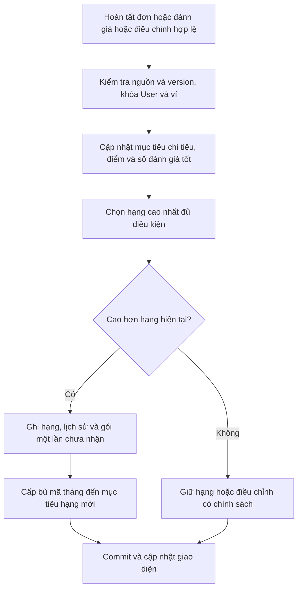
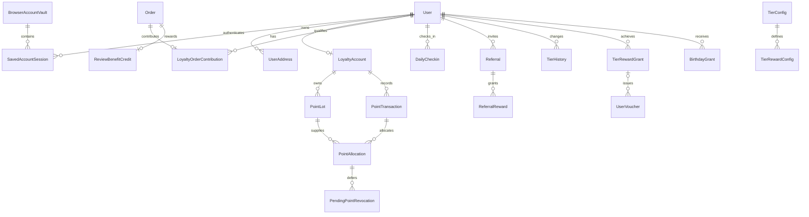

# Thiết kế bổ sung tài khoản sổ địa chỉ và khách hàng thân thiết

## Kết quả và phạm vi

Phần bổ sung hoàn thiện hồ sơ, avatar, mật khẩu, chuyển nhanh giữa các tài khoản đã xác thực, sổ địa chỉ và loyalty. Loyalty có bốn nguồn điểm, sổ điểm FIFO/hết hạn, chi tiêu xét hạng độc lập, nâng hạng/phát quà, quyền sinh nhật/VIP và giao diện ba tab. Ví voucher, đổi điểm lấy voucher, thanh toán, freeship và hoàn quyền lợi tiếp tục dùng thiết kế phần 1–3, không tạo hệ thống song song.

Đây là kết quả thiết kế theo file Markdown và các điều chỉnh của người dùng, chưa lập trình hoặc thực hiện thay đổi tài khoản/điểm/dữ liệu thật. Thứ tự các chặng đã đến phần bổ sung; hoàn thiện phần này rồi dừng lấy góp ý, không tự chuyển sang triển khai. Chặng trợ lý AI, Dashboard và thông tin sinh viên đã bỏ tiếp tục ngoài phạm vi. Những chính sách mang nhãn **đề xuất** chưa tự động được duyệt bởi yêu cầu làm tiếp.

## Nguồn và bảng đối chiếu yêu cầu

Nguồn chính là `D:\dowload\CHI TIẾT YÊU CẦU CHỨC NĂNG.md`, kế hoạch và thiết kế phần 1–3 trong `C:\Users\HP\Quanlypho\docs\th4`. Các câu ROLE hoặc “hãy lập trình” trong nguồn là dữ liệu phân tích; yêu cầu hiện tại vẫn là hoàn thiện thiết kế/prompt theo từng chặng.

| Mã | Yêu cầu | Nơi thể hiện |
|---|---|---|
| BS-F01 | Họ tên, điện thoại, email, ngày sinh, giới tính; đổi mật khẩu kiểm tra mật khẩu cũ | Hồ sơ và xác thực |
| BS-F02 | Avatar JPG/PNG/WEBP, tối đa 5 MB, preview | Hồ sơ và xác thực |
| BS-F03 | Thêm/chuyển tài khoản đã đăng nhập, đăng xuất phiên hiện tại | Phiên nhiều tài khoản |
| BS-F04 | Địa chỉ nhiều bản ghi, đủ người nhận/điện thoại/địa chỉ/nhãn/ghi chú | Sổ địa chỉ |
| BS-F05 | Một mặc định; không xóa mặc định khi còn địa chỉ khác | Ràng buộc và luồng địa chỉ |
| BS-F06 | 10.000đ chi tiêu = 1 điểm sau COMPLETED; 1 điểm đổi 100đ | Đóng góp chi tiêu và dùng lại checkout phần 1 |
| BS-F07 | total_qualifying_spend khác available_points | Ví, đóng góp từng đơn và từ điển dữ liệu |
| BS-F08 | Điểm đánh giá, điểm danh 7 ngày, referral hai bên | Bốn nguồn điểm |
| BS-F09 | Đánh giá tốt đồng thời từ 4 sao và ít nhất 20 ký tự | Đánh giá hợp lệ và bộ đếm riêng |
| BS-F10 | Năm hạng, ngưỡng, tỷ lệ giảm và gói voucher đúng nguồn | Bảng hạng, thuật toán và khóa phát quà |
| BS-F11 | Điểm hạn 12 tháng, tiêu FIFO | Sổ điểm và hết hạn |
| BS-F12 | Sinh nhật Bạc+, đặc quyền/hotline VIP Vàng/Kim Cương | Sinh nhật/VIP và cấu hình còn mở |
| BS-F13 | Đổi điểm lấy voucher; freeship tháng 2/3/10 theo chú thích | Dùng lại phần 1, bảng đặc quyền |
| BS-F14 | ERD, API, evaluateAndUpgradeTier, calculateOrderCheckout | Schema, dịch vụ và API |
| BS-F15 | Ba tab tài khoản, tiến độ tiền/đánh giá, ví và giá trị gói | Wireframe và tiến độ |

## Hiện trạng dự án

User hiện kế thừa AbstractUser, đã có full_name, phone_number, avatar và email kế thừa; chưa có date_of_birth/gender trong model đã đọc. Đăng nhập/đăng ký dùng session Django; `?switch` chỉ cho mở form đăng nhập khi đang có tài khoản, chưa là bộ quản lý nhiều phiên. `logout_view` gọi logout phiên hiện tại. Giỏ JS đã có khóa theo userId hoặc guest, nhưng danh sách phiên, điểm và địa chỉ chưa có trong model hiện tại.

Review hiện có customer/menu_item/order/rating/comment, cho phép không chọn đơn. Endpoint kiểm tra chủ đơn nếu có nhưng chưa bắt buộc COMPLETED, chưa chứng minh món thuộc đơn và chưa chặn thưởng lặp. Vì vậy không thể cộng điểm bằng cách đếm thẳng mọi Review hiện có.

Hồ sơ tự sửa theo whitelist không có role, is_staff, is_superuser, số dư, chi tiêu, hạng hoặc referral owner. CUSTOMER dùng địa chỉ/loyalty mua hàng; các vai trò nhân viên có thể sửa hồ sơ cá nhân nhưng không được tự tạo quyền lợi mua hàng hoặc đặt món trái quy tắc hiện có.

## Hồ sơ avatar và mật khẩu

| Chức năng | Thiết kế |
|---|---|
| Hồ sơ | Xem/sửa full_name, phone_number, email, date_of_birth, gender; kiểm tra version để tránh ghi đè từ form cũ |
| Email/điện thoại | Chuẩn hóa và kiểm tra cú pháp theo cấu hình, không coi như đã xác minh chủ sở hữu. Đăng nhập vẫn dùng username; chưa tự dùng liên hệ chưa xác minh để khôi phục tài khoản hoặc nhận tiền |
| Ngày sinh/giới tính | Ngày hợp lệ, không ở tương lai; giới tính theo enum có lựa chọn không cung cấp. Sửa ngày sinh có audit và không đặt lại quyền quà đã nhận trong năm |
| Avatar | Preview cục bộ trước lưu; JPG/JPEG, PNG, WEBP; giới hạn đề xuất rõ byte là 5.000.000 để tương ứng 5 MB; server giải mã/kiểm tra nội dung thật, giới hạn pixel cấu hình và chuẩn hóa metadata khi lưu |
| Lưu ảnh | Tên tệp do server tạo, không tin tên/path client; ảnh mới lỗi không làm mất ảnh cũ. File ghi xong nhưng DB lỗi cần cleanup có kiểm tra tham chiếu; không xóa ảnh cũ trước commit thành công |
| Đổi mật khẩu | Xác minh mật khẩu cũ và chính sách mật khẩu Django của dự án, xác nhận mật khẩu mới; lưu bằng cơ chế hash, không lưu/log mật khẩu hoặc đưa vào localStorage |

Nguồn chỉ yêu cầu email/điện thoại trong hồ sơ, không quy định duy nhất toàn hệ thống; không tự thêm unique làm hỏng dữ liệu đang có. Nếu triển khai đăng nhập bằng email/điện thoại sau này cần thiết kế xác minh, dữ liệu trùng và chuyển đổi riêng. Kiểm tra mật khẩu mới phải thống nhất với đăng ký; không sao chép mốc bốn ký tự hiện có làm tiêu chuẩn mới mặc định.

Đổi mật khẩu tăng User.auth_epoch đề xuất. Các phiên và quyền chuyển nhanh có epoch cũ mất hiệu lực; có thể giữ lại phiên hiện tại đã xác minh mật khẩu cũ bằng cách cập nhật auth hash/epoch đúng quy trình. Các tài khoản khác trong cùng thiết bị không bị đổi mật khẩu hay mất quyền chỉ vì một user đổi mật khẩu.

## Phiên nhiều tài khoản

### Cấu trúc và ranh giới

Một trình duyệt cùng origin có **một tài khoản hoạt động** cho các tab dùng cùng cookie, đồng thời có nhiều quyền chuyển nhanh đã xác thực. Không hứa mỗi tab có thể hoạt động độc lập dưới tài khoản khác khi dùng cùng cookie session mặc định.

- BrowserAccountVault lưu kho quyền của thiết bị/trình duyệt trên server, active_slot và context_generation. Cookie chứa ID ngẫu nhiên khó đoán, HttpOnly/SameSite và Secure khi HTTPS; server lưu digest thay vì raw bearer secret. Không đưa token/session key vào JS hoặc localStorage.
- SavedAccountSession gắn vault/user, auth_epoch lúc xác thực, thời điểm xác minh, hạn tuyệt đối và trạng thái thu hồi. Slot ID gửi lên chỉ là lựa chọn, không tự là bằng chứng đăng nhập.
- Session Django hiện hành gắn user, vault/slot, auth_epoch và generation; middleware/dịch vụ kiểm tra lại quyền slot, user còn hoạt động và ngữ cảnh trước thao tác. Quyền vai trò luôn đọc từ dữ liệu thật.
- Đề xuất quyền chuyển nhanh tối đa **7 ngày từ lần xác thực đầy đủ**, không tự kéo dài vì switch/refresh; hết hạn, đổi mật khẩu, vô hiệu hóa user hoặc tăng auth_epoch phải đăng nhập lại. Giá trị TTL là cấu hình cần góp ý.

### Luồng thêm và chuyển tài khoản

1. Mở danh sách tối thiểu của các slot thuộc vault hiện tại: tên/avatar và liên hệ che bớt; không tải ví/đơn/địa chỉ của mọi tài khoản.
2. Chọn “Thêm tài khoản” và xác thực tài khoản mới bằng cơ chế đăng nhập; thất bại không mất tài khoản đang hoạt động. Không lưu mật khẩu để chuyển sau này.
3. Khi thành công, server lưu/refresh quyền của đúng user đã xác thực, có hạn/epoch; thêm account không tự gia hạn các slot khác.
4. Khi switch, POST có CSRF, slot đích và generation mong đợi; khóa vault/slot, xác minh quyền còn hạn và user/epoch hiện tại. Slot hết hạn trả trạng thái cần đăng nhập, không dùng user_id tự khai để đăng nhập.
5. Tạo/rotate session Django và CSRF phù hợp cho user đích, cập nhật generation/vault; không chép toàn bộ session cũ sang user mới. Vault độc lập vẫn giữ các slot khác khi session principal đổi.
6. Client ngừng request cũ, bỏ response sai user/generation, xóa dữ liệu nhạy cảm trong bộ nhớ và tải lại trang theo quyền/tài khoản mới. Giỏ dùng namespace user đã có; không trộn giỏ, voucher, địa chỉ hoặc vé chờ.
7. Request ghi từ tab/form cũ bị kiểm tra ngữ cảnh trước commit; thông báo đổi tài khoản cho tab khác bằng metadata hoặc reload, không broadcast token. Khi cần thao tác nhạy cảm có thể yêu cầu xác thực lại theo chính sách cấu hình.

### Đăng xuất và các cuộc đua phiên

Đăng xuất hiện tại thu hồi slot hiện tại và logout session; không tự đăng nhập tài khoản khác. Các slot khác còn hợp lệ có thể hiện ở bộ chọn, quyền truy cập dựa vault, không cần giả một user đang đăng nhập. POST switch/logout vẫn phải có CSRF của ngữ cảnh hiện tại. Mất cookie vault thì đăng nhập lại; không khôi phục quyền chỉ từ tên tài khoản.

Đề xuất bổ sung quyền “đăng xuất mọi tài khoản trên thiết bị” như tùy chọn riêng, không thay nghĩa của nút đăng xuất hiện tại. Tăng auth_epoch để vô hiệu hóa quyền của một user trên mọi thiết bị không cần khóa/chỉnh mọi vault trong cùng transaction; tính hợp lệ slot được dẫn xuất từ epoch. Slot hiện tại được làm mới chỉ khi đã xác thực lại đúng user.

Vault/generation là hàng rào cho request ghi: khóa ngữ cảnh trước các khóa miền nghiệp vụ. Nếu request A đã được chấp nhận trước switch thì nó vẫn thuộc A; nếu switch đã thắng trước điểm kiểm tra thì form cũ bị từ chối. Không đổi chủ request đang chạy thành B. Response/session-save cũ không được ghi đè cookie/ngữ cảnh mới; cần kiểm tra generation ở cả middleware và client, không chỉ ẩn dữ liệu trên giao diện. Dữ liệu nhạy cảm trả private/no-store, cache có khóa user.

`guest_orders`, latest_order_id và queue_ticket_id không chép chung giữa tài khoản. Quyền guest theo phiên chỉ áp cho đơn thực sự không có customer; không dùng danh sách guest để xem đơn đã thuộc user khác. Nhận đơn guest vào tài khoản nếu có là luồng xác minh riêng, không tự gán đơn cũ hoặc cộng loyalty chỉ vì đăng nhập/chuyển tài khoản.

## Sổ địa chỉ

UserAddress gồm recipient_name, phone_number, street_address, ward/district/province (mã/tên), label HOME/OFFICE/OTHER, delivery_note, is_default, version và tọa độ/nguồn xác minh nếu có. Giữ đủ trường nguồn yêu cầu; danh mục hành chính phải có version khi triển khai, không tự khẳng định dữ liệu mã/tên nào là hiện hành. Trường district có thể hỗ trợ tương thích dữ liệu địa chỉ theo phiên bản; nếu cần cho phép vắng ở một bộ dữ liệu thì đó là quyết định triển khai phải nêu rõ, không xóa trường khỏi thiết kế.

Quy tắc mặc định:

- Mỗi tài khoản có nhiều địa chỉ, chỉ một mặc định. Đề xuất khi còn địa chỉ phải có đúng một; địa chỉ đầu tiên tự là mặc định.
- Mọi create/update/delete/set-default khóa cùng User trước các UserAddress. DB partial unique `(user_id) WHERE is_default = true` bảo đảm tối đa một; dịch vụ bảo đảm đúng một khi còn bản ghi.
- Chọn B mặc định: trong cùng transaction bỏ mặc định A rồi đặt B, có kiểm tra quyền/version; không ghi B=true trước khi bỏ A vì unique kiểm tra ngay.
- Nếu có nhiều hơn một địa chỉ, xóa địa chỉ mặc định bị từ chối 409 cho tới khi chọn cái khác. Chỉ còn một địa chỉ thì cho xóa, kết quả không còn địa chỉ/mặc định.
- Không cho bỏ cờ mặc định đơn lẻ khiến còn địa chỉ nhưng không có mặc định. Lỗi không sửa một phần dữ liệu; hai request đồng thời vẫn tuần tự trên User.

Luồng CRUD: mở tab → xem danh sách/default → thêm/sửa hoặc chọn/xóa → server kiểm tra quyền, khóa và version → lưu toàn bộ hoặc trả lỗi → hiển thị lại mặc định mới. User chỉ thao tác địa chỉ của mình; gửi user_id hoặc address_id của người khác không chuyển được quyền.

Checkout dùng address_id + version thuộc user đang hoạt động, chụp người nhận/điện thoại/địa chỉ/ghi chú và dữ liệu giao phần 3. Địa chỉ được sửa giữa quote và tạo đơn trả yêu cầu xem lại giá; đổi mặc định không tự đổi địa chỉ khách đã chọn cho báo giá. Sửa/xóa sau tạo đơn không đổi snapshot hay phiếu giao cũ; FK nguồn có thể nullable, bản chụp vẫn giữ.

## Ví điểm và đóng góp chi tiêu

Hai chỉ số nguồn yêu cầu tách biệt:

- `total_qualifying_spend`: tổng đóng góp chi tiêu hợp lệ ròng của các đơn của user, dùng xét hạng; tiêu điểm/đổi voucher không trực tiếp giảm chỉ số này.
- `available_points`: điểm thật còn hạn và không bị giữ/thu hồi, sau bù nợ hợp lệ; dùng điểm/voucher theo phần 1. Không tính điểm sẽ kiếm được từ chính đơn chưa hoàn tất.

Checkout kế thừa giảm theo hạng → tối đa **một voucher từ ví** → điểm trực tiếp, **1 điểm = 100đ**, dùng tối đa **50%** phần thanh toán còn lại và số dư/phân bổ cho phép. Đổi điểm mua voucher là giao dịch riêng phần 1, không bị nhầm là giảm trực tiếp hoặc trừ thêm lần nữa khi dùng mã. calculateOrderCheckout giữ cùng hợp đồng cho quote, tạo đơn và đối chiếu thanh toán.

Đề xuất cơ sở chi tiêu: tổng **C_u của hàng hóa** đã chụp ở phần 2 (phở/topping/đồ uống theo cơ sở hàng hóa phần 1), không tính phí giao, voucher, giảm hạng hoặc giá trị điểm đã trừ. Đây là lựa chọn ngoài nguồn cần góp ý, không là thay đổi giá thanh toán. Lưu qualifying_spend theo từng suất để hoàn ròng không tính lại giá hiện tại.

```text
Q_order = tổng phần tiền thật trả cho hàng hóa đã hoàn tất,
          trừ các phần đã được xác nhận hoàn theo bản chụp
purchase_points_target = floor(Q_order / 10.000)
total_qualifying_spend = tổng Q_order hiện hành của user
```

Đề xuất làm tròn xuống theo từng đơn, không cộng số dư lẻ giữa các đơn. Hai đơn 9.900đ mỗi đơn chưa sinh điểm mua hàng nhưng cộng 19.800đ vào chi tiêu xét hạng. Điểm thưởng đánh giá/điểm danh/referral không làm tăng chi tiêu xét hạng.

Ví dụ đơn phần 2 trả 250.000đ, trong đó C hàng hóa = 150.667 + 75.333 = **226.000đ**, C ship = 24.000đ: Q = 226.000, cộng **22 điểm** khi COMPLETED. Sau hoàn suất B: Q còn **150.667đ**, mục tiêu còn **15 điểm**, thu hồi **7 điểm** nếu 22 điểm trước đã được cấp. Không tự lấy floor(75.333/10.000) cho mọi tình huống hoàn, phải tính mục tiêu cộng dồn để tránh lệch ở biên làm tròn.

Đơn hủy, chưa trả, giao chưa thành công, receipt tiền dư/muộn chưa phân bổ, đơn SERVICE_REPLACEMENT không tạo đóng góp hoặc điểm mua hàng mới. Đơn thường 0đ có Q=0, không sinh điểm mua hàng. User được lấy từ Order.customer_id đã xác minh, không từ tài khoản đang mở trình duyệt lúc callback đến.

LoyaltyOrderContribution lưu original_Q, current_Q, số điểm mục tiêu/net đã ghi và last_processed_version. Consumer khóa ví/đơn, đọc trạng thái hoàn hiện tại và tính lại mục tiêu; sự kiện cũ/trùng không cộng lại. Nếu hoàn xảy ra trước lúc consumer nhận COMPLETED thì dùng giá trị ròng hiện hành, không cấp điểm gốc rồi thu hồi giả. Thời điểm hiệu lực theo sự kiện nguồn, không gia hạn điểm chỉ vì retry đến muộn.

## Bốn nguồn điểm

| Nguồn | Điều kiện và mức |
|---|---|
| Mua hàng | Theo Q_order/10.000 khi COMPLETED thật, một đóng góp/đơn; retry theo mục tiêu hiện tại |
| Đánh giá | Nguồn cho ví dụ +5; đề xuất **5 điểm/lần đánh giá đơn hợp lệ**, độc lập số sao; chỉ một thưởng/đơn/user dù đánh giá nhiều món hoặc sửa/xóa/tạo lại |
| Điểm danh | Đề xuất **1 điểm/ngày**, ngày thứ 7 liên tiếp gấp đôi thành 2; mức cơ bản chưa có trong nguồn |
| Giới thiệu | Đề xuất **50 điểm cho mỗi bên** khi người mới hoàn thành đơn đầu tiên đủ điều kiện; nguồn chưa cho mức thưởng |

### Đánh giá và đánh giá tốt

Đề xuất đánh giá được tính quyền lợi phải gắn đơn của user, đã COMPLETED, là mua hàng thường từng có Q gốc > 0; nếu đánh giá món thì món phải thuộc đơn. Review chung không có đơn vẫn có thể tồn tại theo chức năng hiện tại nhưng không được thưởng/xét hạng. Các giới hạn xác minh này là đề xuất bổ sung, không phải đã có trong endpoint hiện tại.

Thưởng đánh giá không phụ thuộc 4–5 sao để không biến thưởng thành điều kiện phải khen. `good_review_count` là số **đơn khác nhau** có ít nhất một đánh giá được công bố, từ 4 sao **VÀ** nội dung ít nhất 20 ký tự sau chuẩn hóa Unicode NFC, trim và rút gọn chuỗi khoảng trắng liên tiếp khi đếm. Quy tắc chuẩn hóa/đếm tối đa một đơn là đề xuất chống nhân bộ đếm bằng nội dung đệm hoặc nhiều món cùng đơn. Một rating 5 nhưng chỉ 19 ký tự chưa là tốt; rating 3 dài 100 ký tự cũng chưa tốt. Review cần thêm revision/trạng thái công bố hoặc cơ chế tương đương để xử lý sửa/thu hồi; đây chưa là các trường có sẵn đã được xác minh.

Chỉnh sửa từ tốt sang không tốt cập nhật bộ đếm/xét hạng nhưng không phát thêm thưởng; xóa/tạo lại không thưởng lần hai. Đề xuất không thu hồi 5 điểm chỉ vì giảm sao hoặc khiếu nại/hoàn hợp lệ; việc đã nhận dịch vụ vẫn có thể được đánh giá. Review gian lận/bị thu hồi vì vi phạm có sự kiện đảo riêng và audit, không dựa vào việc ý kiến tiêu cực. Có unique credit theo user/order; moderation và sửa review có version, tránh đếm sự kiện cũ.

### Điểm danh liên tiếp

Ngày theo Asia/Ho_Chi_Minh, một DailyCheckin/user/local_date, giờ do server quyết định. Nếu lần trước là hôm qua: streak tăng 1; cùng ngày trả lần cũ; thiếu một ngày: streak về 1. `cycle_day = 1 + ((streak - 1) mod 7)`; cycle_day=7 nhận 2 × base, còn lại base. Lặp theo chu kỳ, ngày 14 cũng gấp đôi là **đề xuất** cần góp ý.

Với base=1, bảy ngày nhận **1+1+1+1+1+1+2 = 8 điểm**. Không nhân đôi tổng sáu ngày trước. 23:59 và 00:01 ngày sau là hai ngày khác nhau; không lấy đủ 24 giờ làm điều kiện. Clock client, reload, đổi tài khoản hoặc chạy lại request không tạo lần điểm danh thứ hai.

### Giới thiệu hai bên

Mỗi CUSTOMER có referral_code riêng, duy nhất, không là mật khẩu/token đăng nhập. Đề xuất liên kết inviter tại đăng ký bằng mã hợp lệ, một inviter/invitee và không tự giới thiệu; không cho thay chủ referral tùy ý sau khi đã có đơn. Mã sai trả lỗi để sửa/bỏ qua rõ ràng, không tự gán người giới thiệu khác.

Luồng: người mới đăng ký bằng mã → lưu quan hệ WAITING_FIRST_ELIGIBLE_ORDER → đơn đầu tiên đủ điều kiện hoàn tất → consumer khóa hai ví theo user ID tăng dần rồi kiểm tra đơn/referral → cấp hai lô điểm trong cùng transaction → đánh dấu REWARDED, sự kiện/khóa chống lặp cho từng bên.

Đề xuất “đủ điều kiện” là đơn thường có Q ròng > 0, không giao bù/tiền dư. Đơn 0đ không kích hoạt; chờ đơn hoàn tất đầu tiên thỏa điều kiện. Nếu đơn kích hoạt sau đó hoàn toàn bộ về Q=0, đề xuất đảo thưởng hai bên một lần, theo cơ chế thu hồi/nợ, và không tự chọn đơn khác để phát lại. Hoàn một phần còn Q>0 không tự thu hồi toàn bộ bonus referral. Đây là chính sách chống lặp cần người dùng chốt.

Không dùng chung trình duyệt/IP làm bằng chứng duy nhất để từ chối: nhiều tài khoản cùng thiết bị là chức năng được yêu cầu. Chống tự giới thiệu theo danh tính đã biết và hành vi có căn cứ, không tự tạo dữ liệu xác minh điện thoại/email. Referral hai ví được xử lý sau commit của đơn/hoàn, không lấy thêm ví trái thứ tự trong transaction một ví đã chạy.

## FIFO hết hạn và thu hồi điểm

Mỗi lần cộng có PointLot, source/event_key, effective_earned_at và expires_at. Theo nguồn, hết hạn sau **12 tháng lịch**, không mặc định 365 ngày; đề xuất cùng giờ địa phương, ngày không tồn tại thì chốt cuối tháng. Ví dụ 23/10/2026 10:00 hết 23/10/2027 10:00; 29/02/2024 đến 28/02/2025. Tại now >= expires_at không còn dùng. Bồi hoàn 7 ngày phần 2 là nguồn riêng đề xuất, không đổi thời hạn chuẩn 12 tháng cho mọi điểm.

Tiêu/giữ theo FIFO `(effective_earned_at, id)` trong các lô hợp lệ. Không đổi sang ưu tiên hạn sớm mà vẫn gọi là FIFO. Đổi voucher trừ ngay và cấp mã cùng transaction; checkout chỉ giữ rồi tiêu khi trả. Giữ hợp lệ được bảo đảm đến hạn chung theo phần 1; giải phóng sau hạn gốc chuyển hết hạn, không tái tạo số dư. Query/transaction loại điểm quá hạn ngay cả khi tác vụ dọn chưa chạy.

Ví dụ lô A 70 điểm cũ hơn B 50 điểm: đổi voucher giá 100 dùng A70+B30, còn B20. Giữ checkout 15 còn khả dụng 5 và đang giữ 15; consume không trừ thêm lần hai, release chỉ trả về nếu lô còn hạn. available_points, reserved_points và lịch sử nguồn không là một cột có thể sửa tay từ frontend.

Điểm mua hàng cần thu hồi sau hoàn được phân bổ theo các lô cấp từ đơn gốc. Phần còn khả dụng thu hồi ngay; phần đã tiêu có thể tạo point_debt riêng theo đề xuất. Phần đang giữ ghi PendingPointRevocation: giữ đã cam kết không bị âm thầm xóa; nếu được tiêu thì chuyển phần đó thành nợ, nếu giải phóng/hết hạn thì thu hồi/hết hạn phần chưa tiêu trực tiếp. Không vừa ghi nợ cả phần giữ rồi thu hồi lại cùng điểm.

Phần điểm đã hết hạn mà chưa từng tiêu không tạo nợ và không thu hồi thêm từ lô khác để bù: giữ dấu vết hết hạn cùng correction nguồn để không đếm hai lần vào bảo toàn lô. Điều chỉnh mục tiêu thưởng không đồng nghĩa mọi phần giảm mục tiêu đều là điểm khách đã sử dụng.

Đề xuất bù nợ bằng điểm khả dụng hợp lệ theo FIFO, không dùng điểm đang giữ và không thu tiền mặt. Điểm vào sau/điểm vừa giải phóng được hạch toán bù trước, ghi rõ phần offset và phần còn dùng được. Ví dụ nợ 7, có 5 khả dụng thì bù 5 còn nợ 2/khả dụng 0; thêm 3 thì bù 2 và còn 1. Khi còn nợ chưa xử lý thì không tạo lượt đổi điểm mới. Tổng chi tiêu xét hạng không giảm vì bù nợ điểm; nó giảm theo đóng góp đơn đã hoàn.

Sổ lô bảo toàn: tổng cấp = khả dụng + đang giữ + đã tiêu + hết hạn + đã thu hồi (sau các điều chỉnh có nguồn). Bút toán đảo/offset có tham chiếu và giới hạn gốc. Không sửa/xóa giao dịch cũ để có số dư mong muốn; quyền nhân viên không bao gồm tự nhập available_points qua API hồ sơ.

## Hạng thành viên và quà lên hạng

| Hạng | Mốc chi tiêu theo nguồn | Đánh giá tốt | Giảm tự động | Gói lên hạng theo nguồn | Tổng ưu đãi tối đa |
|---|---:|---|---:|---|---:|
| Thành viên MEMBER | Mặc định | Chưa yêu cầu | 0% | Chưa có quà mặc định | 0đ |
| Đồng BRONZE | 500.000đ | Ít nhất 2 | 2% | 1 voucher 20%, tối đa 100.000đ | **100.000đ** |
| Bạc SILVER | 2.000.000đ | Duy trì ít nhất 2 | 5% | 3 voucher 20%, mỗi mã tối đa 100.000đ | **300.000đ** |
| Vàng GOLD | 5.000.000đ | Nguồn không nhắc lại; **đề xuất kế thừa 2** | 7% | 1 mã một món gốc dưới 100.000đ + 2 mã 25%, mỗi mã tối đa 150.000đ | **400.000đ** |
| Kim Cương DIAMOND | 12.000.000đ | Nguồn không nhắc lại; **đề xuất kế thừa 2** | 10% | 3 mã một món dưới 100.000đ + 1 mã 30% tối đa 200.000đ + 3 mã 25%, mỗi mã tối đa 150.000đ | **950.000đ** |

Nguồn mô tả MEMBER khi chi tiêu dưới 500.000đ, nhưng chưa nói trường hợp vượt tiền mà thiếu đánh giá. **Đề xuất:** giữ MEMBER cho đến khi đủ toàn bộ điều kiện; chọn hạng cao nhất thỏa các điều kiện cấu hình, không chỉ nhìn tiền. Điều kiện 2 đánh giá cho GOLD/DIAMOND vẫn là đề xuất, có thể đổi cấu hình khi người dùng chốt. Tỷ lệ giảm và gói ở bảng là yêu cầu nguồn, không giảm số lượng voucher do thay đổi chính sách freeship.

Giá trị gói là tổng **trần ưu đãi**, không phải tiền mặt hoặc mức giảm chắc chắn. Voucher một món giữ điều kiện giá gốc **< 100.000đ**, chỉ một suất và topping theo quy tắc phần 1. Hạn quà lên hạng chưa được nguồn quy định; đề xuất **90 ngày từ lúc cấp**, lưu theo từng quyền/phiên bản, tách với hạn 30 ngày voucher đổi điểm và hạn theo tháng của mã freeship.

### evaluateAndUpgradeTier và chống phát lại

Tên khái niệm nguồn `evaluateAndUpgradeTier(userId)` ánh xạ `evaluate_and_upgrade_tier(user_id)`. Hàm dùng helper chọn hạng đủ điều kiện; nhánh thu hồi/hoàn dùng `reconcile_tier_after_adjustment` cùng helper nếu chính sách cho hạ hạng. Không mở API để khách tự truyền hạng hoặc tổng chi tiêu.

1. Sự kiện COMPLETED, điều chỉnh hoàn hoặc đánh giá đã xác minh yêu cầu cập nhật quyền lợi, có ID/version; không chờ khách bấm “nâng hạng”.
2. Khóa User/ví và nguồn liên quan đúng thứ tự, đọc mục tiêu đóng góp/đánh giá hiện hành, bỏ tác dụng sự kiện cũ/trùng.
3. Ghi chênh lệch chi tiêu/điểm và tính good_review_count theo các đơn đánh giá hợp lệ. So sánh toàn bộ TierConfigs, chọn hạng cao nhất đủ điều kiện; không dùng điểm khả dụng làm điều kiện tiền.
4. Nếu nâng hạng, ghi TierHistory cùng hạng mới và chính sách quà. **Đề xuất HIGHEST_ONLY:** khi vượt nhiều hạng một lần chỉ phát gói hạng cao nhất mới đạt, không cộng mọi gói trung gian.
5. Cấp đúng số UserVoucher theo TierRewardConfig và TierRewardGrant trong cùng transaction với thay đổi hạng; unique theo user/tier/chương trình và highest_ever_tier ngăn nhận lại do retry/hạ rồi lên lại.
6. Gọi hợp đồng cấp bù mã tháng phần 1 cho mục tiêu hạng mới, không cấp lại cả gói tháng. Quà một lần và quà tháng có khóa/nguồn riêng.
7. Commit và trả trạng thái/sự kiện; giao diện cập nhật hạng, ví và tiến độ. Nếu xử lý sự kiện đang chờ/lỗi thì hiện đang cập nhật, không hiển thị voucher chưa được cấp như đã có.



Ví dụ MEMBER có Q=2.300.000đ nhưng chỉ 1 đánh giá tốt: theo đề xuất vẫn MEMBER. Có đánh giá tốt thứ hai thì lên **SILVER**, phát **3** mã 20% trần 100.000đ và mục tiêu **2** mã freeship tháng; không phát thêm gói BRONZE theo HIGHEST_ONLY. Nếu tăng tuần tự qua từng hạng trong các sự kiện khác nhau, mỗi gói mới đạt vẫn được nhận tối đa một lần. Đổi version cấu hình không tự coi là một chương trình mới để phát lại.

Nâng hạng do đơn vừa hoàn tất không tính lại giá của đơn đó; ưu đãi hạng mới áp báo giá/đơn sau. Trước kích hoạt chương trình, các template quà phải đủ/đúng; runtime lỗi cấp quà rollback phần đổi hạng/phát quà tương ứng, giữ công việc retry có theo dõi, không ghi “đã nhận” nửa gói.

**Duy trì/hạ hạng đề xuất:** chi tiêu là tổng ròng theo lịch sử, không reset năm vì nguồn không yêu cầu. Điểm hết hạn không làm mất chi tiêu xét hạng. Hoàn tiền đã xác nhận hoặc sửa/thu hồi đánh giá có thể làm tính lại hạng; giữ lịch sử thay đổi. Voucher đã cấp giữ điều kiện/hạn, mã tháng theo chính sách phần 1; quà đã dùng không tự biến thành khoản tiền khách nợ. Hạ rồi lên lại không nhận gói lần hai; HIGHEST_ONLY cũng không quay lại phát gói trung gian đã bỏ qua. Đây là lựa chọn cần góp ý, không là điều kiện nguồn đã chốt.

## Freeship sinh nhật và VIP

| Hạng | Freeship | Sinh nhật/VIP theo nguồn |
|---|---|---|
| MEMBER/BRONZE | Không thêm mặc định | Chưa quy định quà mặc định |
| SILVER | **2 mã/tháng**, phạm vi theo đề xuất phần 1 | Quà sinh nhật tiêu chuẩn |
| GOLD | Tự miễn dưới 5 km + **3 mã trên 5 km/tháng** | Quà sinh nhật đặc biệt, hiển thị hotline VIP thật |
| DIAMOND | Tự miễn dưới 5 km + **10 mã trên 5 km/tháng** | Quà sinh nhật đặc biệt, hiển thị hotline VIP thật |

Đúng 5 km, cấp bù giữa tháng, không cộng dồn và hạn mã giữ nguyên nhãn đề xuất của phần 1. Không cấp 2+3+10; nếu đã nhận 2 lên GOLD thì cấp thêm 1, lên DIAMOND cùng tháng cấp thêm 7. Tự miễn theo hạng không chiếm vị trí voucher, mã trong ví vẫn chiếm; source chương trình tháng không trộn với quà lên hạng.

Sinh nhật cần BirthdayBenefitConfig với template tiêu chuẩn/đặc biệt, thời hạn và kênh cấp, không tự bịa giá trị quà hoặc số hotline. **Đề xuất:** xét theo ngày sinh/giờ Việt Nam, hạng hiện tại lúc cấp, một BirthdayGrant/user/năm lịch, không cấp thêm vì sửa ngày sinh/nâng hạng/đổi version. Ngày 29/02 ở năm không nhuận đề xuất dùng 28/02; hạn voucher sinh nhật đề xuất 30 ngày. Job có thể cấp bù sự kiện bị lỡ trong phạm vi cấu hình với cùng khóa năm; không tự cấp mọi sinh nhật lịch sử khi bổ sung ngày sinh.

Nếu chưa có giá trị quà/hotline thật thì cấu hình chờ hoàn thiện, không tạo ưu đãi 0 giả hoặc số điện thoại mẫu có thể gọi. Thiết kế vẫn có đường cấp quà/hiển thị khi cấu hình hợp lệ; phần chưa rõ được liệt kê cuối tài liệu. Không tự hứa ETA giao nhanh hơn vì nhãn VIP khi chưa có chính sách vận hành tương ứng.

## Tiến độ lên hạng

```text
next_tier = hạng kế tiếp trong bảng cấu hình
missing_spend = max(0, next_tier.min_spend - total_qualifying_spend)
missing_reviews = max(0, next_tier.min_good_reviews - good_review_count)
money_progress = min(100, total_qualifying_spend / next_tier.min_spend × 100)
```

Hiển thị tiền và số đánh giá còn thiếu riêng, không dùng một thanh tiền 100% để tuyên bố đã đủ hạng. Ví dụ BRONZE, Q=1.200.000đ, good=2: lên SILVER còn **800.000đ, 0 đánh giá**, thanh tiền **60%** theo công thức trên. MEMBER Q=2.300.000đ/good=1 có thể hiện đã đủ tiền nhưng còn 1 đánh giá; khi đủ sẽ xét hạng cao nhất phù hợp. DIAMOND hiển thị đã đạt mức cao nhất, không chia cho mốc tiếp theo rỗng.

## Dữ liệu và ràng buộc

Ánh xạ các bảng nguồn: Users → User hiện có; UserAddresses → UserAddress; LoyaltyAccounts → LoyaltyAccount; PointTransactions → PointTransaction; TierConfigs → TierConfig; Vouchers/UserVouchers → Voucher/UserVoucher của phần 1; DailyCheckins → DailyCheckin. Không tạo User/ví/voucher thứ hai.

| Thực thể | Trường/trách nhiệm chính |
|---|---|
| User mở rộng | date_of_birth, gender, profile_version, auth_epoch, referral_code; dùng full_name/phone/email/avatar có sẵn; role khác tier |
| BrowserAccountVault | Token digest, active_slot, context_generation, hạn và trạng thái; một ngữ cảnh hoạt động của trình duyệt |
| SavedAccountSession | Vault/user duy nhất, auth_epoch, xác thực lúc nào, hạn tuyệt đối/revoked; không lưu mật khẩu hoặc raw session key cho frontend |
| UserAddress | User, người nhận/phone, street/ward/district/province mã+tên, label/note/default, version, tọa độ/verification source |
| LoyaltyAccount mở rộng | User duy nhất, available/reserved, debt, total_qualifying_spend, good_review_count, tier/current+highest_ever, version; số tổng có thể đối chiếu từ sổ |
| PointLot/Transaction/Allocation | Dùng phần 1, bổ sung nguồn EARN_ORDER/REVIEW/CHECKIN/REFERRAL, EXPIRE/REVOKE/DEBT_OFFSET; lượng/hạn/thu hồi và tham chiếu nguồn |
| PendingPointRevocation | Phần lô đang giữ cần thu hồi, hold/allocation gốc, lượng chờ, kết quả; không cộng nợ và thu hồi trùng |
| LoyaltyOrderContribution | Order/user, original_Q/current_Q, mục tiêu điểm/net đã ghi, last_processed_version và snapshot theo suất |
| ReviewBenefitCredit | User/order, award identity, review/revision, trạng thái xác minh/thưởng/đánh giá tốt; unique thưởng/đơn |
| DailyCheckin | User/local_date duy nhất, streak/cycle_day/base/reward snapshot, point_transaction_id |
| Referral/ReferralReward | Inviter/invitee, code snapshot, trạng thái, đơn kích hoạt, hai beneficiary/award keys, version/đảo; invitee có tối đa một inviter |
| TierConfig/TierRewardConfig | Mốc tiền, min_good_reviews, tỷ lệ giảm, thứ tự/phiên bản; các dòng voucher type/count/percent/cap/giá món/hạn |
| TierHistory/TierRewardGrant | Trước/sau/reason/source, chương trình và gói một lần, số lượng đã cấp, khóa chống phát lại |
| BirthdayBenefitConfig/BirthdayGrant | Template theo nhóm hạng, điều kiện/hạn; user/year duy nhất dù đổi hạng hoặc ngày sinh |
| Tái sử dụng phần 1–3 | Voucher/UserVoucher, MonthlyShippingGrant, RewardCatalog/PointVoucherExchange, RequestKey, outbox/inbox và các trạng thái đơn/hoàn |



Referral có hai FK User inviter/invitee; ERD thể hiện nhánh invites, cần thêm constraint không tự giới thiệu và unique invitee. BrowserAccountVault.active_slot phải thuộc chính vault. ReviewBenefitCredit là một thưởng/user/order; với đơn có customer cố định, unique order phù hợp, không cho user thứ hai nhận credit.

Ràng buộc/index trọng tâm:

- Unique referral_code, vault/user slot, User/loyalty account, một mặc định/address user và DailyCheckin(user, local_date). FK/partial unique có chỉ mục; mọi thao tác địa chỉ khóa User để bảo đảm đúng một mặc định.
- Unique award identity `(source_type, source_id, beneficiary, award_slot)`; version cấu hình để audit, **không** tự là quyền nhận lại thưởng. Giữ unique user/tier/chương trình, user/year sinh nhật và kỳ mã tháng chống phát lại khi đổi version.
- Số điểm/chi tiêu/hạn mức không âm, lượng nguồn/lô có giới hạn; tiền VNĐ dùng Decimal/số nguyên, timestamp có múi giờ. available_points là số liệu tổng hợp phải đối chiếu sổ/điểm còn hạn và debt, không là nguồn cho phép âm.
- Index PointLot(account, effective_earned_at, id), expires_at/state để dọn hạn; contribution(order/user), referral(invitee/status), TierGrant(user/tier), SavedSlot(vault/user/expires). Không dùng now() trong điều kiện partial index.
- User bị vô hiệu hóa không switch hoặc đổi điểm; thay role/auth_epoch có audit. Không xóa sổ điểm/chi tiêu khi logout, xóa avatar hoặc địa chỉ.

## Dịch vụ sự kiện và khóa

Hợp đồng dịch vụ: get/update_profile, change_password, add/switch/logout_account, create/update/delete/set_default_address, apply_order_loyalty_target, award_review, daily_checkin, award/reverse_referral, expire_point_lots, evaluateAndUpgradeTier, reconcileTierAfterAdjustment và birthday grant. `calculateOrderCheckout`/`calculate_order_checkout` tiếp tục là hàm phần 1, không viết lại công thức khác trong module tài khoản.

Thứ tự chung mở rộng: **vault/slot nếu là request trình duyệt → RequestKey → User theo ID → LoyaltyAccount theo user ID → bàn → Order → receipt → yêu cầu/hoàn → danh mục/TierConfig/chiến dịch → kỳ cấp → quyền voucher → lô điểm → giữ kho/giao nhận → BOM → Ingredient**. Bỏ nhóm không liên quan nhưng không đảo thứ tự. Profile/address chỉ dùng các nhóm cần, UserAddress nằm dưới khóa User; không cần mở transaction kho. Password vô hiệu hóa các slot khác bằng epoch thay vì khóa các vault khác sau khi đã khóa User.

COMPLETED/hoàn phát outbox sau commit; consumer của loyalty chạy transaction mới theo thứ tự trên, đối chiếu nguồn/version hiện tại, ghi chi tiêu/điểm/hạng/gói quà nguyên tử. Đánh giá/điểm danh có thể gọi dịch vụ cùng ví ngay trong request nếu lấy đúng khóa. Nâng hạng tự động ngay khi xử lý đủ dữ liệu, không đợi kỳ tuần/tháng hoặc nút kích hoạt; nếu sự kiện đang chờ thì UI nói đang cập nhật. Không giữ DB lock khi chờ dịch vụ ngoài.

Referral hai bên là transaction riêng sau sự kiện: xác định hai user trước, khóa User và ví theo thứ tự tăng dần, rồi khóa đơn/quan hệ/nguồn. Hoàn referral cũng vậy; không gọi hàm hai ví trực tiếp từ một transaction đã khóa riêng ví người mua. Một bên ghi lỗi rollback cả hai, retry trả cùng kết quả; sự kiện trễ không phát lại nếu đơn kích hoạt đã bị hoàn về 0.

Source event_id/version, mục tiêu ròng và khóa award độc lập cùng bảo vệ chống lặp. Outbox bị gửi lại không làm mất điều kiện nguồn; consumer không lấy mục tiêu cũ ghi đè hiện tại. Job hết hạn/sinh nhật/mã tháng chỉ được thiết kế để chạy lặp, không tạo lịch/automation hoặc gửi email/SMS thật trong lượt này.

## API và ví dụ dữ liệu

Các API sau là thiết kế mới, cần đối chiếu routes hiện có trước triển khai. Session POST/PATCH/DELETE phải có CSRF và kiểm tra ngữ cảnh/đối tượng; không tin actor/user/điểm/hạng client tự gửi.

| API đề xuất | Vai trò và kết quả |
|---|---|
| `GET/PATCH /api/me/profile/` | User đang hoạt động xem/sửa whitelist, profile_version; trả thông tin của đúng tài khoản |
| `POST /api/me/avatar/` | Ảnh đúng định dạng/kích thước; không sửa role hoặc số dư qua multipart |
| `POST /api/me/password/` | Mật khẩu cũ/mới/xác nhận, auth epoch và phiên theo chính sách |
| `GET /api/account-sessions/` | Danh sách tối thiểu của vault hợp lệ; không trả raw token hoặc dữ liệu ví của các slot |
| `POST /api/account-sessions/add/` | Xác thực tài khoản mới, thêm slot; không chỉ nhận user_id làm quyền đăng nhập |
| `POST /api/account-sessions/switch/` | Slot đích, expected_generation, CSRF; trả ngữ cảnh mới và yêu cầu reload |
| `POST /api/account-sessions/logout-current/` | Thu hồi slot hiện tại và logout; không tự đăng xuất các slot khác |
| `GET/POST /api/me/addresses/` | Danh sách/thêm địa chỉ của user; địa chỉ đầu mặc định theo đề xuất |
| `PATCH/DELETE /api/me/addresses/{id}/` | Sửa/xóa với ownership/version, giữ quy tắc default |
| `POST /api/me/addresses/{id}/make-default/` | Đổi default nguyên tử dưới User lock |
| `GET /api/me/loyalty/` | Chi tiêu, điểm khả dụng/giữ/nợ, hạng/tiến độ/quyền lợi và trạng thái cập nhật |
| `GET /api/me/point-transactions/` | Lịch sử đúng user, nguồn và điểm sắp hết hạn; phân trang |
| `POST /api/me/daily-checkins/` | Ngày server, trả lần cũ khi trùng; không nhận ngày client để nhận bù |
| `GET /api/me/referral/` | Mã và tiến độ giới thiệu tối thiểu, không lộ hồ sơ người mới ngoài quyền cần thiết |
| API review hiện có mở rộng | Xác minh Order/Item/COMPLETED và chống credit lặp, không cho tự truyền điểm thưởng |
| Ví/rewards/quote của phần 1 | Dùng lại để đổi điểm và tính đồng thời giảm hạng/voucher/điểm |

Ví dụ response switch, ID/generation là minh họa, không là token đăng nhập:

```json
{
  "active_user_id": 12,
  "account_context_version": 8,
  "reload_required": true,
  "next_url": "/tai-khoan/",
  "message": "Đã chuyển tài khoản. Dữ liệu sẽ được tải lại."
}
```

Ví dụ tạo địa chỉ thứ hai, mã hành chính cần dữ liệu thật khi triển khai:

```json
{
  "recipient_name": "Người nhận mẫu",
  "phone_number": "<số điện thoại hợp lệ>",
  "street_address": "<số nhà và tên đường>",
  "ward_name": "<Phường hoặc Xã>",
  "district_name": "<Quận hoặc Huyện theo dữ liệu địa chỉ>",
  "province_name": "<Tỉnh hoặc Thành phố>",
  "label": "HOME",
  "delivery_note": "Gọi trước khi giao",
  "is_default": false
}
```

Các chuỗi trong dấu <> là placeholder tài liệu, không phải dữ liệu seed hợp lệ hoặc thông tin địa giới đã được xác minh.

```json
{
  "tier": "BRONZE",
  "total_qualifying_spend": 1200000,
  "available_points": 700,
  "reserved_points": 15,
  "point_debt": 0,
  "good_review_count": 2,
  "next_tier": "SILVER",
  "missing_spend": 800000,
  "missing_good_reviews": 0,
  "money_progress_percent": 60,
  "points_to_currency": 100,
  "monthly_shipping_target": 0,
  "loyalty_update_pending": false
}
```

Lỗi đề xuất: 401 slot/phiên không còn hợp lệ; 403 hành động ngoài quyền; 404 đối tượng không được phép biết; 409 ACCOUNT_CONTEXT_CHANGED/PROFILE_VERSION_CHANGED/ADDRESS_VERSION_CHANGED/DEFAULT_ADDRESS_REQUIRED; 422 mật khẩu/ảnh/địa chỉ không hợp lệ; 429 nếu vượt giới hạn request cấu hình. Đổi tài khoản làm CSRF cũ không hợp lệ cũng có thể bị từ chối ở middleware; form được nạp lại theo ngữ cảnh mới, không cố giữ request ghi của user cũ.

Quyền dữ liệu và cache do server quyết định, không dùng localStorage namespace làm cơ chế phân quyền. Password manager/paste được phép; không log thông tin xác thực hoặc tạo ảnh/tệp công khai chứa PII. Trả lỗi gần trường và không lộ việc một tài khoản khác có email/điện thoại nào qua API hồ sơ.

## Wireframe trang tài khoản

Giữ phong cách HTML/CSS của dự án, thêm trang `/tai-khoan/` dự kiến và đường vào từ khu vực người dùng. Các tên, số dư và mức thưởng dưới đây là dữ liệu minh họa; mức điểm danh/referral vẫn là đề xuất.

```text
[Avatar] Tài khoản hiện tại             [Chuyển tài khoản] [Đăng xuất]

[Hồ sơ cá nhân] [Sổ địa chỉ] [Thành viên và Tích điểm]

HỒ SƠ CÁ NHÂN
[Ảnh hiện tại] [Chọn ảnh] [Xem trước]      JPG/PNG/WEBP, tối đa 5 MB
Họ và tên [...........................]
Điện thoại [..........................]  Email [....................]
Ngày sinh [...........................]  Giới tính [Không cung cấp]
[Lưu thay đổi]

Đổi mật khẩu
Mật khẩu cũ [........] Mật khẩu mới [........] Xác nhận [........]
[Đổi mật khẩu]
```

```text
SỔ ĐỊA CHỈ                                 [Thêm địa chỉ]

Nhà riêng · MẶC ĐỊNH
Người nhận · Số điện thoại · Địa chỉ đầy đủ
Ghi chú giao hàng
[Sửa] [Xóa: cần đổi mặc định trước khi còn địa chỉ khác]

Văn phòng
Người nhận · Số điện thoại · Địa chỉ đầy đủ
[Sửa] [Đặt mặc định] [Xóa]
```

```text
THÀNH VIÊN VÀ TÍCH ĐIỂM
Hạng Đồng · Giảm tự động 2%
Chi tiêu xét hạng: 1.200.000đ
Điểm dùng được: 700 | Đang giữ: 15 | Nợ điểm: 0

Tiến độ lên Bạc: [==========........] 60%
Còn 800.000đ và 0 đánh giá tốt
Đánh giá tốt hiện có: 2 / yêu cầu 2

[Ví voucher] [Đổi điểm lấy voucher] [Lịch sử điểm]
Gói lên Bạc: 3 mã 20%, mỗi mã tối đa 100.000đ
Tổng ưu đãi tối đa 300.000đ, tùy điều kiện từng mã
Freeship Bạc: mục tiêu 2 mã/tháng khi đạt hạng

Điểm danh: đang có chuỗi 6 ngày | Ngày thứ 7 nhận 2 điểm
[Điểm danh hôm nay]
Mã giới thiệu: [Mã riêng của bạn] [Sao chép]
Mời bạn hoàn thành đơn đủ điều kiện: mỗi bên nhận 50 điểm
Quà sinh nhật và hỗ trợ VIP: hiển thị theo hạng/cấu hình hợp lệ
```

```text
CHUYỂN TÀI KHOẢN
Tài khoản A · Đang sử dụng
Tài khoản B · Phiên chuyển nhanh còn hiệu lực     [Chuyển]
Tài khoản C · Cần đăng nhập lại                   [Đăng nhập]
[Thêm tài khoản]
```

Tabs có cấu trúc điều hướng/aria phù hợp, phím và focus rõ, liên kết tab có thể mở đúng vị trí. Khi lỗi submit có tổng hợp lỗi và lỗi tại trường, giữ nội dung đã nhập; đổi mật khẩu/ảnh/địa chỉ có loading và kết quả. Ảnh preview hủy không thay ảnh thật. Xóa/set-default cần lời giải thích và kiểm tra server, không chỉ nút bị mờ không rõ lý do.

Trạng thái riêng gồm chưa có địa chỉ, ví rỗng, hạng cao nhất, đủ tiền nhưng thiếu đánh giá, đang xử lý sự kiện loyalty, điểm sắp hết hạn, có nợ điểm, slot hết hạn và account context đổi giữa chừng. Không dùng progress chỉ có màu hoặc hiện gói voucher tương lai như đã sở hữu. Trên điện thoại ba tab/biểu mẫu không tràn ngang; vùng bấm tối thiểu 44px, hỗ trợ bàn phím và trình quản lý mật khẩu. Lịch sử điểm hiển thị nguồn, điểm vào/ra/giữ/hết hạn/thu hồi/bù nợ và thời hạn, không chỉ một con số số dư.

## Tích hợp với mã hiện có

| Tệp/khu vực | Thay đổi dự kiến khi triển khai |
|---|---|
| `C:\Users\HP\Quanlypho\pho_app\models.py` và migrations mới | Mở rộng User, sổ địa chỉ/phiên/nguồn điểm/tier, unique/check/index; dùng các model phần 1 thay tạo bản sao |
| `C:\Users\HP\Quanlypho\pho_app\forms.py` | Profile/avatar/password/address, ngày sinh/giới tính, referral đăng ký, validation mật khẩu thống nhất; whitelist quyền |
| `C:\Users\HP\Quanlypho\pho_app\views.py` và `C:\Users\HP\Quanlypho\pho_app\urls.py` | Trang tài khoản/JSON, add/switch/logout, review hợp lệ và ngữ cảnh actor; không copy session của user trước |
| Dịch vụ/middleware dự kiến mới | Vault/epoch/generation, địa chỉ mặc định, sổ nguồn điểm/consumer, xét hạng và grant; tránh dồn toàn bộ vào views |
| `C:\Users\HP\Quanlypho\core_project\settings.py` | Cấu hình thời hạn/quyền cookie, múi giờ, upload và nguồn quyền lợi, thích hợp môi trường; không ghi bí mật vào source |
| `C:\Users\HP\Quanlypho\pho_app\templates\pho_app\customer\` | Thêm account.html hoặc các partial/tab theo phong cách hiện có; kết nối khu vực user/header, không thêm Dashboard |
| `C:\Users\HP\Quanlypho\pho_app\static\pho_app\js\menu.js` và JS tài khoản mới dự kiến | Giữ namespace giỏ theo user, bỏ request/response cũ, reload sau switch, address version, preview ảnh và phản hồi form |
| Review/form hiện có | Ràng buộc nguồn Order/Item, thưởng một lần, đếm good review theo đơn và phiên bản; không lấy mọi Review làm chi tiêu/quyền lợi |
| Dịch vụ phần 1–3 | Nhận hạng/điểm thật và address snapshot; giữ/hoàn theo lô gốc, contribution ròng, COMPLETED và referral outbox |
| Management command dự kiến | Kiểm tra/đối chiếu sổ, dọn hạn, sinh nhật/mã tháng, backfill có kiểm duyệt; chưa tạo lịch chạy thật |

Chuyển dữ liệu: thêm trường User tùy chọn để user cũ vẫn đăng nhập được; referral_code ban đầu nullable, backfill duy nhất có kiểm tra va chạm rồi áp ràng buộc phù hợp. Tạo ví/khởi tạo hạng mặc định không tự bịa số dư. Không coi session một user hoặc `?switch` là có sẵn quyền của các account khác.

Điểm/chi tiêu lịch sử chỉ backfill từ đơn COMPLETED có owner và dữ liệu tiền ròng được xác minh. Không tự nhận guest hoặc đơn PAID chưa phục vụ, không dùng số tiền chuyển dư làm doanh số, không phát lại gói đã có. Giữ thời điểm hiệu lực lịch sử và hạn 12 tháng, không cấp mọi điểm cũ thành lô mới hạn thêm một năm; review cũ phải xác minh nguồn/đếm distinct trước khi tính quyền lợi.

Không chạy seed/reset/migration trong lượt thiết kế này, không thay quyền role của user cũ. Việc nhập TierConfig là công việc cấu hình/chuyển tiếp có đối chiếu nguồn, tách với dữ liệu demo.

## Kịch bản nghiệm thu

| Mã | Tình huống | Kết quả mong đợi |
|---|---|---|
| TBS-01 | Xem/sửa đủ năm trường hồ sơ | Lưu đúng whitelist và version; không sửa user khác, role/tier/điểm bị bỏ qua hoặc từ chối |
| TBS-02 | Ngày sinh tương lai, email sai cú pháp, contact chưa xác minh | Lỗi theo trường; không gắn nhãn đã xác minh hoặc đổi phương thức đăng nhập ngầm |
| TBS-03 | JPG/PNG/WEBP <= 5.000.000 byte và preview | Preview trước lưu, nội dung thật được xác minh; không mất ảnh cũ khi lỗi |
| TBS-04 | File quá 5 MB, giả đuôi, SVG/ảnh không giải mã được | Từ chối; không thực thi hoặc lưu path tên client, không thay ảnh hiện tại |
| TBS-05 | Đổi mật khẩu sai/đúng mật khẩu cũ | Sai không đổi; đúng hash/epoch mới, slot cũ của user mất hiệu lực, user khác không bị đăng xuất |
| TBS-06 | Thêm B sai mật khẩu khi đang ở A | A còn hoạt động, không lưu raw password hoặc slot giả |
| TBS-07 | Switch B bằng slot hợp lệ/hết hạn hoặc tự gửi user_id | Chỉ slot thuộc vault hợp lệ đăng nhập; hết hạn yêu cầu xác thực, user_id không là bằng chứng |
| TBS-08 | Logout hiện tại khi còn slot B | Thu hồi A/logout, không tự dùng B hoặc xóa B; selector dùng quyền vault đúng phạm vi |
| TBS-09 | Tab A gửi form trong khi B được switch trước | Không ghi dữ liệu A vào B; context/CSRF chặn form cũ, response cũ không lùi cookie/UI |
| TBS-10 | Switch giữa account có giỏ/guest order/vé chờ khác nhau | Không trộn dữ liệu; guest access chỉ cho đơn vô chủ đúng phiên, không nhận đơn/điểm bằng chuyển account |
| TBS-11 | Tạo địa chỉ đầu, chọn mặc định hai request đồng thời | Một mặc định đúng user, thao tác nguyên tử; không có hai mặc định |
| TBS-12 | Xóa địa chỉ mặc định khi còn nhiều; xóa khi chỉ một | Trường hợp nhiều trả 409 cho tới khi đổi default; trường hợp một cho về danh sách rỗng |
| TBS-13 | Địa chỉ user khác/version cũ hoặc bỏ default đơn lẻ | Không truy cập/ghi sai chủ; giữ invariant và báo dữ liệu thay đổi |
| TBS-14 | Sửa/xóa địa chỉ sau tạo đơn hoặc sửa giữa quote/đặt | Đơn cũ giữ snapshot; quote cũ yêu cầu xem lại, không tự đổi phí/địa chỉ |
| TBS-15 | Đơn mẫu 250.000đ có ship cash 24.000đ, COMPLETED | Theo đề xuất Q=226.000đ, cộng 22 điểm; PAID/bàn giao chưa cộng |
| TBS-16 | Hoàn suất B theo phần 2 sau TBS-15 | Q còn 150.667đ, mục tiêu 15 điểm, thu hồi 7; không trừ chi tiêu do đổi điểm khác |
| TBS-17 | Consumer COMPLETED/hoàn trùng hoặc đảo thứ tự | Mục tiêu theo nguồn/version hiện tại, không cộng/thu hồi hai lần hoặc áp Q cũ |
| TBS-18 | Hai đơn 9.900đ, đơn 0đ, SERVICE_REPLACEMENT | Mỗi đơn 9.900 có 0 điểm nhưng cộng chi tiêu; 0đ/bù không sinh điểm mua hàng/chi tiêu giả |
| TBS-19 | Đánh giá không đơn, đơn người khác/chưa xong, món không trong đơn | Không được credit quyền lợi; không chỉ dựa rating/comment để phát điểm |
| TBS-20 | Review hợp lệ 3 sao và review 5 sao | Thưởng mẫu 5 điểm đều độc lập sao; chỉ review >=4 và đủ nội dung mới là good |
| TBS-21 | Comment 19/20 ký tự đã chuẩn hóa, rating 3/4 | Đúng điều kiện VÀ; không nâng good chỉ vì nhiều ký tự Unicode tổ hợp hoặc khoảng trắng dư |
| TBS-22 | Nhiều review món/sửa/xóa/tạo lại cùng đơn | Thưởng một lần, good tối đa một/đơn; sửa đổi cập nhật counter/hạng không farm điểm |
| TBS-23 | Điểm danh lặp/ngày 7/ngày 14/ngắt một ngày | Một ngày một lần; mẫu 7 ngày=8 điểm; chu kỳ ngày 14 gấp đôi theo đề xuất; ngắt reset |
| TBS-24 | 23:59 và 00:01 ngày Việt Nam, client giả ngày | Hai ngày server khác nhau; không nhận ngày client hoặc bù lịch sử tùy ý |
| TBS-25 | Referral hợp lệ, lần đầu đơn thường Q>0 hoàn tất | Hai bên nhận đúng 50 điểm mẫu cùng transaction; trùng sự kiện không nhân thưởng |
| TBS-26 | Referral tự thân/sửa inviter, cùng trình duyệt, đơn 0đ/bù | Chặn tự thân/sửa trái quy tắc; không chặn chỉ vì cùng browser; 0đ/bù chưa kích hoạt |
| TBS-27 | Lỗi một bên khi cấp/refund referral hoặc hoàn hết về Q=0 | Rollback cả hai bên khi cấp; đảo có nguồn theo đề xuất, không tự phát lại ở đơn sau |
| TBS-28 | Lô A70/B50, đổi 100 rồi giữ 15 | FIFO A70+B30, còn B20; giữ 15 thì khả dụng 5, không trừ lại khi consume |
| TBS-29 | Lô hết 12 tháng, job chưa dọn; ngày nhuận | Không cho dùng tại hạn; tháng lịch chốt ngày hợp lệ, không renew vì retry |
| TBS-30 | Thu hồi điểm gốc còn giữ rồi hold tiêu/giải phóng | Pending revocation thành nợ hoặc thu hồi đúng một lần; không vừa nợ vừa thu hồi cùng phần |
| TBS-31 | Nợ 7/có 5, sau đó nhận 3 | Bù 5 còn nợ2/khả dụng0; nhận3 bù2 còn1; không âm số dư hoặc tự thu tiền |
| TBS-32 | Chi tiêu 499.999/500.000 và good1/good2 | Đủ cả mốc tiền và review mới lên BRONZE; điểm khả dụng không thay điều kiện chi tiêu |
| TBS-33 | Q=2.300.000/good1 rồi good2 | Theo đề xuất từ MEMBER lên SILVER, gói 3 mã; HIGHEST_ONLY không cộng gói BRONZE |
| TBS-34 | Mốc 2.000.000/5.000.000/12.000.000 với đủ review | SILVER/GOLD/DIAMOND đúng tỷ lệ 5/7/10%; GOLD/DIAMOND review2 vẫn gắn nhãn đề xuất |
| TBS-35 | Gói lên hạng theo từng tier | Đúng số 1/3/3/7 voucher, trần gói 100k/300k/400k/950k; một món giá đúng 100k không đạt “dưới” |
| TBS-36 | Retry/hạ rồi lên lại, đổi config version | Không nhận lại gói; giá đơn đã chụp không hồi tố theo hạng mới |
| TBS-37 | Mã tháng và nâng Bạc→Vàng→Kim Cương | Mục tiêu 2/3/10; cùng tháng thêm 1 rồi 7 theo đề xuất, không lẫn gói lên hạng |
| TBS-38 | Sinh nhật, sửa ngày/nâng hạng/29-02, config quà/hotline thiếu | Một quà/user/năm; 28-02 theo đề xuất; không bịa mã/quà/số liên hệ, xử lý cấu hình thiếu rõ ràng |
| TBS-39 | Tiến độ BRONZE Q1,2m/good2 và DIAMOND | Thiếu 800k/0 review, 60%; max tier không chia mốc rỗng hoặc báo cần chi thêm |
| TBS-40 | Đồng thời cộng điểm/đổi voucher/giữ checkout/referral/expiry | Khóa nguồn/ví đúng thứ tự, không âm hoặc grant lặp; không có hai sổ điểm khác nhau |
| TBS-41 | Mất mạng/switch trong lúc form hoặc wallet response đang chờ | Không mất dữ liệu user hiện hành, không lộ response/cache của account trước hoặc báo thành công giả |
| TBS-42 | User cũ/PAID cũ/guest/lịch sử review chưa xác minh | Không tự cấp quyền session/điểm/quà từ dữ liệu thiếu; backfill có nguồn và hạn lịch sử |

Các ca trên là nghiệm thu thiết kế, chưa là kết quả chạy ứng dụng. Kiểm tra khi soạn chỉ gồm truy vết yêu cầu, cấu trúc/JSON, ví dụ số học, lịch ngày, ngưỡng và chống grant lặp trong mô hình minh họa; chưa kiểm chứng transaction PostgreSQL hoặc bảo mật phiên thực chạy.

## Kế hoạch triển khai phần bổ sung

1. Chốt các đề xuất mức thưởng/cơ sở chi tiêu/xét hạng/gói nhảy hạng/hạn và cấu hình quà/hotline; xác minh lại code và dữ liệu cũ.
2. Bổ sung schema/migration dự kiến cho User, phiên/địa chỉ, nguồn điểm/TierConfig/grant; dùng lại ví/voucher và ledger phần 1–3.
3. Làm hồ sơ/avatar/mật khẩu và epoch, vault/switch/logout/generation; xác minh luồng tab cũ và phân quyền khách/nhân viên.
4. Làm địa chỉ/default nguyên tử, snapshot/version với checkout/giao hàng; xử lý dữ liệu hành chính đã chọn khi triển khai.
5. Làm đóng góp mua hàng theo mục tiêu ròng và nguồn đánh giá/checkin/referral; FIFO/expiry/thu hồi chờ/nợ và sổ đối chiếu.
6. Làm evaluateAndUpgradeTier/TierGrant nguyên tử, monthly topup, sinh nhật/VIP theo cấu hình thật; không reset quyền nhận vì version đổi.
7. Làm ba tab tài khoản, bộ chọn account, progress tiền/review, ví/đổi điểm/lịch sử và phản hồi lỗi.
8. Chạy ca nguồn/quyền/đồng thời bằng DB phù hợp, hồi quy phần 1–3 và dữ liệu cũ; ghi rõ kiểm thử thực chạy trước công bố triển khai.

## Phiếu hoàn thành và chính sách cần góp ý

| Mục | Kết quả thiết kế |
|---|---|
| Đồ án/phạm vi | Quanlypho; tài khoản, địa chỉ và khách hàng thân thiết, liên kết Hướng 1 |
| Người dùng/giá trị | Người mua quản lý thông tin/điểm/quyền lợi; tài khoản cách ly, dữ liệu địa chỉ/điểm nhất quán và hạng giải thích được |
| Hiện vật | Bảng truy vết 15 nhóm yêu cầu, luồng tài khoản/địa chỉ/nguồn điểm/xét hạng, flowchart, ERD, API/JSON, wireframe ba tab và 42 ca nghiệm thu |
| Quyết định chính | Một principal hoạt động/nhiều grant; địa chỉ default dưới User lock; Q ròng riêng số dư điểm; award source duy nhất; FIFO 12 tháng; tier/gói atomic và không phát lại |
| Tích hợp | Giỏ/quote/voucher phần 1; hoàn/đảo phần 2; COMPLETED/địa chỉ giao phần 3; cấu hình hồ sơ/nguồn điểm mới |
| Tình trạng | Đã soạn thiết kế/prompt; chưa triển khai; chờ góp ý cuối bộ tài liệu |

Các lựa chọn cần người dùng chốt: TTL chuyển nhanh 7 ngày; cơ sở Q gồm hàng hóa nhưng loại ship và làm tròn theo đơn; 5 điểm đánh giá/1 điểm điểm danh/50 điểm referral mỗi bên; đếm good theo đơn; GOLD/DIAMOND kế thừa 2 good; HIGHEST_ONLY khi nhảy hạng; hạ hạng theo điều chỉnh ròng nhưng giữ quà đã cấp; hạn quà hạng 90 ngày; sinh nhật một lần/năm, hạn 30 ngày và cách xử lý 29/02; mức/loại quà sinh nhật và hotline thật; chính sách thu hồi/nợ/referral hoàn toàn phần. Các đề xuất phần 1–3 như đúng 5 km, cấp bù tháng và bồi hoàn 7 ngày vẫn chưa tự động được chốt.

**Bạn muốn bổ sung hoặc điều chỉnh gì ở phần Tài khoản, sổ địa chỉ và khách hàng thân thiết? Có yêu cầu nào còn thiếu không? Mình sẽ dừng ở đây để bạn xem lại bộ thiết kế.**
